# NHFOAM

**A non-hydrostatic, free-surface wave model for OpenFOAM**, in the spirit of
NHWAVE and SWASH, on surface- and terrain-following (σ) meshes that can be
**unstructured in the horizontal**.

NHFOAM solves the incompressible Navier–Stokes equations for water only. The
free surface z = η(x, y, t) is the top boundary of a σ-mesh that moves with it.
Because it lives inside OpenFOAM, the horizontal mesh can be any 2D mesh
(quads, triangles, polygons) extruded into vertical columns. It also uses
OpenFOAM's parallelism, boundary conditions, turbulence models, fvOptions and
function objects.

> Status: research code. 2DV and 3D, pressure on the layer interfaces as in
> NHWAVE (2–3 layers resolve dispersion up to kh = 7), second order in time,
> prescribed seabed motion (tsunami generation, solid landslides),
> depth-induced breaking (hydrostatic front approximation and a breaking
> eddy viscosity with a breaking age), wetting and drying (moving
> shorelines, run-up) after NHWAVE, wave generation in relaxation zones or
> by a boundary wavemaker with active absorption (regular, stream-function
> and irregular/directional waves, with a return current, or measured gauge
> and paddle records), a stabilised
> k–ω closure, periodic (cyclic) lateral boundaries, exact restarts and
> wave-averaged output. See *Limitations* and *Roadmap* below.
>
> **Report:** the model, its verification and its validation against NHWAVE
> (following the tests of Ma et al. 2012, with wetting and drying) are
> documented in
> [`doc/report/NHFOAM_report.pdf`](doc/report/NHFOAM_report.pdf) (LaTeX
> sources in `doc/report`).

---

## 1. Method

**Pressure.** The kinematic pressure is written as

    p_rgh = p/ρ + g z = g η + q

where `g η` is the hydrostatic part and `q` is the non-hydrostatic part. The
momentum equation is

    ∂U/∂t + ∇·(φ_rel U) − ∇·(ν_eff ∇U) = −∇p_rgh  (+ relaxation-zone forcing)

Gravity never appears explicitly, so still water stays exactly at rest on any
mesh, however skewed the σ-cells are over steep bathymetry.

**Where the pressure lives (`pressureLocation`).** Two vertical arrangements
are available:

- `interface` (default), as in NHWAVE and SWASH: p_rgh is stored on the
  layer interfaces (σ-levels). There is one unknown on the bottom face of
  every cell (the bed and the internal interfaces) and one surface unknown
  per column, p_s = g η^{n+1}, so that q = 0 exactly at the free surface.
  Inside a cell the vertical gradient is compact, (p_top − p_bottom)/Δz.
  A cell's centre value is the mean of its two interfaces, and the
  horizontal gradient is the mean of the two interface gradients (NHWAVE's
  choice). In practice, the momentum equation takes the Gauss gradient with
  the interface values on the layer faces and the interpolated centre values
  on the side faces. Continuity is imposed on interface-centred control
  volumes, half a cell above and half a cell below each interface, as in
  NHWAVE's Poisson equation. Each side face gives half of its flux to the
  interface below and half to the one above, and the vertical fluxes at the
  cell centres connect neighbouring interfaces. After the solve, the side
  fluxes follow from the differences of the centre values. The layer fluxes
  are then integrated upward from the bed, so every cell conserves volume
  exactly, and η^{n+1} follows from the flux through the surface.
- `cell`: OpenFOAM's usual cell-centred pressure, with the free-surface
  condition applied as a Robin condition (below). For the same dispersion it
  needs more layers, up to ten times as many for short waves (section 5.2),
  and a step costs about two thirds of an interface step.

**Interface pressure matrix.** The unknowns are the interface values of all
cells plus one surface value per column. The flux through a side face depends
on the difference of the two centre values, so it couples the four
interfaces of its two cells (the bottom and top interfaces of the owner and
of the neighbour). Each cell couples its own two interfaces, and the
surface row holds the kinematic condition. The matrix is symmetric positive
definite, but it is not diagonally dominant where layers are thicker than
the horizontal spacing, and incomplete Cholesky (DIC) can then break down. NHFOAM solves it
with PCG and the `sigmaColumn` preconditioner. This preconditioner solves
the tridiagonal block of each column exactly (line relaxation in the
vertical), so it also handles thin layers and the strong vertical coupling
of breaking columns. On ordinary matrices it falls back to DIC, so a case can
name it in either layout. Three kinds of terms would need more couplings, so
they are lagged and updated in every non-orthogonal corrector:

- the non-orthogonal correction of the side faces;
- the part of the vertical flux through sloping σ-planes that comes from the
  gradient along the layer. The flux is split as in OpenFOAM's over-relaxed
  `corrected` Laplacian. If S_mid is the area vector of the cell's sloping
  mid-plane and A the column area (its vertical component), the implicit
  vertical coefficient carries |S_mid|² = A² + |S_mid,h|², not just A². The
  lagged part then holds no vertical pressure difference, and the iteration
  converges however steep the layers are. With A² alone, it diverged under
  the bore fronts of the breaking case (5.6);
- on processor boundaries, the couplings to the cell above the remote cell.
  The face is written in a compact form that bounds the exact one, and the
  difference is lagged, so the iteration converges.

**σ-mesh motion (ALE).** Each face of the `surface` patch defines one water
column. Points move only vertically:

    z = z_b + σ (η − z_b)

σ ∈ [0, 1] is taken from the initial mesh, so any vertical grading is kept.
η is stored per column and interpolated to the surface points with
horizontal inverse-distance weights, synchronised across processors. The
equations are solved in physical coordinates on the moving mesh. There are no
σ-transformation metric terms, and OpenFOAM's swept-volume mesh fluxes handle
space conservation.

**Semi-implicit free surface.** The kinematic condition

    (η^{n+1} − η̂)/a = φ_s/A_h

(where φ_s is the absolute flux through the surface face and A_h the
horizontal column area) is combined with the dynamic condition
p_rgh = g η^{n+1}. In the interface layout this is simply the equation of the
surface unknown of each column: with η^{n+1} = p_s/g and the relaxation
zones,

    A_h ((1 + a σ_z) p_s/g − η̂ − a σ_z η_t)/a = φ_s

In the cell layout the two conditions give a **Robin condition** for p_rgh
on the surface patch, implemented through OpenFOAM's `mixed` patch field:

    p_rgh_s  = f·refValue + (1 − f)·p_rgh_c
    refValue = g (η̂ + a σ_z η_t + a φHbyA_s/A_h)/(1 + a σ_z)
    f        = (1 + a σ_z)/(1 + a σ_z + β),   β = g a rAU_f |S_f| Δ_f / A_h

Either way, each pressure solve delivers q and η^{n+1} together. There is
no gravity-wave Courant limit, the matrix stays symmetric, and no pressure
reference is needed. Volume is conserved to round-off in closed basins.
Time integration follows `ddt(U)`: Euler, or backward (BDF2, with
variable-Δt coefficients) for both U and η. Here
η̂ = (c₀ ηⁿ − c₀₀ ηⁿ⁻¹)/c, a = Δt/c, and σ_z and η_t are the relaxation rate
and target of the forcing zones.

**Algorithm per time step** (PIMPLE):

1. Move the mesh to the extrapolated surface. Optionally, move it to the
   latest η in every outer corrector (`moveMeshOuterCorrectors`).
2. Rebuild the flux on the moved faces from the face velocity Uf, and make it
   relative to the mesh motion. In the first outer corrector, Uf is
   extrapolated from the last two time levels,
   (1 + r) Uf<sup>n</sup> − r Uf<sup>n−1</sup> with r = Δt/Δt₀
   (`fluxExtrapolation`, default with backward). Convecting with the flux of
   level n instead makes the scheme only first order in time for nonlinear
   waves: a solitary wave of H/h = 0.5 lost three times more height and fell
   0.8 m behind in 150 m (section 6.2).
3. Momentum predictor, with the pressure gradient of the last corrector.
4. Pressure correctors. Each one solves for the interface pressures and p_s
   (or, in the cell layout, sets the surface Robin coefficients from φHbyA
   and solves for p_rgh), then updates the flux, η^{n+1}, U and Uf.

**Wave generation and absorption.** Relaxation zones relax U and η towards a
target with rate σ(χ) = σ_max χⁿ, implicitly in both the momentum equation and
the surface condition. Type `wave` uses a linear (Airy) target and both
generates and absorbs waves. Type `sponge` uses still water and only absorbs.

**Moving bottom.** A prescribed displacement z_b = z_b0 + Δz(x, y, t) moves
the bottom points, and the σ-mesh follows. The new boundary condition
`nhMovingSlipVelocity` gives the fluid the bottom's normal velocity
(slip tangentially), so the flux through the bottom equals the swept volume.
The free-surface condition needs no change, because the surface flux already
contains the volume pushed up by the bottom. Two motions are built in:
- `uplift`: a box raised with an exponential (Hammack 1973), half-cosine or
  linear time history;
- `slide`: a rigid quasi-Gaussian slide moving down a plane slope with the
  law of motion s(t) = s₀ ln cosh(t/t₀) (Grilli & Watts 2005; Enet & Grilli
  2007).

**Breaking.** A column starts breaking when ∂η/∂t > α√(gD) (Smit, Zijlema &
Stelling 2013), or optionally when the horizontal velocity of its surface
cell in the direction of propagation exceeds B_k C (kinematic onset after
Barthelemy et al. 2018, `onset kinematic`). The crest speed C and the
direction n come from the front faces in the column and its two rings of
neighbours (∂η/∂t > 0, |∇η| > `crestSlope`): for a wave of permanent form
∂η/∂t = C|∇η| there, so C = Σ∂η/∂t / Σ|∇η| and n = −Σ∇η/|Σ∇η|. Without
front faces C = √(gD). The two rings stop at processor boundaries. A
column keeps breaking, and a neighbouring column joins it, while
∂η/∂t > η_t*. Without `betaFinal`,
η_t* = β√(gD) as in Smit et al. With `betaFinal`, η_t* falls from β√(gD) to
β_F√(gD) over the age t − t₀ of the breaking event, T* = T_s√(D/g), as in
the eddy-viscosity model of Kennedy et al. (2000); a column that joins next
to an older breaker takes over its age, so the age travels with the wave and
the breaking region grows over the face of a mature bore. The joining
neighbours include columns across cyclic patches and processor boundaries. Two
treatments act in the breaking columns (`model HFA`, `eddyViscosity` or
`hybrid` for both):

- *Hydrostatic front approximation (HFA).* The non-hydrostatic pressure is
  switched off: the vertical coupling of the column in the pressure matrix is
  multiplied by a large factor (`hydrostaticFactor`). In the interface layout
  this is the coefficient between the two interfaces of each cell, up to the
  surface unknown. In the cell layout it is an extra coupling across the
  layer faces plus a large mobility of the surface face. p_rgh is then
  uniform in the vertical (q = 0, since the surface value is g η), and the
  fluxes through the layer faces follow from continuity. The factor acts on
  the vertical difference of the pressure only. Scaling the face mobility
  itself would also scale the non-orthogonal correction on the sloping layer
  faces, i.e. the horizontal pressure gradient under a steep front, which
  drives spurious vertical fluxes.
- *Breaking eddy viscosity* (Kennedy et al. 2000). The momentum equation
  gets ∇·(ν_b∇u) with ν_b = B δ_b² D ∂η/∂t, B = min[max(η_t/η_t* − 1, 0), 1],
  δ_b = 1.2, uniform over the column. It acts through the side faces
  (horizontal mixing; `verticalMixing` puts a fraction 0–1 of ν_b on the
  layer faces, `yes`/`no` = 1/0), not
  through closed faces of dry columns, and is implicit in u. The
  non-hydrostatic pressure is kept.

Subgrid turbulence comes from OpenFOAM's turbulence library. The LES
Smagorinsky model with `delta cubeRootVol` is the model NHWAVE uses for the
longshore current (Ma et al. 2012): ν_t = (C_s Δ)²√(2S:S) with
Δ = (Δx Δy Δσ D)^(1/3) and C_s = 0.168 for the default constants.

The wave front then travels as a bore. The conservative momentum equation
with a TVD convection scheme dissipates its energy.

**Wetting and drying.** Dry columns keep a thin film (`minDepth`), as in
NHWAVE, and the mask is updated at the start of each step with NHWAVE's
rules: a dry column floods when a wet neighbour has a higher surface and more
than the film; a wet column dries when its depth is down to the film. Faces
between a wet and a dry column are closed: no flux, and the pressure gradient
treats them as walls, so still water stays at rest against a dry beach. Dry
columns (and puddles whose faces are all closed) are held at rest. What had
to change for the implicit free surface and the collocated mesh:

- *Positivity.* The pressure solve can draw more water from a shallow column
  than it holds; the side outflows of such a column are scaled down after the
  solve so that its surface stays at the film. Volume is conserved, unlike
  NHWAVE's clip `D = max(D, MinDep)`.
- *Upwind face depth.* The side fluxes carry the water depth of the upwind
  column, D_f = η_f − z_b,f with η_f the TVD (van Leer) reconstruction of the
  upwind surface (`faceDepth`; first-order upwind next to near-dry columns),
  as in the staggered schemes of Stelling & Duinmeijer (2003) and SWASH, and
  as NHWAVE's MUSCL–HLL fluxes do. With the centred depth of the mesh faces
  the fronts ran too slowly (run-up R/d = 0.41 instead of 0.51).
- *Supercritical faces.* Where the upwind column is supercritical (Fr > 1,
  `upwindFroude`), the predicted face flux is that of the upwind cell, as an
  HLL flux with both wave speeds positive. Blending it in below Fr = 1 makes
  the collocated mesh noisy.
- *Opened faces.* In the step after a column floods, its new faces only let
  water in; a lower neighbour gets at least the dam-break velocity
  ⅔√(g(D − minDepth)), so puddles drain downhill.

`postProcessing/wettingDrying/<t0>/shoreline.dat` holds the number of wet
columns, the highest wet bed and the highest surface on land at every step.
Section 6.6 compares the method with NHWAVE's and tests it.

**Bottom friction** (optional): a quadratic stress C_d |u_b| u_b on the
bottom cells, with constant C_d or C_d = g n²/D^(1/3) from a Manning
coefficient.

**Nonlinear waves.** The wave-making zones take a linear (Airy) target or a
stream-function wave of any height (Fenton 1988), whose Fourier coefficients
`validation/stream_function.py H T h [N]` computes (zero mass flux, i.e. with
the return current of a closed flume). In a flat flume the zone made the
wave of Ting & Kirby (1994), H = 0.125 m, T = 2 s, h = 0.4 m (Ursell number
27), with H = 0.1246–0.1249 m over 10 m and no beating of free harmonics.

**Convection.** For waves that do not break, use filtered central
differencing, `Gauss filteredLinear2V 0.2 0`: it damps as little as central
differencing, and its filter on grid-scale oscillations kept it stable in
40–65 s runs over the submerged bar and in 3D. The TVD scheme
`Gauss limitedLinearV 1` damps steep short waves even when they do not break
(8.5% of a standing wave at kD = 3π in 30 s, against 1.7%; section 6.1), but
bores need it, so breaking cases keep it. Plain central differencing
(`Gauss linear`) fails in long nonlinear runs and behind bores.

---

## 2. Building

You need the ESI OpenFOAM line (openfoam.com).

```sh
source /usr/lib/openfoam/openfoam2512/etc/bashrc   # or your own installation
./Allwmake
```

This builds:

| target | what |
|---|---|
| `libNHFOAM` | σ-column structure, mesh motion, the interface pressure matrix and the `sigmaColumn` preconditioner, wave theories (linear, irregular, stream function, measured time series), relaxation zones, seabed motion, the conditions `nhMovingSlipVelocity` and `nhWaveVelocity` (boundary wavemaker) |
| `libNHFOAMturbulenceModels` | `kOmegaLF`: k–ω (Wilcox 2006) with the stabilisation of Larsen & Fuhrman (2018) |
| `NHFOAM` | the solver |
| `nhSetWaves` | initial conditions: `standing`, `solitary`, `linear`, `circularMode` |

*Compatibility.* The code was compiled and run with OpenFOAM v1912. The API
calls were checked against the v2512 headers, and only calls present in both
versions are used (the turbulence model follows the v1912 template of
OpenFOAM's `kOmega`; its headers were not available to check). `./Allwclean`
removes the build.

*Tests.* `validation/regression.py <workDir>` runs twelve short cases (about
3 minutes on one core: standing and solitary waves, the boundary wavemaker
with regular and irregular waves and with measured elevation and paddle
records, a dam break and the run-up with wetting and drying, breaking on
Ting & Kirby's beach, the k–ω model, a bottom uplift and a triangulated
beach) and compares their gauge records with the
stored references (`regression_ref.json`). It also checks that a parallel
run (2 processors, the breaker crossing the processor boundary) and a run
restarted at half time reproduce the serial, continuous run. `--update`
stores new references.

---

## 3. Setting up a case

**Mesh.** Use a vertical extrusion between a top patch (`surface`) and a
bottom patch (`bottom`). Mesh points must lie on vertical lines. Any of these
works:

- `blockMesh` with vertical block edges (sloping bottoms are fine);
- `extrudeMesh` from a 2D mesh;
- gmsh `Extrude {…} {Layers{n}; Recombine;}`, then `gmshToFoam`
  (triangles become prisms; `validation/unstructured.py` has two examples,
  a beach on a triangulated strip and a cylinder in a mesh refined around
  it, with the points then moved onto the bathymetry).

Build the bathymetry into the mesh, with the top of the mesh at the still
water level. The solver detects the columns at start-up and reports
`Sigma columns: N columns ..., layers per column n`. Periodic lateral
boundaries are pairs of `cyclic` patches (the tutorial `longshoreCurrent`);
the field files then need their constraint entries,
`#includeEtc "caseDicts/setConstraintTypes"` in `boundaryField`.

**Layers.** With the interface pressure (the default), uniform layers are
best: 2 layers keep the period error of standing waves within 0.6% up to
kh = 7 and 3 layers within 0.21% (section 5.2). Refining the layers towards
the surface does not help in this layout. With `pressureLocation cell`, many
more layers are needed (about 20 at kh = 7), and a blockMesh `simpleGrading`
of 0.25–0.5 in z (top layer a quarter to half the bottom one) cuts the
period error at kh = 5 from 5.8% to 2.1% with 5 layers.

**Fields** (`0/`):

| field | `surface` | `bottom` / walls | notes |
|---|---|---|---|
| `U` | `zeroGradient` | `slip` or `noSlip` | |
| `p_rgh` | **`mixed`** | `fixedFluxPressure` | the mixed coefficients are overwritten by NHFOAM; in the interface layout, walls and bottom must be flux conditions (`fixedFluxPressure` or `zeroGradient`) |
| `eta` | `zeroGradient` | `zeroGradient` | free-surface elevation; one value per column (all cells of a column carry it) |

Outputs: `eta`, `q` (non-hydrostatic pressure), `p` (total p/ρ), `p_rgh`, `U`,
and in the interface layout `pI` (p_rgh on the bottom interface of each
cell); with breaking `breaking` (1 in breaking columns) and `nuBreaking`, and
with `averaging` the time averages `UMean` and `etaMean` (averaged at fixed
σ; with uniform layers the layer average of `UMean` in a column is the mean
depth-averaged velocity).

**Restarts.** With the fields NHFOAM writes its state: the time levels of η
(`etaOld`, `uniform/NHFOAMState`), the face velocities of the last two
levels (`Uf`, `UfN`), the surface pressure unknowns (`pSurf`), the breaking
flags and ages (`breakingAge`) and the averaging time. A run restarted from
a written time keeps the mesh it was written with and continues as if it had
not stopped (Ting & Kirby with breaking and wetting and drying, restarted
after 6 s: η within 6·10⁻¹⁴ m of the continuous run after another 6 s;
bottom uplift within 10⁻¹⁸ m). This needs the fields written at full
precision (`writePrecision 17`, or `writeFormat binary`): with 10 digits the
truncated state differs by 10⁻¹⁰ relative, and in breaking runs the on/off
breaking flags can turn that into millimetres within seconds. Without the
state (older output) it starts afresh: Euler first step, mesh placed on η.

**`constant/NHFOAMProperties`:**

```c++
surfacePatch    surface;     // top patch (default: surface)
bottomPatch     bottom;      // bottom patch (default: bottom)
minDepth        1e-4;        // smallest depth used to place mesh points
stillWaterLevel 0;           // reference for relaxation-zone targets
pressureLocation interface;  // pressure on the layer interfaces (default) or
                             // at the cell centres (cell)

gauges                       // free-surface time series of the nearest column
{                            // -> postProcessing/gauges/<t0>/eta.dat
    G1  (5.7 0 0);
}

forcingZones
{
    inlet                    // generation + absorption
    {
        type        wave;
        start       (8 0 0); // sigma = 0 here ...
        end         (0 0 0); // ... sigmaMax here
        sigmaMax    20;      // [1/s]
        exponent    2;
        waveHeight  0.02;  wavePeriod 2.02;  depth 0.4;
        direction   (1 0 0);
        rampTime    4.04;
        // returnCurrent no;  // default yes (linear, irregular): -M/h,
        //                    // M = g a^2/(2c), so the target carries no
        //                    // net volume (closed flume, as NHWAVE)
        // theory streamFunction; waveNumber ...; uMean ...;
        // etaCoeffs (...); psiCoeffs (...);  <- validation/stream_function.py
        // theory irregular;  Hs 0.03;  Tp 1.5;  gamma 3.3;  // JONSWAP
        // nFrequencies 100;  fMin 0.33;  fMax 2;  seed 1;
        // nDirections 11;  spreading 10;  maxAngle 60;     // cos^2s((th-th0)/2)
        // periodicWidth 5.6; // directions moved to fit a periodic width
        // components ((0.01 1.5 0 0) (0.005 1.2 20 1.3)); // or explicit:
        //                    // amplitude [m], period [s], angle [deg], phase
    }
    outlet
    {
        type        sponge;
        start       (46 0 0);
        end         (54 0 0);
        sigmaMax    20;
        // relaxEta false;   // damp the velocity only and keep the water
                             // volume (e.g. ahead of a truncated beach, where
                             // the wave setup must not be drained)
    }
}
```

Optional entries in the same file:

```c++
breaking
{
    model       hybrid;      // HFA | eddyViscosity | hybrid (both) | none
    onset       etaT;        // etaT | kinematic
    alpha       0.6;         // onset:       d(eta)/dt > alpha sqrt(g D)
    Bkin        0.85;        // kinematic onset: u_s.n > Bkin C, crest speed
    crestSlope  0.01;        //   C from the front faces steeper than this
    beta        0.3;         // persistence: d(eta)/dt > beta  sqrt(g D)
    betaFinal   0.15;        // optional: persistence threshold falls from
    Tstar       5;           //   beta to betaFinal over Tstar sqrt(D/g)
    delta       1.2;         // eddy viscosity nu_b = B delta^2 D d(eta)/dt
    verticalMixing 0;        // fraction of nu_b between the layers
                             //   (yes = 1, no = 0)
    hydrostaticFactor 1000;  // extra vertical coupling in HFA columns
}

averaging                    // time averages UMean and etaMean, written
{                            // with the fields
    timeStart   95;
}

etaMax          yes;         // highest free surface of each column while it
                             // is wet, written as the field etaMax (columns
                             // never wet keep their bed): inundation, run-up

surfaceSnapshots (15.3 15.8 16.3); // x, y, bed and eta of every column at
                             // the steps nearest to these times [s] ->
                             // postProcessing/surface/<t>.dat (shorelines
                             // without writing the full fields)

wettingDrying                // moving shorelines (pressureLocation interface)
{
    minDepth         0.005;  // film of the dry columns [m]
    tolerance        1e-6;   // drying when D - minDepth <= tolerance
    faceDepth        vanLeer;// depth of the side fluxes: upwind | minmod |
                             // vanLeer | MC | mesh (centred)
    faceDepthBelow   1e15;   // ... only where a column is shallower [m]
    upwindFroude     1;      // upwind predicted flux above this Froude
                             // number (0: off)
    hydrostaticDepth 0;      // q = 0 in columns shallower than this [m]
}

bottomFriction               // quadratic bottom stress
{
    Cd          0.006;       // or: manning 0.012;  or: ks 0.0008; (log
                             // law [kappa/ln(30 z1/ks)]^2 at the centre z1
                             // of the bottom cell, NHWAVE's Zob)
}

bottomMotion                 // prescribed seabed motion
{
    type        uplift;      // or slide (see src/NHFOAM/bottomMotion)
    min         (-0.305 -1 0);
    max         ( 0.305  1 0);
    amplitude   0.0005;      // [m], + up
    history     exponential; // exponential | halfCosine | linear
    riseTime    0.1;         // [s]
}

bottomMotion                 // rigid slide on a plane slope
{
    type        slide;
    centre      (0.551 0 0); // initial horizontal position of the centre
    direction   (1 0 0);     // down-slope direction
    slopeAngle  15;          // [deg]
    thickness   0.082;       // T, normal to the slope
    length      0.395;       // b, along the slope
    width       0.680;       // w, across (<= 0: 2D slide)
    epsilon     0.717;       // shape parameter of the sech^2 profile
    terminalVelocity     1.70;   // u_t: s(t) = (u_t^2/a_0) ln cosh(a_0 t/u_t)
    initialAcceleration  1.12;   // a_0
}
```

With wetting and drying, build the beach into the mesh up to the highest
run-up, with the top of the mesh at the still water level where the bed is
below it and at the bed plus the film where it is above
(`validation/make_case.py`: `beach_profile`); NHFOAM puts the surface of the
dry columns on the film at the start.

With a moving bottom, use `nhMovingSlipVelocity` for U on the bottom patch,
and add `libs ("libNHFOAM.so");` to `system/controlDict` so that utilities
such as `decomposePar` know that condition.

**Boundary wavemaker and absorbing boundary.** Instead of a wave-making
zone, a side patch can make the waves itself: `nhWaveVelocity` imposes the
velocity of the target wave (the same entries as a `wave` zone, any theory,
with the return current) at the face centres, which follow the free surface,
and lets out the waves that come back from the inside (active absorption,
Schäffer & Klopman 2000):

```c++
// 0/U
inlet
{
    type             nhWaveVelocity;
    activeAbsorption yes;            // default yes
    absorptionCelerity shallow;      // sqrt(g h) | wave (phase speed of the
                                     // target) | a value [m/s]
    wave
    {
        theory      linear;          // linear | irregular | streamFunction
        waveHeight  0.041;  wavePeriod 1.01;  depth 0.4;
        direction   (1 0 0);
        rampTime    2.02;
    }
    value            uniform (0 0 0);
}
```

U = U_target + (c/h)(η − η_target) n, with n the outward normal and η the
elevation of the boundary column, uniform over the depth. With
`waveHeight 0` the patch is an absorbing boundary (give the period of the
waves to absorb with `absorptionCelerity wave`). `p_rgh` and `eta` keep the
wall conditions (`fixedFluxPressure`, `zeroGradient`); add
`libs ("libNHFOAM.so");` to `controlDict` for the utilities. The tests are
in 5.7.

**Measured records.** `theory timeSeries` makes the waves from a record of
the surface elevation (a wave gauge, e.g. the incident gauge of a laboratory
test) or of the displacement of a piston paddle, given as any OpenFOAM
`Function1` of time (`table`, `tableFile`, `csvFile`), in the boundary
wavemaker or in a wave zone:

```c++
wave
{
    theory      timeSeries;
    depth       0.218;
    direction   (1 0 0);
    origin      (12.64 0 0);     // where the record holds (the patch)
    eta                          // the elevation [m] ... or the paddle:
    {                            //   paddle { ... }  displacement [m]
        type    tableFile;       // file: ((t eta) ...)
        file    "$FOAM_CASE/constant/gauge4.dat";
    }
    celerity    1.50;            // optional: u = c eta/(h + eta), default
                                 //   c = sqrt(g (h + eta))
    timeShift   265;             // record time = t + timeShift [s]
    scale       1;               // factor on the record (0.01 for cm)
    // velocity linear;          // u = eta sqrt(g/h) instead
    // differenceStep 0.025;     // step of the time derivatives [s]
    //                           //   (default: half the sampling interval)
    // verticalVelocity no;      // w = 0 instead of continuity
}
```

The velocity is uniform over the depth, as in a long wave, with w = (z_b/c)
du/dt from continuity. A paddle record gives u = dX/dt and η from the same
relation (the target of the absorption); the paddle stays at its rest
position, which suits strokes that are small against the distances to the
gauges. In a wave zone the record arrives after the travel time
(x − x₀)·d/c₀, c₀ = √(gh). A table keeps its first and last values outside
its range, so a record should start and end at rest. Keep the active
absorption with an elevation record, so that the reflected waves leave the
domain; a paddle record without it (`activeAbsorption no`) reflects them, as
the laboratory paddle at rest does. The default velocity is the relation of
the NTHMP benchmarks; for a single pulse of height H up to about 0.3h,
`celerity` √(g(h + H)) makes it more accurate, while for steeper pulses
the default is the better choice (5.7, 6.10).

**Turbulence.** Any incompressible turbulence model of OpenFOAM can be used
(`constant/turbulenceProperties`): the Smagorinsky LES model for the
longshore current (6.8), or the stabilised k–ω model `kOmegaLF` of
`libNHFOAMturbulenceModels` (Larsen & Fuhrman 2018) for surf zones resolved
with many layers:

```c++
simulationType  RAS;
RAS
{
    RASModel        kOmegaLF;
    turbulence      on;
    // kOmegaLFCoeffs { lambda1 0.875; lambda2 0.05; }  // lambda2 0: Wilcox
}
```

with `k`, `omega` and `nut` fields (wall functions `kqRWallFunction`,
`omegaWallFunction`, `nutkWallFunction` on a no-slip bottom; see
`validation/make_case.py`: `rans_files`). The model limits ω̃ from below by
λ₂ (β/(β*γ)) (p₀/p_Ω) ω, which keeps the eddy viscosity small in the nearly
potential flow before breaking.

You also need `constant/g` (along −z), `transportProperties` and
`turbulenceProperties`, as in pimpleFoam.

**`system/fvSchemes`: full ddt flux correction and low-dissipation
convection.**

```c++
ddtSchemes { default backward 1; }        // "1" = ddtPhiCoeff
divSchemes
{
    div(phi,U)  Gauss filteredLinear2V 0.2 0;  // waves that do not break
//  div(phi,U)  Gauss limitedLinearV 1;        // TVD, where waves break
}
```

Without the ddt coefficient, OpenFOAM limits its Rhie–Chow ddt correction
and waves are visibly damped. In our standing-wave test, amplitude loss went
from 3.9% to 0.09% over 4.5 periods once the coefficient was set. NHFOAM
prints a warning if it is missing. Euler works, but it is far too
dissipative for wave propagation. Upwind-biased convection (`linearUpwind`,
`LUST`) damps progressive waves of moderate steepness, and the TVD
`limitedLinearV` damps steep short waves (section 6.1). Central
differencing (`Gauss linear`) damps least, but grid-scale noise grows in
long nonlinear runs and behind bores, and the runs fail; the filtered
version `filteredLinear2V 0.2 0` does not have this problem in the tests so
far, except with bores.

**Time step.** Resolve the shortest wave that matters, not only the peak
period. Behind the submerged bar, halving Δt to 5 ms (T/400 in case A,
T/200 in case C) cut the rms error by 40% and 60%, because the free higher
harmonics there have periods of T/2 and T/3 (see 5.4).

**`system/fvSolution`, PIMPLE:**

| entry | value |
|---|---|
| `nOuterCorrectors` | 1 (with flux extrapolation, a second one changes nothing in the tests) |
| `nCorrectors` | 2–3 |
| `nNonOrthogonalCorrectors` | 1 over sloping beds (it also updates the lagged terms of the interface matrix) |
| `fluxExtrapolation` | `true` (default with backward): second order in time with one outer corrector |
| `moveMeshOuterCorrectors` | `false` (default) |
| `ddtCorr` | `true` (default) |

**Pressure solver.** In the interface layout, use

```c++
p_rgh
{
    solver          PCG;
    preconditioner  sigmaColumn;   // falls back to DIC in the cell layout
    tolerance       1e-10;
    relTol          0.01;
}
```

The interface matrix is solved by NHFOAM's own lduMatrix with the controls
of `p_rgh`. Only PCG and PBiCGStab are used: other solvers (GAMG, smooth
solvers) are replaced by PCG, and any preconditioner except `diagonal` and
`none` by `sigmaColumn`. The unknowns are written as the field `pI` (the
pressure on the bottom interface of each cell); `p_rgh` holds the cell-centre
values, as in the cell layout.

**Initial conditions.** Set them with `nhSetWaves` (`system/nhSetWavesDict`).
NHFOAM moves the mesh onto the initial η at start-up.

**Parallel.** Whole columns must stay on one processor, so use the
`structured` decomposition method on the bottom patch:

```c++
method structured;
structuredCoeffs { method simple; patches (bottom); simpleCoeffs { n (2 1 1); } }
```

---

## 4. Tutorials

| case | what it shows |
|---|---|
| `standingWave` | 2DV closed basin, kh = 1, 10 layers: linear dispersion |
| `solitaryWave` | 2DV, H/h = 0.1, flat bottom: nonlinear propagation |
| `submergedBar` | Beji & Battjes (1993) / Luth et al. (1994) case A: shoaling, harmonic generation, wave-making and sponge zones; `Allrun-parallel` runs it on 2 processors |
| `circularBasin` | **3D unstructured** triangular-prism mesh (gmsh): first sloshing mode of a circular basin |
| `bottomUplift` | 2DV tsunami generation by a bottom uplift (Hammack 1973 type), `nhMovingSlipVelocity` bottom |
| `landslide3D` | 3D rigid slide of Enet & Grilli (2007), NTHMP landslide benchmark 2, on a coarse mesh (about 3.5 min on one core); `Allrun-parallel` for 2 processors |
| `breakingSlope` | Hansen & Svendsen (1979) spilling breakers on a 1:34 slope with the hydrostatic front approximation and the breaking eddy viscosity, and a velocity-only sponge (about 8 min) |
| `beachRunup` | solitary wave (H/d = 0.28) breaking and running up a 1:20 beach with **wetting and drying** (Synolakis 1987; NTHMP benchmark 4; about 40 s); prints the maximum run-up (R/d = 0.52, lab about 0.5) |
| `longshoreCurrent` | **longshore current** on a 1:20 beach (Visser 1991, case 4; test 4.7 of Ma et al. 2012): oblique stream-function waves, periodic alongshore, breaking eddy viscosity, Smagorinsky model, log-law friction, wetting and drying, time-averaged velocity (48 000 cells, 100 s; about 1.5 h on one core) |
| `irregularWaves` | **JONSWAP waves** (Hs = 3 cm, Tp = 1.5 s) from the **boundary wavemaker** `nhWaveVelocity` with active absorption, and an absorbing boundary at the other end, without relaxation zones (2DV flume, 120 s; about 10 min) |
| `recordedWave` | solitary wave (H/h = 0.3) made by the boundary wavemaker from a **record of the surface elevation** (`theory timeSeries`, the table `constant/record.dat`), as from a wave gauge, with active absorption (2DV, 10.5 s; about 40 s); the crest is within 0.5% of H from 4 to 12 m |

Each case runs with `./Allrun` and cleans with `./Allclean`. `validation/`
holds the scripts used to generate cases and make the figures below
(`make_case.py` builds every validation case).

The figures are typeset with LaTeX (Computer Modern), and `doc/figures` has
both PNG and vector PDF versions. Regenerating them needs `latex`, `dvipng`
and the `cm-super` fonts; without them, the scripts fall back to
matplotlib's own Computer Modern.

---

## 5. Verification and comparison with NHWAVE and REEF3D::NHFLOW

*These runs predate the fixes of section 6: they use `limitedLinearV` and
one outer corrector without flux extrapolation.*

Where possible, the benchmarks below were also run with two established
non-hydrostatic σ-layer models, on the same set-up: the same domain, bottom,
gauges, horizontal spacing and number of layers. Each model keeps its own
numerics and its usual wave input.

| | NHFOAM | NHWAVE | REEF3D::NHFLOW |
|---|---|---|---|
| version | this repository | `JimKirby/NHWAVE` master (1483007), MPI + HYPRE 3.2 | 26.08 (conda-forge build) |
| vertical pressure | layer interfaces (default) or cell centres | layer interfaces (σ-levels) | as distributed |
| momentum advection, time | `limitedLinearV` (TVD), BDF2 | HLPA TVD, 2nd-order Runge–Kutta | WENO reconstruction, HLL fluxes (defaults) |
| time step (bar) | fixed, 5 ms | adaptive, CFL 0.5 (≈ 4.6 ms) | adaptive, CFL 1 (≈ 9.7 ms) |
| wave input (bar) | 8 m relaxation zone, linear | linear, at the left boundary | 8 m relaxation zone, linear |
| absorption (bar) | 8 m sponge | 8 m sponge | 8 m relaxation zone |

`validation/other_models.py` writes their input files and reads their gauge
output, and the plotting scripts accept `nhwave:<dir>` and `reef3d:<dir>`
next to NHFOAM cases. REEF3D::NHFLOW has no slide model, so the landslide
runs are NHFOAM and NHWAVE only. SWASH could not be included: its only
download site was not reachable from the build machine.

### 5.1 Basic checks

Interface pressure (the default) unless noted.

| test | result |
|---|---|
| Still water over the bar bathymetry (1:20 and 1:10 slopes), 10 s | η ≡ 0 (exact); max\|U\| below 10⁻¹² m/s (round-off) and exactly 0 at the end |
| Volume conservation, closed basins | round-off: 10⁻¹⁴ m³ or less (2DV and 3D) |
| Standing wave, kh = 1, 10 layers, T/Δt = 200 | period +0.04%, amplitude −0.04% over 4.5 T (cell layout: +0.13%, −0.03%) |
| Solitary wave, H/h = 0.1, 10 layers | speed 3.283 m/s between x = 10 and 30 m vs √(g(h+H)) = 3.285; height −0.2% from x = 10 to 40 m |
| Circular basin, 3D unstructured prisms, 8 layers | period +0.07% vs analytical Bessel mode (cell layout: +0.20%) |
| Serial vs 2-processor run (solitary wave crossing the processor boundary) | max \|Δη\| = 7·10⁻⁸ m (H = 0.1 m) |
| Bottom uplift, ζ₀/h = 0.01, 5 layers | peaks within 1.5% of linear potential theory up to x/b = 20; volume conserved to 10⁻¹⁶ m³ |


### 5.2 Dispersion and layer distribution


Standing waves in closed basins, 64 cells per wavelength, T/Δt = 200,
uniform layers, period from 4.5 periods. Period error:

| layers | interface layout (default), kh = 1 / 3 / 7 | cell layout, kh = 1 / 3 / 7 |
|---|---|---|
| 1 | −2.4 / +3.9 / +38% | +6.9 / +35 / +91% |
| 2 | −0.52 / −0.16 / +0.61% | +1.9 / +12 / +42% |
| 3 | −0.20 / −0.06 / +0.05% | +0.88 / +5.9 / +24% |
| 5 | −0.03 / +0.01 / +0.05% | +0.36 / +2.2 / +10.5% |
| 10 | +0.04 / +0.04 / +0.05% | +0.13 / +0.61 / +3.0% |
| 20 | +0.06 / +0.05 / +0.04% | +0.08 / +0.19 / +0.79% |

With 5 or more layers, what is left (−0.04 to +0.07%) comes from Δx and Δt.
In the cell layout, keeping the error below 1% takes about 3 layers for
kh ≤ 1, 5–6 for kh ≤ 2, 10 for kh ≤ 4 and 20 for kh ≤ 7. The interface layout
needs 2 for all of them. `validation/run_dispersion_study.sh` reproduces the
table (`PRESSURE=cell` for the cell layout).

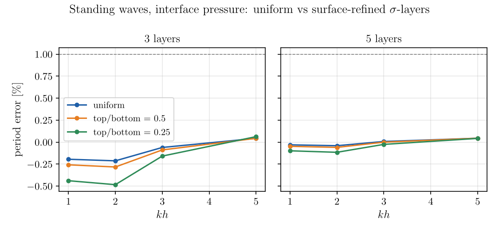

Refining the layers towards the surface no longer helps. With 3 layers, a
top layer a quarter of the bottom one moves the error at kh = 1–2 from
−0.2% to −0.45%, and at kh = 5 it stays at +0.05%. (In the cell layout the
same grading cut the error at kh = 5 from 5.8% to 2.1% with 5 layers.)

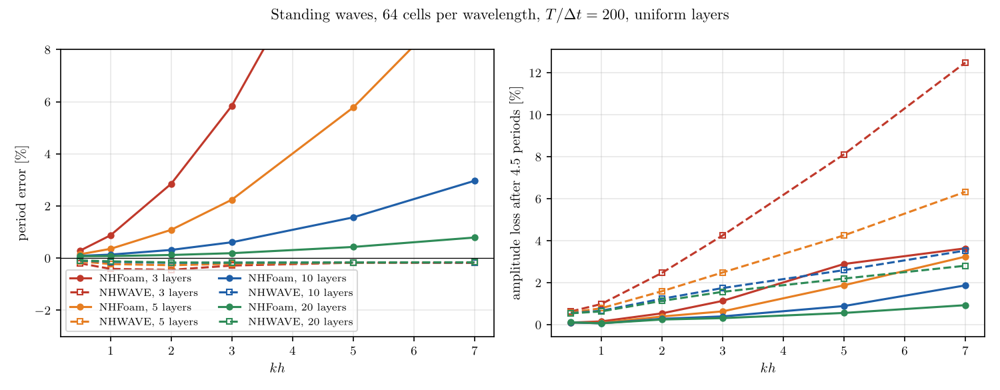

**Against NHWAVE** (same basins and resolution, same analysis). NHWAVE keeps
the period error within 0.8% with 2 layers and 0.45% with 3; NHFOAM within
0.61% and 0.21%. With 10–20 layers both converge, NHWAVE to −0.17% and
NHFOAM to +0.05%. NHWAVE damps more. After 4.5 periods, NHWAVE has lost
0.6–12% of the amplitude with 3 layers and 0.6–3.5% with 10. NHFOAM has lost
0.04–1.3% and 0.04–0.7%. The cell-centred results are shown dotted. Before
the interface arrangement, they were NHFOAM's main disadvantage against
NHWAVE.

### 5.3 Convection and the decay of progressive waves

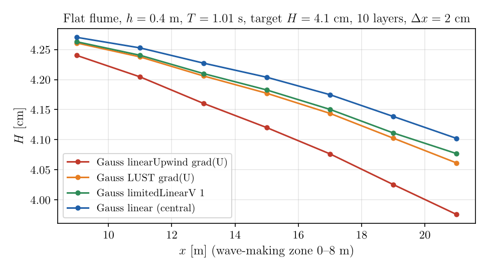

Waves of H = 4.1 cm and T = 1.01 s in 0.4 m of water (kh = 1.69, 10 layers,
Δx = 2 cm, interface pressure) lose 6.1% of their height over 12 m
(8 wavelengths) with `linearUpwind`, 4.7% with `LUST`, 4.4% with
`limitedLinearV` and 3.9% with central differencing. With the cell-centred
pressure the same runs lost 12%, 6.2%, 3.3% and 1.7%. The interface layout
thus narrows the spread between the schemes but adds some damping of steep
waves to the central and TVD schemes. Waves of H = 0.4 cm lose 0.7% over
10 m with `linearUpwind` (1.5% with the cell-centred pressure), so the
damping grows with steepness. Central differencing damps least, but over
longer runs it fails (5.4), so the default is `limitedLinearV`. The waves
leave the wave-making zone about 4% higher than the linear target, a
nonlinear effect of generating them with linear theory.

The phase speed of the small waves (H = 0.4 cm) is 0.24% below linear
theory (10 uniform layers, T/Δt = 100). With the cell-centred pressure it
was 0.60% below. About 0.13% of it is the BDF2 time step, and the layers
contribute less than 0.05% (5.2). The steep waves (H = 4.1 cm) travel 0.74%
below the linear speed (0.87% with the cell layout), where third-order
Stokes theory makes them 0.9% faster than linear waves. We have not
separated this deficit; the long waves and mean flows of the closed flume
(5.4) are a likely part of it.

### 5.4 Submerged bar (Luth et al. 1994)


All three models: Δx = 2 cm and 10 uniform layers. NHFOAM: interface
pressure, `limitedLinearV`, Δt = 5 ms; its cell-centred layout is shown for
reference. One time shift, fitted at x = 22 m, is applied to all gauges of
a run, and ΔH is the error of max − min over the lab record. All runs are
compared over the same window, the last 4 s before t = 50 s
(`validation/plot_bar.py --tend 50`). By then the wave train has reached the
last gauge (x = 41 m) about 10 periods earlier in case C. Why the window has
to be the same for all models is explained below.

| | NHFOAM | NHFOAM, cell layout | NHWAVE | REEF3D::NHFLOW |
|---|---|---|---|---|
| case A, rms over the 10 gauges | 0.17 cm | 0.21 cm | 0.29 cm | 0.25 cm |
| case A, mean \|ΔH\|/H | 5.1% | 6.6% | 4.7% | 6.3% |
| case C, rms over the 10 gauges | 0.65 cm | 0.59 cm | 1.02 cm | 0.92 cm |
| case C, mean \|ΔH\|/H | 4.9% | 4.7% | 6.1% | 5.1% |

In front of the bar (x ≤ 30.5 m) all models are within 0.06–0.42 cm rms of
the measurements. On and behind the bar, NHFOAM has the smallest errors at
every gauge in case C (0.46–0.90 cm, against 1.0–1.5 cm for the other two)
and at 6 of the 7 gauges in case A. In case C the difference is mostly
phase: NHWAVE and REEF3D::NHFLOW are 0.1–0.18 s early over the bar crest,
and NHFOAM is up to 0.1 s late. At x = 32.5–33.5 m in case C, where the lab
height drops from 4.5 to 4.2 cm (the lab waves seem to break slightly
there), NHFOAM's heights are 6–18% high and REEF3D::NHFLOW's 8–15%. NHWAVE
is within 3% there and 9–15% low just behind the bar.

**Long waves of the flume.** The phase over the bar changes with the time
at which it is measured, in all three models. Between t = 45 and 65 s, the
first harmonic at x = 35.7 m moves relative to x = 22 m. In NHFOAM it moves
0.21 s later, in NHWAVE 0.08 s later, and in REEF3D::NHFLOW 0.07 s earlier;
REEF3D's first-harmonic amplitude on the crest also drops by 20%. These
changes come with mean water levels that vary by a few millimetres along
the flume: ±2 mm in NHFOAM (+1.6 mm at 22 m and −1.8 mm behind the bar at
t = 65 s), ±1 mm in the other two. These are long waves of the closed flume,
released when the wave train starts and when it crosses the bar, which the
8 m zones absorb only partly. Over the 0.1 m deep crest, the current of such
a wave (a few cm/s) shifts the waves by tenths of a second. The rms error
over the 10 gauges therefore depends on the window, and so does the
ranking. Case C:

| window ending at | NHFOAM | NHFOAM, cell layout | NHWAVE | REEF3D::NHFLOW |
|---|---|---|---|---|
| 45 s | 0.49 cm | 0.47 cm | 1.08 cm (41 m not yet settled) | 0.93 cm |
| 50 s | 0.65 cm | 0.59 cm | 1.02 cm | 0.92 cm |
| 55 s | 0.94 cm | 0.77 cm | 0.97 cm | 0.92 cm |
| 60 s | 1.18 cm | 1.04 cm | 0.89 cm | 0.98 cm |
| 65 s | 1.39 cm | 1.19 cm | 0.77 cm | 1.10 cm |

NHFOAM's long waves are the largest of the three and shift its phase the
most. The lab flume had long waves of its own, which no model reproduces,
so the comparison above uses the earliest window in which all gauges are
settled. The drift was later traced to the missing return current of the
wave-making zone: with the return current (now the default) or the
boundary wavemaker, the runs are steady and the error is about 1.0 cm in
every window, with the waves 0.12 s early over the bar like those of the
other two models (5.7).

Behind the bar, the interface pressure also made NHFOAM's records nearly
periodic. Over the last 15 periods of case C, the heights at 37–41 m vary by
at most ±7% from wave to wave. With the cell-centred pressure they varied by
±25% (at 41 m between 3.5 and 5.7 cm, lab 3.9 cm), and the irregularity
reached the gauges in front of the bar after about 60 s.

Two numerical settings matter as much as the model (cell layout,
50 s windows):
- **Time step.** With Δt = 10 ms instead of 5 ms, NHFOAM's single-shift rms
  error was 65% higher in case A and 150% higher in case C. The free third
  harmonic behind the bar (T/3 = 0.34 s in case C) gets only 34 steps per
  period with Δt = 10 ms, and the phase error of BDF2 grows with the square
  of Δt/T.
- **Convection.** Central differencing failed after 62 s (case A) and 53 s
  (case C) with Δt = 5 ms; `limitedLinearV` runs to the end. `linearUpwind`
  loses 17% of the wave height before the bar in case C.

The bar measurements (digitised) are in the FUNWAVE-TVD benchmark
repository, `fengyanshi/BENCHMARK_FUNWAVE/car_luth_AC/lab_data`, and are not
redistributed here.

### 5.5 Seabed motion


**Bottom uplift** (Hammack 1973 type). A block of half-width b = 0.305 m
rises by ζ₀ = 0.5 mm in h = 5 cm of water with the exponential history
(t_c = 0.1 s). With 5 layers and Δx = 5 mm, the peaks at x/b = 0–20 are within
1.5% of linear potential theory, and the dispersive tail follows it. The two
pressure layouts differ by less than 2% of ζ₀ at any gauge.

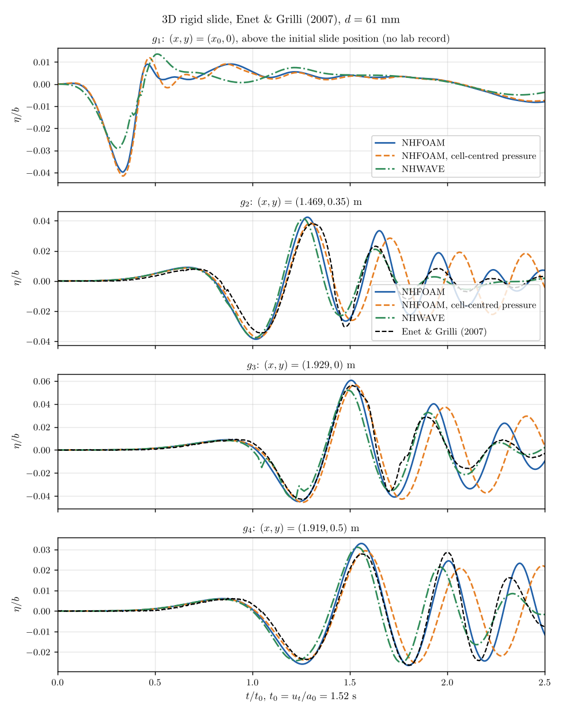

**3D rigid landslide** (Enet & Grilli 2007, NTHMP benchmark 2, d = 61 mm).
Half tank, symmetry wall on the axis. NHFOAM: Δx = Δy = 2.5 cm, 5 uniform
layers (141 000 cells); the domain starts 0.2 m from the shoreline (no
wetting and drying). In deep water the layers are up to 12 times thicker
than Δx, so the interface matrix needs about 180 PCG iterations per solve.
The run takes 51 min on one core for 4 s, about 1.6 times the CPU time of
the cell layout. NHWAVE: its own benchmark set-up
(`examples/landslide_benchmarks/BM2_enet_grilli`: Δx = 2 cm, 3 layers, full
beach), with the gauges moved to the published positions. No time shift is
applied.

| gauge | first trough, lab / NHFOAM / NHFOAM cell layout / NHWAVE [mm] | first crest [mm] |
|---|---|---|
| g2 (1.469, 0.35) | −13.7 / −15.3 / −14.9 / −14.9 | 15.0 / 16.7 / 15.2 / 16.3 |
| g3 (1.929, 0) | −17.0 / −17.7 / −18.0 / −17.1 | 22.2 / 23.9 / 22.5 / 20.5 |
| g4 (1.919, 0.5) | −9.4 / −10.2 / −9.5 / −9.6 | 11.0 / 13.0 / 11.6 / 12.3 |

All runs get the leading trough within 12%. The leading crest is 8–18% high
with the interface pressure, 1–5% with the cell-centred pressure, and
between −7% and +12% for NHWAVE. NHFOAM has the leading waves on time,
NHWAVE about 0.05 t₀ early. The trailing waves (kh = 3–5) are where the
interface pressure matters. They now follow the measured phase, as NHWAVE's
do; with the cell-centred pressure they were too slow and fell further
behind with every wave. Their amplitude is still too large: the third and
fourth crests are up to 2–3 times the measured ones, while NHWAVE follows
the measured decay. The wall that replaces NHFOAM's beach is not the cause
(6.5). The lab records are in the same NHWAVE example folder.

### 5.6 Breaking


**Spilling breakers** (Hansen & Svendsen 1979, test 061071): T = 1.67 s,
H = 6.9 cm at the toe of a 1:34.26 slope from h = 0.36 m. 10 layers,
Δx = 2 cm, Δt = 10 ms, HFA with α = 0.6 and β = 0.3, `limitedLinearV`. The
slope is cut at x = 11 m (h = 3.9 cm) and continues as a 3 m shelf with a
velocity-only sponge (`relaxEta false`). The run covers 40 periods (8 min on
one core with the interface pressure, 5 min with the cell layout), and the
statistics use the last 10.

| H (mean of max − min per period) | lab | NHFOAM (interface) | NHFOAM (cell) |
|---|---|---|---|
| near the toe, x < 1 m | 6.9–7.0 cm | −1% to +9% | +8% to +17% |
| shoaling, x = 2–7 m | 7.0–8.4 cm | −4% to +20% | −2% to +9% |
| largest | 10.4 cm at x = 8.2 m | 10.9 cm at x = 8.1 m | 10.6 cm at x = 9.0 m |
| surf zone, x = 8.3–11 m | 10.0 → 3.5 cm | +3% to +99% | −12% to +47% |
| rms before / after x = 8.3 m | | 0.55 / 2.98 cm | 0.56 / 1.79 cm |
| rms over all lab points | | 1.55 cm | 1.01 cm |

With the interface pressure, the incident waves are within a few percent of
the lab at the toe, and the waves break where they did in the flume: the
largest height is 5% high and 0.1 m from the measured position (the cell
layout broke 0.8 m too far inshore). Inside the surf zone, however, the
bores lose too little energy. They keep a sawtooth shape of 7–8 cm down to
x = 10 m, where the lab heights have halved. Through the surf zone, the
breaking switch flags about 7 columns at a time in both layouts. So the
onset is right, and the dissipation of the hydrostatic bores is what falls
short. The strong bores also reach the shallow end of the flume
(h < 6 cm). There, between t = 28 and 43 s, their troughs fell below the bed
for a few periods. The mesh survives this through `minDepth`, but those
values are not physical; the statistics window (the last 10 periods) is
clear of it. Without a beach, the mean water level
is off in both layouts: the interface run has a set-down of up to 9 mm in
the surf zone, against a measured setup of 4.5 mm.

The bore fronts are where the lagged terms of the interface matrix matter
most. With only the horizontal projection of the sloping mid-plane in the
implicit vertical coefficient, the pressure correctors diverged under the
first steep bores. This happened after 22 s, with a fixed or an adaptive
time step alike. The over-relaxed split described in section 1 fixed it.

**REEF3D::NHFLOW** on the same case, with the full beach (it has wetting and
drying), 10 layers, Δx = 2.5 cm, an 8 m linear wave zone and its breaking
algorithm (`A 550 1`, onset parameter 0.6), breaks too early instead:
largest H 9.4 cm at x = 6.9 m, rms 1.5 cm. Its incident waves are within 4%
of the lab at the toe, and inshore of x = 8.3 m its heights are 18–46% low. It overpredicts the setup at the shoreline
(14 mm at x = 11 m against 4.5 mm measured at 10.5 m). Neither model gets
this case right with default breaking parameters: the onset is the hard
part. NHWAVE is not included yet: our run of this case (10 layers, k–ε,
full beach) stopped after 4 s of simulated time without an error message.

NHFOAM does not reproduce the mean water level. There is no beach to hold
the setup, and the wave-making zone fixes the mean level offshore. With a
full sponge (η relaxed to zero) on the shelf, water drains out through the
sponge until the shelf dries and the run fails after 37 periods; the
velocity-only sponge keeps the volume.

The plunging case of the same experiments (T = 3.33 s, Ursell number 33)
needs nonlinear wave generation. With a linear target, the incident waves
are about 15% too low and change shape from gauge to gauge.

Making the HFA work in the cell layout needed two fixes to the first
implementation:
- Scaling the face mobility of the layer faces also scaled the explicit
  non-orthogonal correction, i.e. the horizontal pressure gradient on the
  sloping layer faces under the front. The large coupling is now applied to
  the difference of the cell values only.
- Overwriting the cell-centred w with values reconstructed from the face
  fluxes is ill-conditioned on the nearly vertical faces of a bore front and
  made the runs fail. The vertical momentum is now left alone, and the
  layer-face fluxes alone carry continuity.

Bores also need a TVD convection scheme everywhere. With central
differencing away from the breaking columns, grid-scale oscillations grow
behind the bores and the run fails within a wave period of the first
breaking. In the cell layout, the switch is also sensitive to the time
step: with Δt = 5 ms instead of 10 ms, the same case fails after 11
periods.

### 5.7 Wave input: boundary wavemaker, absorption, return current, irregular waves, measured records

`validation/wavemaker.py` writes the cases, `plot_wavemaker.py` makes the
figures. Flat flume, h = 0.4 m, 10 layers, Δx = 2 cm, Δt = 10 ms, regular
waves of H = 2 cm and T = 1.5 s (kh = 0.96) unless stated. Incident and
reflected amplitudes come from a least-squares fit of
A_j = a_I e^{ikx_j} + a_R e^{−ikx_j} to the first harmonic at 30–70 gauges
(Zelt & Skjelbreia 1992).

- **Boundary wavemaker** (`nhWaveVelocity` at x = 0, 6 m sponge at the far
  end): H = 0.995 H_target on average and within 0.7% over 13.5 m;
  reflection of the flume 0.4%. A 6 m (2.3 wavelengths) relaxation zone
  gives 0.998 H_target and 0.16%, with the domain 6 m longer.
- **Closed flume** (wall 10 m from the wavemaker): with active absorption the
  incident amplitude settles at 1.03 a within 5 periods and stays there for
  the 60 periods of the run (a_R/a_I = 0.99 at the wall). Without
  absorption the wavemaker reflects the returning waves, which beat with
  the generated ones: the incident amplitude swings between 0.1 a and 1.1 a
  with a period of about 40 s.
- **Absorbing boundary** (`waveHeight 0`, waves from a 6 m zone, boundary at
  14 m), reflection coefficient:

  | T | kh | `absorptionCelerity shallow` | `absorptionCelerity wave` | 8 m sponge instead |
  |---|---|---|---|---|
  | 2.5 s | 0.53 | 1.9% | 0.3% | 0.2% |
  | 1.5 s | 0.96 | 5.9% | 1.7% | 0.4% |
  | 1.0 s | 1.72 | 12.6% | 9.3% | < 0.1% |

  The shallow-water absorber follows (1 − c/√(gh))/(1 + c/√(gh)), the
  mismatch of its depth-averaged velocity with that of the wave; with the
  phase speed of the wave it reflects 3–6 times less for kh ≤ 1, but a
  depth-uniform correction cannot match the profile of shorter waves. A
  sponge of several wavelengths still absorbs best, at the cost of the
  domain.
- **Return current.** In a closed flume of constant depth (6 m wave-making
  zone, wall 10 m further on) the mean water level of the flume stays within
  0.1 mm with or without it, and with the boundary wavemaker within 0.2 mm;
  there the mismatch only steps the mean level inside the zone. Over the
  submerged bar it is what keeps long runs steady (below).
- **Irregular waves** (JONSWAP, Hs = 3 cm, Tp = 1.5 s, γ = 3.3, 100
  components, spectra over 200 s): from a 6 m relaxation zone and from the
  boundary wavemaker the spectra keep the target shape, and Hm0 is within
  −4% to +2% of the target over 12 m (8 peak wavelengths), with the peak
  period of the target. In all runs Hm0 falls by 3–5% between 2 and 12 m
  from the generator, through a slow loss of energy in the peak band that
  the convection scheme does not change (TVD or filtered central) and that
  regular waves of the peak period and 2 cm height do not show; its cause
  is not yet identified.
- **Measured records** (`theory timeSeries`; `validation/timeseries_input.py`,
  `plot_timeseries_input.py`). A solitary wave is made at x = 0 from its own
  record, sampled every 0.02 s like a gauge, in a flat tank (h = 0.218 m,
  Δx = 2 cm, 5 layers, Δt = 5 ms, 3 m sponge at the far end), and compared
  12 m downstream with the exact wave of Babenko's equation. The elevation
  record runs with the active absorption; the paddle record is the time
  integral of the velocity c η/(h + η), without absorption. For reference,
  the same wave also starts as the exact initial condition:

  | H/h | input | crest / H | crest arrival | rms / H |
  |---|---|---|---|---|
  | 0.1 | exact initial condition | 1.000 | −9 ms | 0.4% |
  | 0.1 | elevation, c = √(g(h + η)) (default) | 0.993 | −2 ms | 0.3% |
  | 0.1 | elevation, c = celerity of the wave | 0.997 | −7 ms | 0.3% |
  | 0.1 | paddle | 1.000 | −9 ms | 0.4% |
  | 0.3 | exact initial condition | 0.997 | −6 ms | 0.6% |
  | 0.3 | elevation, c = √(g(h + η)) (default) | 0.979 | +17 ms | 1.8% |
  | 0.3 | elevation, c = celerity of the wave | 0.995 | −3 ms | 0.3% |
  | 0.3 | paddle | 0.996 | −3 ms | 0.2% |
  | 0.6 | exact initial condition | 0.980 | +3 ms | 0.5% |
  | 0.6 | elevation, c = √(g(h + η)) (default) | 0.991 | 0 ms | 0.5% |
  | 0.6 | elevation, c = celerity of the wave | 1.037 | −58 ms | 9.5% |
  | 0.6 | paddle | 0.937 | +56 ms | 8.1% |

  (Δt = 4 ms at H/h = 0.6.) Trailing waves stay below 0.1% of H at
  H/h = 0.1 and 0.7% above. For a wave of permanent form u = c η/(h + η)
  with its own celerity is the exact depth-averaged velocity (mass
  conservation). Up to H/h = 0.3 that input, and the paddle record, are as
  good as the exact initial condition, while the local √(g(h + η)) of the
  NTHMP benchmarks carries too little water on the flanks (2% low and
  17 ms late at H/h = 0.3). At H/h = 0.6 a velocity that is uniform over
  the depth no longer fills the boundary column under the steep crest: the
  paddle record, without absorption, makes the wave 6% low and 56 ms late,
  and with an elevation record the absorption makes up the difference, too
  much with the celerity of the wave (4% high) and about right with the
  default (1% low, on time). The default is therefore the safer choice for
  steep pulses, the celerity of the wave for H/h ≤ 0.3.

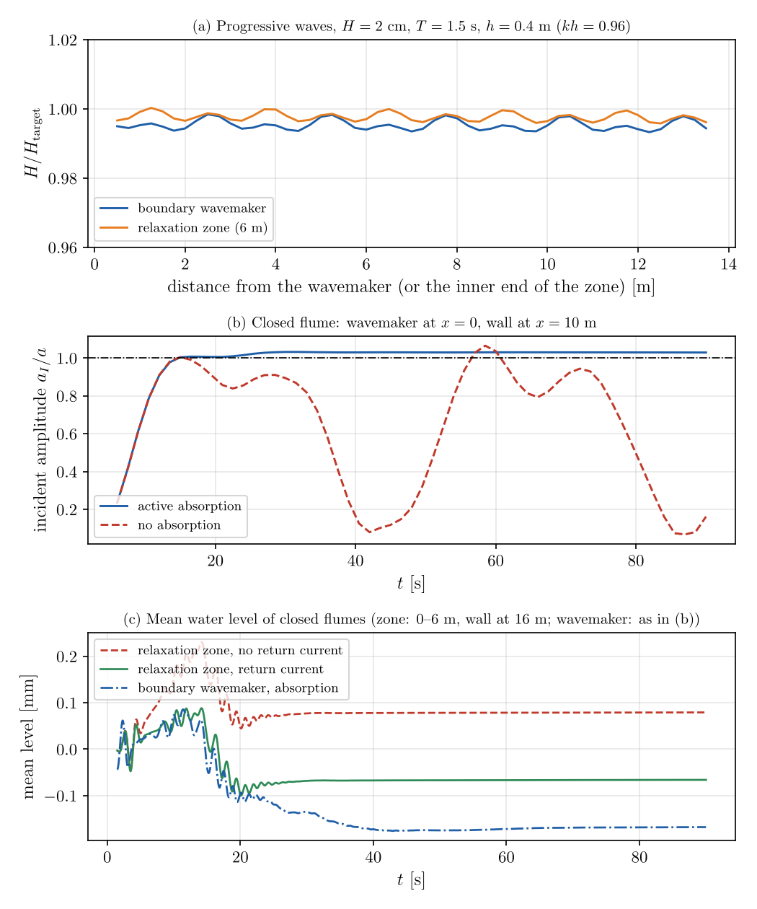

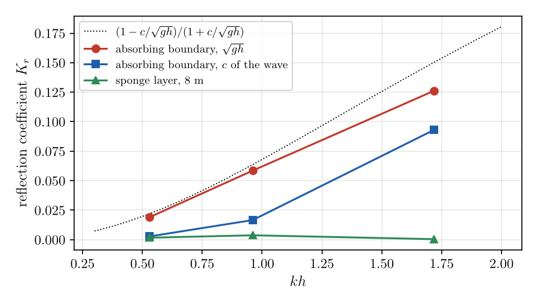

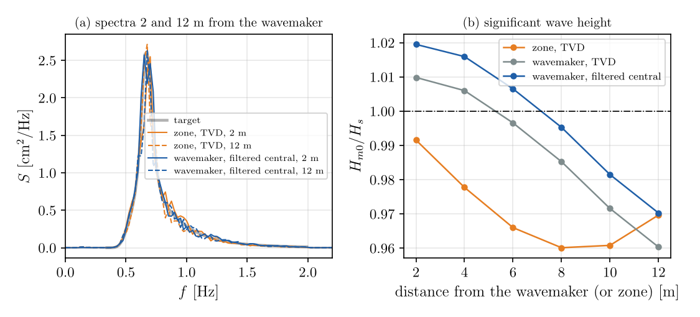

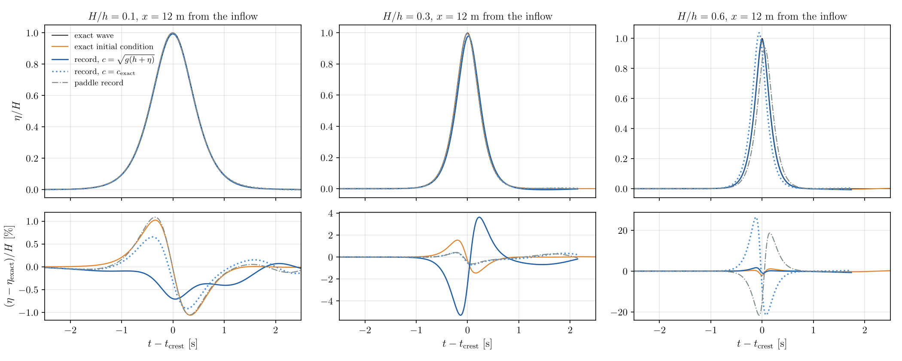

**The submerged bar: return current and long waves.** Case C of 5.4
(H = 4.1 cm, T = 1.01 s, 10 layers, Δt = 5 ms) on the same mesh, with the
8 m wave-making zone with and without the return current, and with the
boundary wavemaker at x = 0 (active absorption, return current):

| | rms error, windows ending at 45 / 50 / 55 / 60 / 65 s | lag of the first harmonic, 35.7 m behind 22 m, 45 → 65 s | spread of the mean level over the gauges |
|---|---|---|---|
| zone, no return current (5.4) | 0.49 / 0.65 / 0.94 / 1.18 / 1.39 cm | 0.98 → 1.19 s | 1.9–3.6 mm |
| zone, return current | 1.03 / 1.01 / 1.00 / 1.00 / 1.03 cm | 0.83 → 0.84 s | 0.7–0.8 mm |
| boundary wavemaker | 0.90 / 0.99 / 1.00 / 0.98 / 0.98 cm | 0.86 → 0.85 s | 0.7–2.5 mm |
| NHWAVE (5.4) | 1.08 / 1.02 / 0.97 / 0.89 / 0.77 cm | 0.80 → 0.84 s | 0.9–2.1 mm |
| REEF3D::NHFLOW (5.4) | 0.93 / 0.92 / 0.92 / 0.98 / 1.10 cm | 0.85 → 0.78 s | 0.9–1.6 mm |
| lab | | 0.96 s | |

The drift of section 5.4 came from the missing return current: without it
the wave-making zone imposes no mean flow while the closed flume needs one,
and the resulting mean currents and long waves shift the waves over the
0.1 m deep crest. With the return current, in the zone or at the
wavemaker, the run is steady: the phase no longer drifts, the mean level
varies by less than 1 mm along the flume, and the error is about 1.0 cm in
every window. NHFOAM then has the waves 0.12 s early at 35.7 m, as NHWAVE
and REEF3D::NHFLOW do (0.1–0.18 s); the smaller errors of the zone run in
short windows came from the drift passing the measured phase. Long runs are
now comparable.

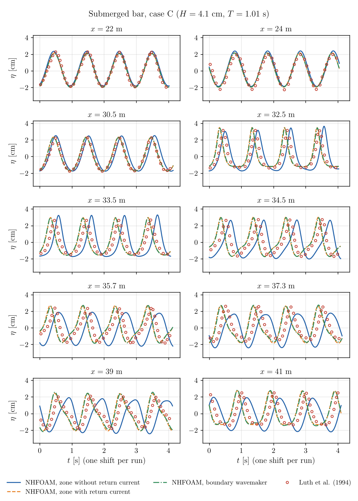

### 5.8 Unstructured meshes

`validation/unstructured.py` builds the meshes with gmsh (triangles extruded
into prisms), `plot_unstructured.py` makes the figures. A 3D run-up case on
unstructured quadrilaterals, refined where the flow needs it, is in 6.12.

**Run-up on a triangulated strip.** The breaking solitary wave of 6.6
(H/d = 0.28, HFA, 5 mm film, no friction, 3 layers) on a 10 cm wide strip
of Delaunay triangles with 2 cm edges (19 986 prisms, slip side walls) and
on a strip refined from 3 cm offshore to 1.5 cm from x = 7 m on (19 083
prisms), against the structured run of 6.6 (Δx = 2 cm, one cell wide):

| mesh | cells | max run-up R/d (at t√(g/d)) | profiles, rms difference to the structured run | shoreline at t√(g/d) = 60 | CPU |
|---|---|---|---|---|---|
| structured, 2 cm | 1 650 | 0.531 (42.5) | | 0.12 d | 39 s |
| triangles, 2 cm | 19 986 | 0.489 (45.3) | 0.05–2.0% of d | 0.35 d | 689 s |
| triangles, 3 → 1.5 cm | 19 083 | 0.490 (45.6) | 0.5–0.7% of d | | 576 s |
| lab | | 0.49–0.55 | | | |

Until the wave reaches the beach the profiles agree closely; on the
triangles it runs up 8% less, 3 t* later, and the backwash is slower.
With the upwind face depth instead of the vanLeer reconstruction the run-up
on the 2 cm triangles is 0.507 (structured: 0.531 with either), so about
half of the difference comes from the TVD reconstruction of the face depth
on triangles; the backwash stays slow (0.38 d at t* = 60). A prism costs
1.5 times a hexahedron per time step.

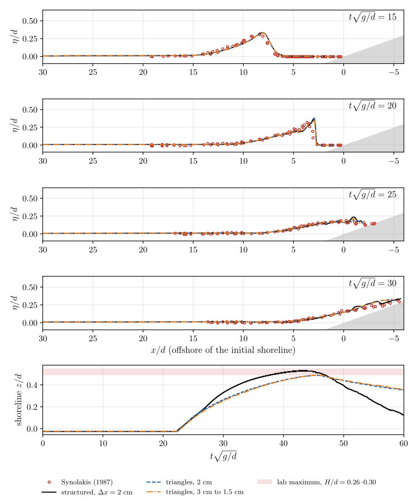

**Diffraction by a vertical cylinder.** Regular waves (H = 1 cm, T = 1 s,
h = 0.3 m: kh = 1.37) from the boundary wavemaker meet a vertical cylinder of
radius a = 0.2 m (ka = 0.92), half domain 8 m × 4 m with a symmetry wall on
the axis, triangles of 2.5 cm at the cylinder growing to 6 cm 0.6 m away,
4 layers (97 156 prisms, 30 min on one core for 16 s). Against the linear
diffraction theory of MacCamy & Fuchs (1954), the first-harmonic amplitude
over t = 8–12 s (before the waves scattered back by the side wall and the
wavemaker return) is within 0.07 a_I rms around the cylinder (largest
error 0.095 a_I) and 0.06 a_I rms at all 70 gauges; the run-up in front
of the cylinder is 1.62 a_I (theory 1.71). Later windows include the
reflections from the walls of the half domain (0.135 a_I rms).

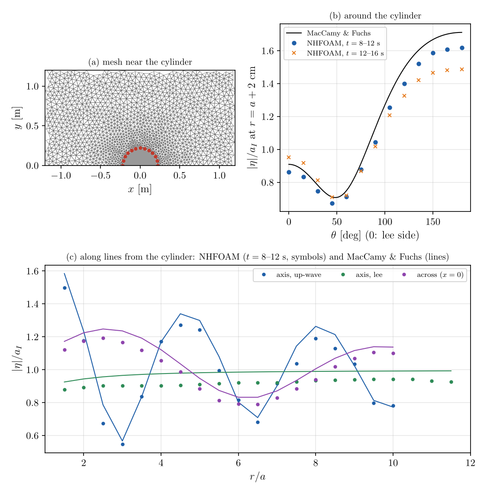

### 5.9 Parallel runs, restarts and the regression suite

- **Breaking across processor boundaries.** Ting & Kirby's beach with the
  default breaking model, 20 s on two processors with the boundary at
  x = 8 m in the surf zone, reproduces the serial run to 4·10⁻⁷ m at all
  gauges (3.0 cm before the breaking ages were exchanged through the
  processor patches). Gauges on a face between two columns now always take
  the same column, so that the records do not depend on the rounding of
  the mesh points.
- **Restarts** (section 3): 6·10⁻¹⁴ m after a restart with breaking, wetting
  and drying, with the fields written at full precision.
- **Regression suite** (`validation/regression.py`, section 2): twelve short
  cases against stored references; the parallel run of its breaking case
  (`structured` decomposition, the boundary near the breaking point) matches
  the serial one to 2·10⁻⁷ m, the restarted run to 10⁻¹² m.
- **Run time on 1 and 2 cores** (`structured` decomposition, an otherwise
  idle 2-core machine): Ting & Kirby's beach with breaking and wetting and
  drying (9 200 cells, 10 s) 102 s → 62 s (speed-up 1.64), the 3D landslide
  tutorial (35 280 cells, 4 s) 252 s → 131 s (1.92). The parallel runs
  reproduce the serial ones to 3·10⁻⁸ and 9·10⁻⁸ m.

---

## 6. Validation against NHWAVE: the tests of Ma et al. (2012)

Ma, Shi & Kirby (2012) introduced NHWAVE with seven tests. They were run here
with NHWAVE and NHFOAM on the same set-ups, from the simplest upwards, and
each was used to look for weaknesses of NHFOAM before moving on.
`validation/ma2012.py` writes the cases for both models.

| test (Ma et al. 2012) | reference | status |
|---|---|---|
| 4.1 standing wave in a closed basin, kD = π, 2π, 3π | linear theory | 6.1 |
| 4.2 solitary wave, H/h = 0.5 | exact solution | 6.2 |
| 4.3 periodic waves over a submerged bar | Luth et al. (1994) | 6.3 |
| 4.4 elliptic shoal on a 1:50 slope | Berkhoff et al. (1982) | 6.4 |
| 4.5 breaking solitary wave run-up | Synolakis (1987) | 6.6 |
| 4.6 3D rigid landslide, d = 61 mm | Enet & Grilli (2007) | 6.5 (and 5.5) |
| 4.7 longshore current on a plane beach | Visser (1991) | 6.8 |
| (NHWAVE example) surf zone | Ting & Kirby (1994) | 6.6, 6.7 |
| (NHWAVE example, NTHMP 6) solitary waves on a conical island | Briggs et al. (1995) | 6.9 |
| (NTHMP 5, in NHWAVE's benchmark report) solitary waves on a composite beach with a wall | Yeh et al. (1996) | 6.10 |
| (NHWAVE example, NTHMP 7) tsunami run-up in the Monai valley | Matsuyama & Tanaka (2001) | 6.11 |
| the same on meshes refined around the valley (NHFOAM only) | Matsuyama & Tanaka (2001) | 6.12 |
| the tutorials of SWASH, and its laboratory cases with one and two layers (NHFOAM only) | Zijlema et al. (2011), Smit et al. (2013) | 6.13 |

Three of the tests changed the code and its defaults: the standing waves
showed that the TVD scheme damps steep short waves, the solitary wave that
the time integration was only first order for nonlinear waves, and the surf
zone of Ting & Kirby that the bores need a breaking eddy viscosity (6.7).

### 6.1 Standing wave in a closed basin


L = 20 m (one wavelength), a = 0.1 m, D = 10, 20, 30 m, Δx = 0.2 m, 30 s;
normalised rms error at x = 17.5 m against linear theory, as in the paper.
Our NHWAVE runs reproduce the published errors to within 0.1 percentage
points. NHFOAM's error is 2.5–4 times smaller with `limitedLinearV` and
3–20 times smaller with `filteredLinear2V 0.2 0`:

| kD | layers | Ma et al. | NHWAVE | NHFOAM, limitedLinearV | NHFOAM, filteredLinear2V |
|---|---|---|---|---|---|
| π | 3 / 5 / 10 | 1.63 / 0.90 / 0.53% | 1.69 / 0.87 / 0.60% | 0.65 / 0.18 / 0.11% | 0.56 / 0.12 / 0.11% |
| 2π | 3 / 5 / 10 | 3.07 / 1.50 / 0.64% | 3.05 / 1.43 / 0.66% | 1.08 / 0.67 / 0.24% | 0.16 / 0.16 / 0.17% |
| 3π | 3 / 5 / 10 | 4.90 / 2.50 / 1.00% | 4.81 / 2.40 / 0.94% | 1.28 / 1.17 / 0.48% | 0.25 / 0.17 / 0.17% |

The difference between the two schemes is damping: at kD = 3π with 3
layers, `limitedLinearV` loses 8.5% of the amplitude in 30 s,
`filteredLinear2V` 1.7%. The damping is nonlinear (a wave ten times smaller
loses 0.09%) and does not depend on Δt.

### 6.2 Solitary wave

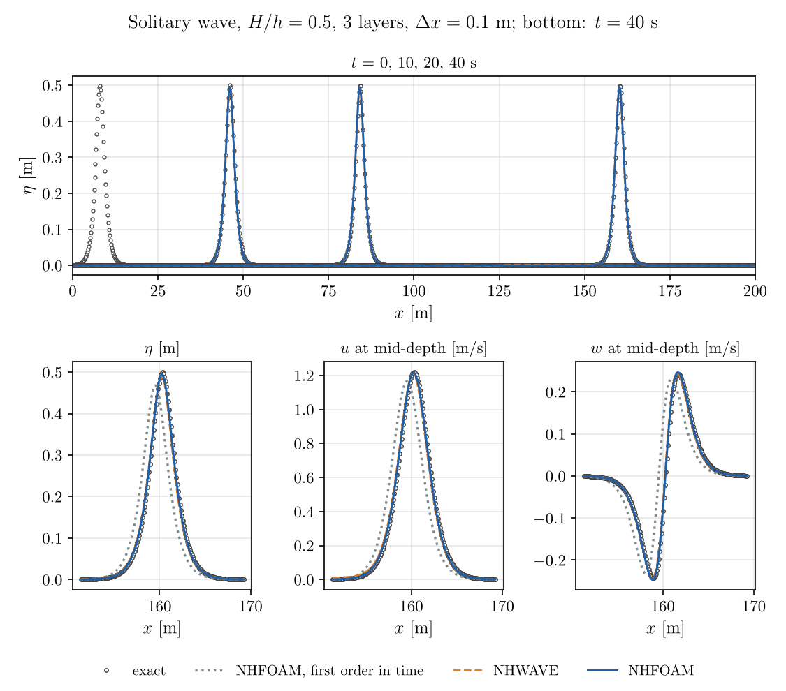

H/h = 0.5, h = 1 m, Δx = 0.1 m, 3 layers, 40 s (150 m). Both models start
from the exact solution of Babenko's equation (`validation/solitary_exact.py`,
Petviashvili iteration to a residual of 1e-13). Peaks of η, and of u and w at
mid-depth, after 40 s:

| run | η | u | w | crest | CPU |
|---|---|---|---|---|---|
| NHWAVE (CFL 0.5) | −2.3% | −0.7% | +0.4% | −0.08 m | 570 s |
| NHFOAM before the fix (Δt = 5 ms) | −6.4% | −4.3% | −4.6% | −0.77 m | 240 s |
| … with Δt = 10 ms / 2.5 ms | −10.3% / −4.4% | −7.6% / −2.6% | −9.4% / −2.2% | −1.37 / −0.47 m | |
| … with 2 (or 3) outer correctors | −2.3% | −0.9% | +0.2% | −0.17 m | 390 s |
| NHFOAM, flux extrapolation | −2.3% | −0.9% | +0.3% | −0.17 m | 210 s |
| NHFOAM, flux extrapolation, `filteredLinear2V` | **−1.0%** | **−0.2%** | **+1.6%** | **−0.07 m** | 210 s |

Before the fix the error grew linearly with Δt: the convection term was
linearised with the flux of the previous time level, a first-order error.
Neither the convection scheme, 5 layers nor a non-orthogonal corrector
changed it, and a second outer corrector gave the same result whether the
mesh was moved again or not. Extrapolating the convecting flux removes the
error at no cost. With `filteredLinear2V` the wave then keeps its height
after an initial adjustment of about 1%.

### 6.3 Submerged bar with 3 layers

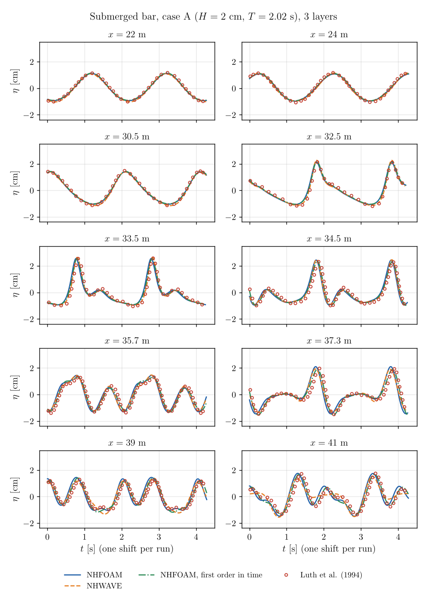

NHWAVE's own example (`examples/submerged_bar`: boundary wavemaker, 10 m
sponge, Δx = 2 cm, 3 layers, CFL 0.5, bottom friction Cd = 0.006 as
distributed) with all ten gauges, against NHFOAM on the same domain with an
8 m wave zone upstream of NHWAVE's wavemaker, Δt = 5 ms. 40 s runs, compared
with Luth et al. case A over the last 4 s, one time shift per run:

| | NHFOAM | NHWAVE | NHFOAM before the fix |
|---|---|---|---|
| rms error over the 10 gauges | 0.31 cm | 0.24 cm | 0.16 cm |
| mean \|ΔH\|/H | 4.9% | 3.8% | 4.6% |
| phase at x = 35.7–41 m relative to x = 22 m | 0.05–0.08 s early | 0.03–0.08 s early | 0.01–0.035 s early |

After the fix NHFOAM's waves over and behind the bar are as early as
NHWAVE's, by up to 0.08 s. Before it they were closer to the measured phase,
because the first-order lag slowed them by about 0.5%, the same lag that
delayed the solitary wave; with the fix, halving Δt moves the phase by less
than 0.005 s. Most of the rms error is this phase error, which both models
share. A second outer corrector, filtered convection or the TVD
scheme change the rms error by less than 0.02 cm.

### 6.4 Elliptic shoal (Berkhoff et al. 1982)

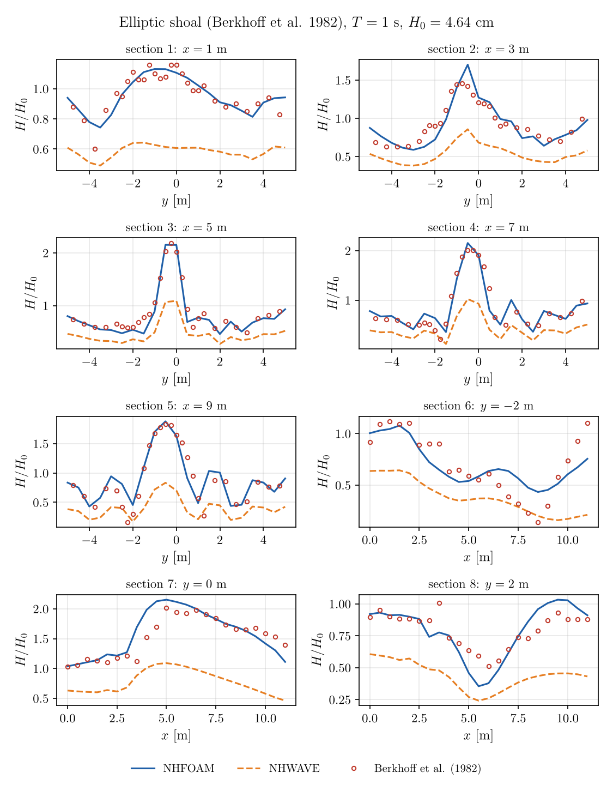

The bathymetry of Ma et al. (2012) (their eqs. 49–51) matches NHWAVE's
`examples/berkhoff` to 2 mm. To keep both runs to a few hours on one core,
the grid is twice as coarse as in the paper in x and y (Δx = 5 cm,
Δy = 10 cm, 600 × 200 columns, 29 cells per wavelength offshore) with 3
layers. NHWAVE: boundary wavemaker, 3 m sponge, CFL 0.5, bottom drag 0.006
as distributed; NHFOAM: 3 m wave zone upstream of NHWAVE's wavemaker, the
same sponge, Δt = 10 ms, flux extrapolation, `filteredLinear2V`. NHFOAM's
wave train arrives 2.25 s later (zone and ramp), so its wave heights are
taken over the five periods ending at 32.25 s, NHWAVE's over those ending at
30 s. Normalised rms error of H per section (Ma et al.'s definition):

| section | 1 | 2 | 3 | 4 | 5 | 6 | 7 | 8 | mean |
|---|---|---|---|---|---|---|---|---|---|
| NHFOAM, Δx = 5 cm | 0.06 | 0.12 | 0.13 | 0.18 | 0.21 | 0.24 | 0.14 | 0.14 | 0.15 |
| NHWAVE, Δx = 5 cm | 0.41 | 0.45 | 0.54 | 0.62 | 0.67 | 0.56 | 0.52 | 0.46 | 0.53 |
| NHWAVE, Δx = 2.5 cm, 5 layers (Ma et al. 2012) | 0.07 | – | 0.11 | – | 0.11 | – | – | – | – |

NHFOAM reproduces the focusing (2.1–2.2 H₀ at sections 3–4) on the coarse
grid, with errors at sections 1 and 3 close to those of NHWAVE on the
paper's grid. On the coarse grid NHWAVE has the right pattern but only about
60% of the heights: its incident waves lose 30% of their height in the first
10 m, NHFOAM's 5%. Sections 4–8 are not fully established by the end of the
window (their errors move by up to 0.08 with a ±1 s shift).

The NHFOAM run with `filteredLinear2V` failed at t ≈ 35 s, after the
window and outside the measured area: in the shallow corner at the south
wall (h = 0.07 m from x ≈ 22.7 m) the shoaled waves reach H/h ≈ 1 and break.
Restarted from 30 s with `limitedLinearV` and the HFA, it ran to 37 s (up to
171 breaking columns there) with the same mean error over the sections
(0.17 at the window ending at 34.5 s, 0.14 at 37 s). A domain in which waves
break anywhere needs the TVD scheme and the breaking model.

### 6.5 3D rigid landslide (rerun of 5.5 with the fixes)

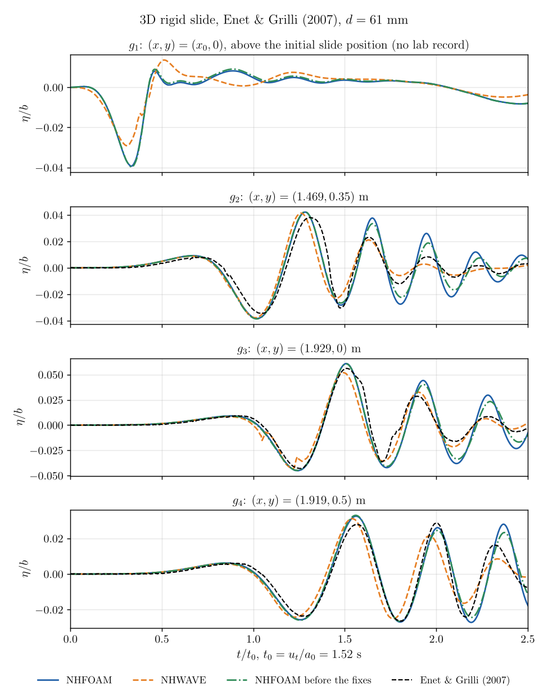

The leading trough and crest change by less than 2%. The trailing waves,
already too large in 5.5, grew by 10–25% with the smaller numerical damping.
Largest crest and the two after it [mm]:

| | g2 | g3 | g4 |
|---|---|---|---|
| lab | 15.0, 9.1, 3.3 | 22.2, 11.3, 3.5 | 11.3, 6.4 |
| NHFOAM | 16.7, 14.9, 10.3 | 24.1, 17.4, 11.7 | 12.8, 10.3, 11.1 |
| NHFOAM before the fixes | 16.7, 13.2, 7.4 | 23.9, 15.9, 9.2 | 13.0, 9.7, 9.2 |
| NHWAVE | 16.3, 8.3, 1.1 | 20.5, 12.9, 2.5 | 12.3, 8.5, 3.4 |

The excess is therefore not missing numerical damping. Its likely cause is
the wall that replaces the beach 0.2 m from the shoreline: the waves the
slide sends shoreward are reflected there and reach the gauges at about
1.5 t₀, when the excess starts, while on NHWAVE's beach they run up. The
test needs the beach to be conclusive; with wetting and drying (6.6) it can
now be rerun with it.

**With the beach.** Rerun with the slope continued 0.25 m inland of the
shoreline (bed 6.7 cm above the still water) and wetting and drying (5 mm
film; `make_case.enet_grilli_case(xWall=-0.25)`), the leading waves change
by less than 4% and the trailing waves are no smaller: largest crest and
the two after it 17.3, 15.7, 10.7 mm at g2; 23.4, 18.2, 11.3 at g3; 12.7,
11.6, 10.7 at g4. The wall is not the cause. The trailing waves (kh = 3–5)
follow the convection scheme instead (smaller with the TVD scheme before
the fixes, smallest with NHWAVE's shock-capturing scheme); whether the
measured decay is physical damping that an inviscid model lacks, or comes
from details of the slide motion, remains open.

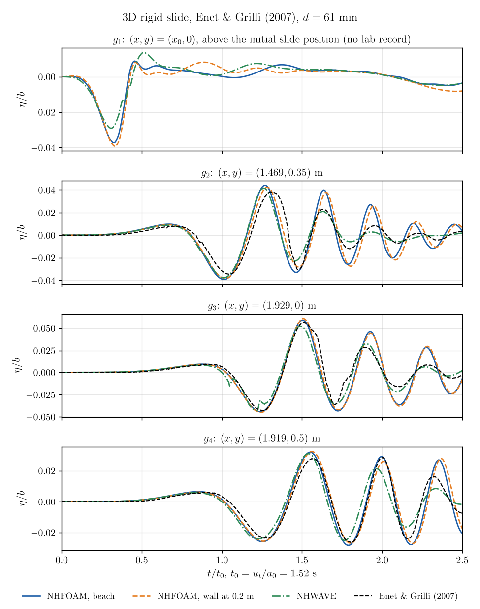

### 6.6 Wetting and drying (test 4.5, and the surf zone)

The method is summarised in section 1; `validation/wetdry.py` builds the
cases, `plot_wetdry.py`, `plot_runup.py` and `plot_tingkirby.py` make the
figures. Compared with NHWAVE (read from `nhwave.F`):

| | NHWAVE | NHFOAM |
|---|---|---|
| mask | from η at each step: flood if a wet neighbour is higher and has more than the film; dry at the film | same |
| faces of dry cells | no mass flux; the wet side's hydrostatic pressure (a wall) | closed: no flux, a wall for the pressure gradient |
| positivity | D = max(D, MinDep) after each stage (adds water) | limiter on the outflows (conservative) |
| depth at wet faces | MUSCL (van Leer) η, HLL flux | TVD (van Leer) η, upwind next to near-dry columns |
| supercritical faces | HLL takes the upwind flux | predicted flux of the upwind cell |
| newly wet faces, puddles | HLL depth diffusion | flux only into the new column, dam-break velocity downhill; puddles held at rest |
| breaking | shock capturing (+ k–ε in the surf-zone example) | hydrostatic front approximation |

**Verification.** Still water against a dry 1:20 beach stays at rest
(|u| < 10⁻⁸ m/s after 10 s). In Thacker's (1981) parabolic basin (a = 100 m,
h₀ = 0.5 m, Δx = 1 m, 3 layers, two periods) the rms error of the planar
surface is 0.9 mm (largest 7.4 mm, for a surface that moves by ±0.16 m), and
the shorelines are within 1.7 m (0.8 m on average). In a dam break on a dry
bed (h₀ = 0.1 m), both models treat the 1 mm film as a wet bed and follow
Stoker's solution for it, not Ritter's: the fronts are at 8.95 m (NHFOAM),
8.77 m (NHWAVE) and 8.70 m (Stoker) after 3 s, against 10.94 m for a truly
dry bed. With the centred face depth NHFOAM's front was at 7.69 m.

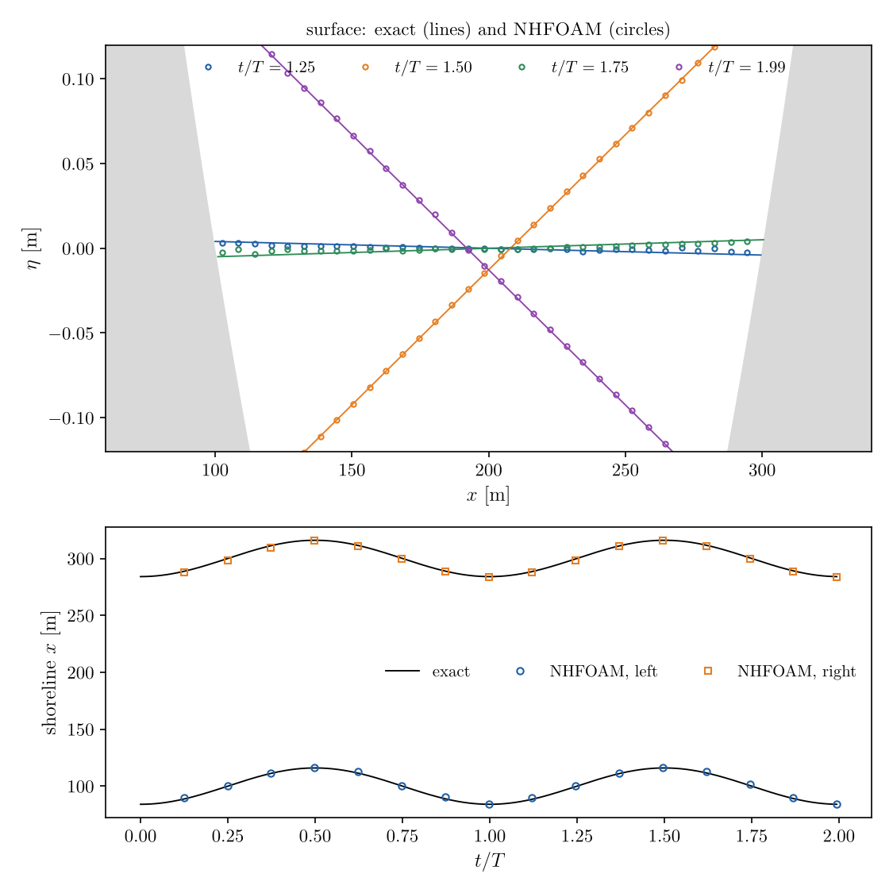

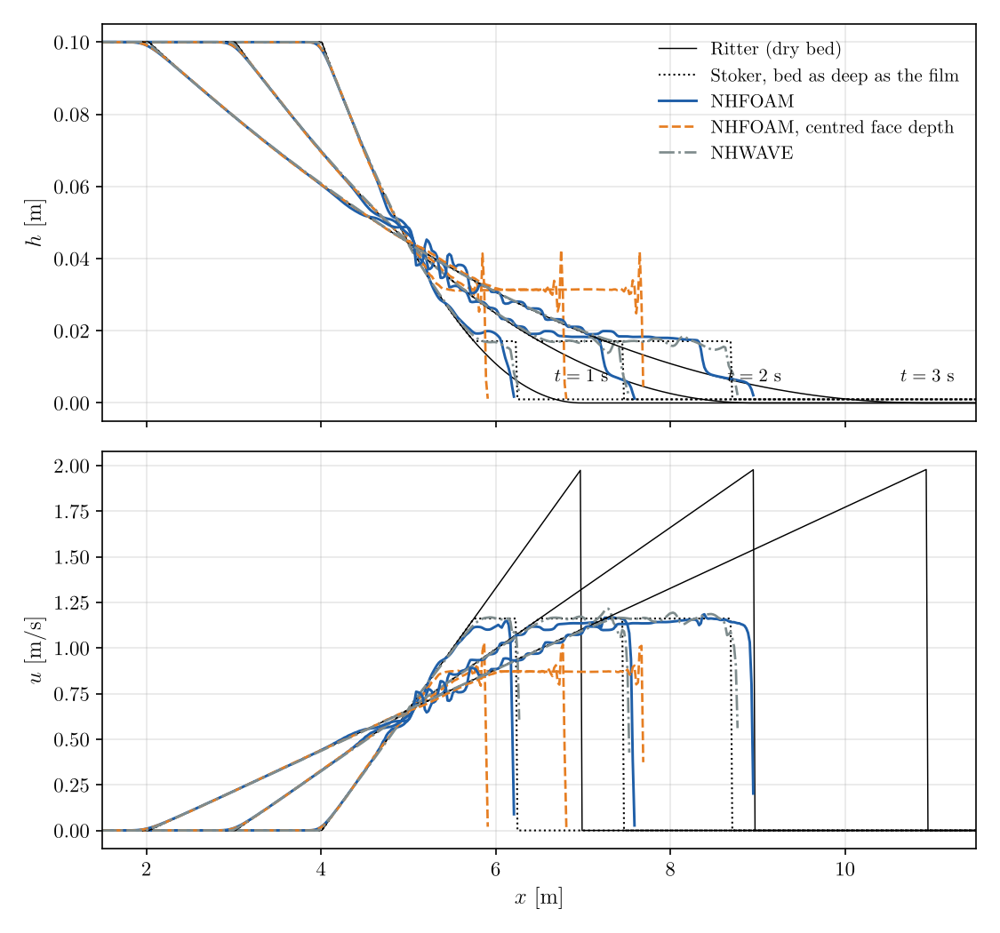

**Breaking solitary wave on a 1:20 beach** (Synolakis 1987; NTHMP benchmark
4), H/d = 0.28, d = 0.21 m, on NHWAVE's example set-up (Δx = 2 cm, 3
layers, 5 mm film, no bottom friction, as the example). Both models start
from the exact solitary wave. The profiles follow the measurements and
NHWAVE. The maximum run-up is R/d = 0.531 at t√(g/d) = 42.5, against 0.512
for NHWAVE and 0.49–0.55 measured for H/d = 0.26–0.30 (first-order upwind
depth 0.531, centred depth 0.412, C_d = 0.006: 0.464). In the backwash, thin
puddles left on the upper beach slow the receding of the highest wet column.
A parallel run with a processor boundary in the swash gives R/d = 0.540.

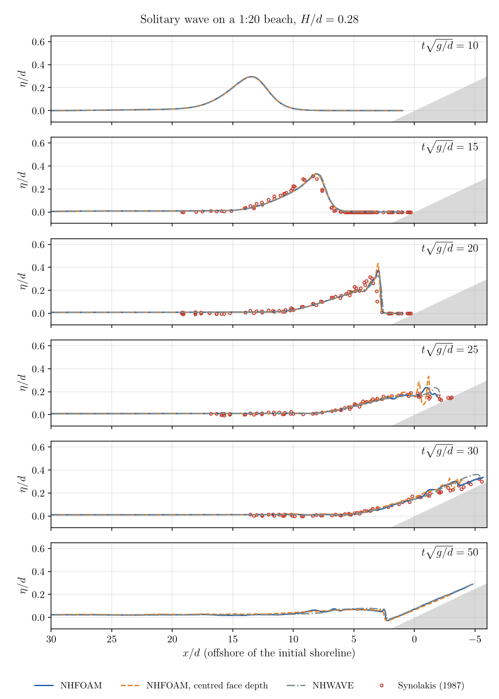

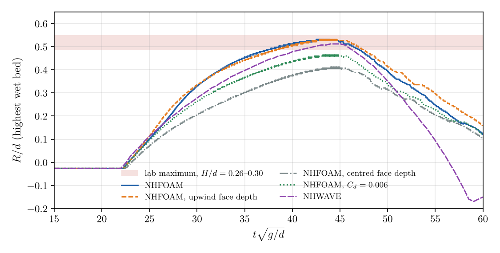

**Spilling breakers on a 1:35 beach** (Ting & Kirby 1994), T = 2 s,
H = 0.125 m, h = 0.4 m, x from the toe. NHFOAM: stream-function waves in a
relaxation zone, beach onto dry land, 10 layers, Δx = 2.5 cm, C_d = 0.006,
HFA. NHWAVE: its example `tingkirby` (20 layers, k–ε, cnoidal wavemaker).
Statistics over the last 10 of 30 periods (cm):

| | lab | NHFOAM | NHFOAM, β = 0.1 | NHWAVE |
|---|---|---|---|---|
| H at x = −0.5 m | 12.3 | 12.3 | 12.3 | 13.1 |
| largest H, at x | 16.5, 6.0 m | 17.3, 6.5 m | 17.1, 6.1 m | 18.0, 6.9 m |
| H at x = 8 m | 9.3 | 15.4 | 13.3 | 16.1 |
| H at x = 11 m | 3.9 | 10.0 | 8.3 | 6.4 |
| mean error of H, x > 7 m | | +6.1 | +4.2 | +4.8 |
| mean level at x = 11 m | 1.4 | 0.5 | 0.7 | 0.0 |

Shoaling and the breaking point agree with the measurements (rms error of H
0.5 cm before x = 6 m; NHWAVE 1.4 cm), but in the surf zone both models lose
too little energy and the setup is too small. In NHFOAM only the front
columns of the sawtooth bores are flagged as breaking: keeping columns
breaking down to β = 0.1 cuts the error by a third, and q = 0 in all columns
shallower than 0.23 m leaves +2.8 cm. Hydrostatic bores themselves are right
(a dam break onto a 2 cm bed matches Stoker's bore within about 1%). The
dissipation behind the hydrostatic front is addressed in 6.7.

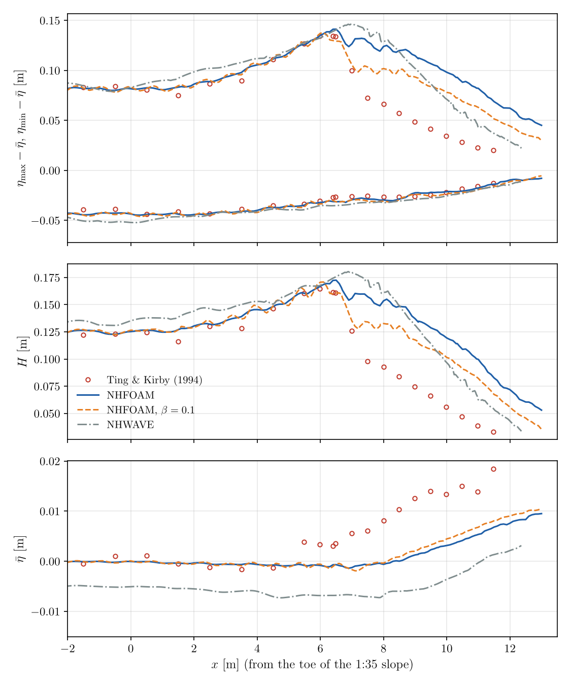

### 6.7 Breaking with a breaking age and an eddy viscosity

The breaking model of section 1 adds two ingredients of Kennedy et al.
(2000) to the HFA: a persistence threshold that falls with the age of the
breaking event (β = 0.3 → β_F = 0.15 over T* = 5√(D/g)), so that the
breaking region grows over the face of a mature bore, and the breaking eddy
viscosity ν_b = B δ_b² D ∂η/∂t (δ_b = 1.2). Ting & Kirby's beach as in 6.6,
now with the time averages of the last 10 periods for the undertow (cm;
undertow: strongest offshore velocity below the trough relative to the
measured one, stations x > 6.5 m):

| | largest H, at x | H at 8 m | H at 11 m | mean error of H, x > 7 m | mean level at 11 m | undertow |
|---|---|---|---|---|---|---|
| lab | 16.5, 6.0 m | 9.3 | 3.9 | | 1.4 | 1 |
| HFA | 17.3, 6.4 m | 15.3 | 10.0 | +6.1 | 0.5 | 1.03 |
| HFA, breaking age | 17.2, 6.5 m | 14.9 | 9.8 | +5.8 | 0.6 | 0.91 |
| **HFA + eddy viscosity** (`hybrid`, default) | 17.6, 6.2 m | 12.9 | 6.6 | **+3.5** | 0.8 | 1.32 |
| … with vertical mixing | 17.7, 6.3 m | 13.4 | 8.1 | +4.4 | 1.1 | 0.65 |
| eddy viscosity alone (vertical mixing) | 18.0, 6.5 m | 13.2 | 8.0 | +4.1 | 1.2 | 0.62 |
| kinematic onset, B_k = 0.85, C = √(gD) (see below) | 21.1, 7.1 m | 13.0 | 5.3 | +3.1 | 0.9 | 1.38 |
| NHWAVE (k–ε, 20 layers) | 18.0, 6.9 m | 16.1 | 6.4 | +4.8 | 0.0 | 1.63 |

The eddy viscosity nearly halves the surf-zone error of the HFA and brings it
below NHWAVE's. With horizontal mixing (the default) the undertow keeps the
measured S-shape, 30% too strong (NHWAVE 60%); mixing through the layer
faces as well makes it nearly uniform over the depth and dissipates less.
The breaking age alone (a larger hydrostatic region) changes little, and the
eddy viscosity without the HFA is close to the hybrid with vertical mixing:
the dissipation comes from ν_b. The kinematic onset with B_k = 0.85 breaks
1.1 m late at 21 cm (√(gD) overestimates the crest speed), which its mean
error inside the surf zone hides. All variants still lose too little height
just after the breaking point (x = 6.4–8 m: lab −6.9 cm, with the eddy
viscosity −4.2 to −4.6 cm, HFA −2.0 cm, NHWAVE −1.3 cm); further in, the
decay rates are close to the measured one. Columns join a breaker above
β√(gD), the threshold of a new breaker. Joining at the lower threshold of an
old breaker cut the error of the run with vertical mixing from +4.4 to
+3.5 cm here, but on the beach of 6.8 the breaking region then crept along
the crests of the oblique waves into deep water.

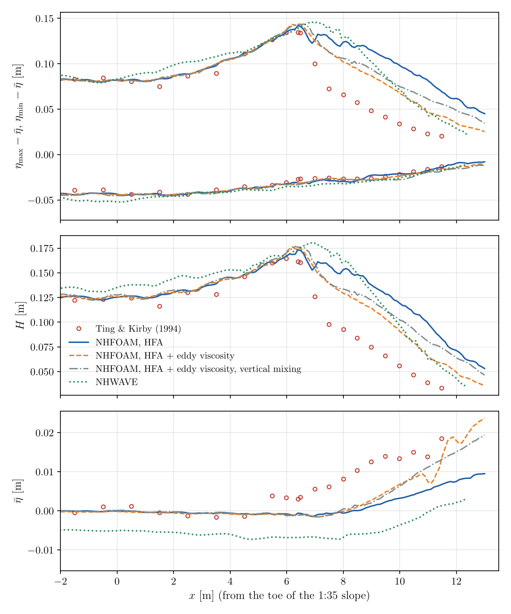

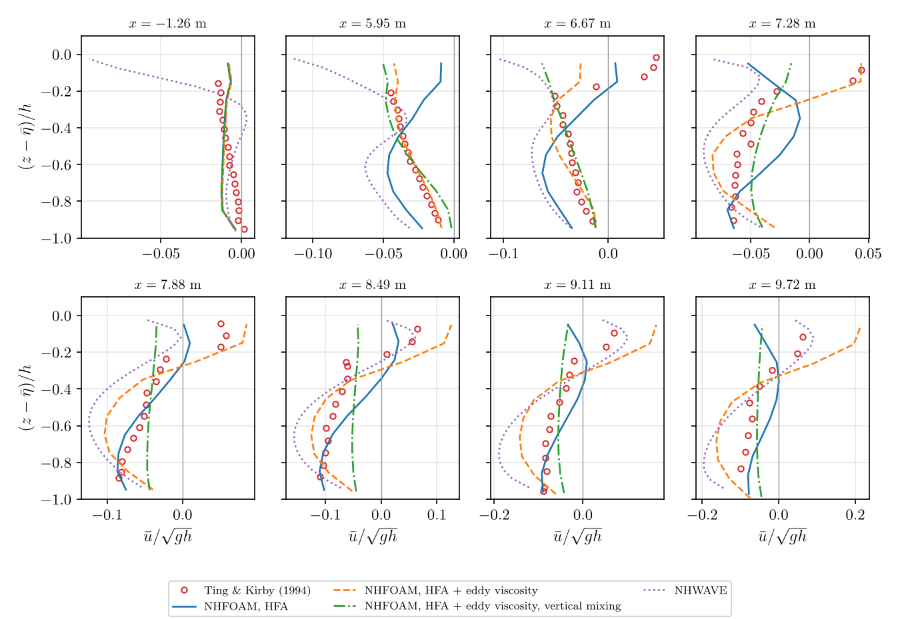

On the spilling breakers of Hansen & Svendsen (5.6, test 061071), the default
nearly halves the rms error of H in the surf zone (x > 8.3 m: 2.98 → 1.54 cm; −19%
to +49% of the measured heights instead of +3% to +99%) and of the mean
water level (4.6 → 2.2 mm), with the same error before breaking (0.56 cm);
it breaks 0.6 m early, with the largest height 0.3 cm low.

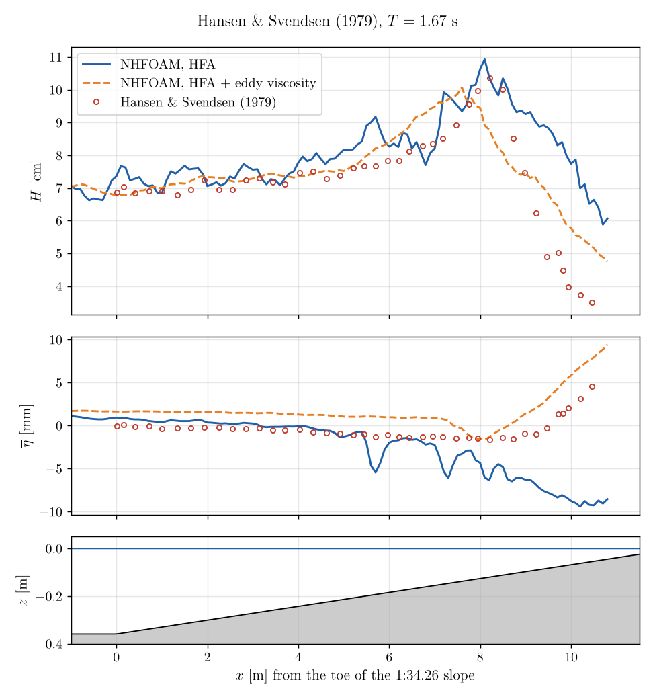

**Sensitivity.** One parameter at a time around the default (α = 0.6,
β = 0.3, β_F = 0.15, T* = 5, δ_b = 1.2, horizontal mixing), on both beaches
(Ting & Kirby: largest H and where, mean error of H for x > 7 m, strongest
undertow relative to the measured one; Hansen & Svendsen: largest H and
where, rms error of H for x > 8.3 m):

| | T&K: largest H, cm (at x, m) | T&K: mean error of H, x > 7 m (cm) | T&K: undertow | H&S: largest H (at x) | H&S: rms of H, x > 8.3 m (cm) |
|---|---|---|---|---|---|
| lab | 16.5 (6.0) |  | 1 | 10.4 (8.2) |  |
| **default** | 17.6 (6.2) | +3.5 | 1.32 | 10.1 (7.6) | 1.54 |
| α = 0.5 | 17.1 (6.1) | +3.5 | 1.36 | 10.1 (7.3) | 1.59 |
| α = 0.7 | 18.3 (6.4) | +3.5 | 1.31 | 9.9 (7.6) | 1.53 |
| β_F = 0.10 | 17.5 (6.2) | +3.3 | 1.33 | 10.3 (7.6) | 1.42 |
| β_F = 0.20 | 17.5 (6.2) | +3.7 | 1.34 | 9.9 (7.7) | 1.62 |
| δ_b = 0.9 | 17.6 (6.2) | +3.8 | 1.39 | 10.0 (7.7) | 1.83 |
| δ_b = 1.5 | 17.8 (6.2) | +3.3 | 1.29 | 10.2 (7.6) | 1.44 |
| vertical mixing 0.1 | 17.6 (6.1) | +4.4 | 0.78 |  |  |
| vertical mixing 0.3 | 17.5 (6.5) | +4.3 | 0.64 | 10.8 (7.9) | 2.08 |
| vertical mixing 1 | 17.7 (6.3) | +4.4 | 0.65 |  |  |
| kinematic onset, B_k = 0.85 | 20.2 (6.9) | +3.1 | 1.35 | 11.5 (7.8) | 1.37 |
| kinematic onset, B_k = 0.70 | 17.3 (5.9) | +2.4 | 1.46 | 9.8 (7.5) | 1.42 |

The breaking point and the surf-zone errors hardly depend on α. A longer
breaking event (β_F = 0.10) or a stronger eddy viscosity (δ_b = 1.5) lowers
the surf-zone errors on both beaches by 4–8%, the opposite changes raise
them by 5–19%: the default sits near a shallow optimum, and no parameter
removes the slow loss of height just after the breaking point (H at 8 m
stays at 12.8–13.4 cm, measured 9.3 cm). A tenth of ν_b through the layer
faces already flattens the undertow (0.78 of the measured strongest
offshore velocity, the closest profiles) but raises the surf-zone errors by
a quarter to a third. The kinematic onset now estimates the crest speed C
from the front face around each column (∂η/∂t = C|∇η| for a wave of
permanent form) instead of √(gD). With B_k = 0.85 it still breaks late
on Ting & Kirby's beach (20.2 cm at 6.9 m): the surface cell of a 10-layer column is half a
layer below the crest, where the velocity is smaller. With B_k = 0.70 the
waves break at the measured place (17.3 cm at 5.9 m, measured 16.5 cm at
6.0 m) and the surf-zone error is the smallest of all runs (+2.4 cm), while
on Hansen & Svendsen's beach the same threshold breaks 0.7 m early (rms
1.42 cm). The kinematic onset with B_k ≈ 0.7–0.8 is a promising
alternative to the default, to be tested on more cases first.

**Stabilised k–ω.** `kOmegaLF` (Wilcox 2006 with the limiter of Larsen &
Fuhrman 2018) on Ting & Kirby's beach, 20 layers, no-slip bottom with wall
functions:

| | largest H (at x) | H at 8 m | H at 11 m | mean error of H, x > 7 m | undertow | (k/gh)^½, x = 7.28 / 9.72 m |
|---|---|---|---|---|---|---|
| lab | 16.5 (6.0 m) | 9.3 | 3.9 | | 1 | 0.038 / 0.065 |
| default (`hybrid`, 10 layers) | 17.6 (6.2 m) | 12.9 | 6.6 | +3.5 | 1.32 | |
| k–ω, 20 layers, no breaking model | 23.9 (7.8 m) | 22.6 | 12.0 | +10.1 | 0.85 | 0.031 / 0.144 |
| … λ₂ = 0 (unstabilised) | 23.4 (7.8 m) | 22.5 | 7.9 | +8.3 | 0.78 | 0.051 / 0.185 |
| HFA + k–ω, 10 layers | 17.2 (6.2 m) | 15.5 | 9.8 | +6.1 | 1.21 | 0.023 / 0.042 |
| NHWAVE, k–ε, 20 layers | 18.0 (6.9 m) | 16.1 | 6.4 | +4.8 | 1.63 | |

Without a breaking model the waves keep steepening 1.8 m past the measured
breaking point (23.9 cm): the non-hydrostatic pressure keeps the front from
steepening, and the closure's eddy viscosity grows only once it is steep.
The turbulent kinetic energy is right at the first two stations, then
grows under the too-high waves; without the stabilisation it is 30–60%
higher everywhere, the over-production Larsen & Fuhrman describe. With the
HFA the waves break at the right place, but the closure adds little
dissipation behind the hydrostatic front (+6.1 cm, as the HFA alone) and
gives half the measured turbulent kinetic energy. The breaking eddy
viscosity therefore stays the dissipation mechanism; the closure helps the
vertical structure (the undertow has the measured strength).

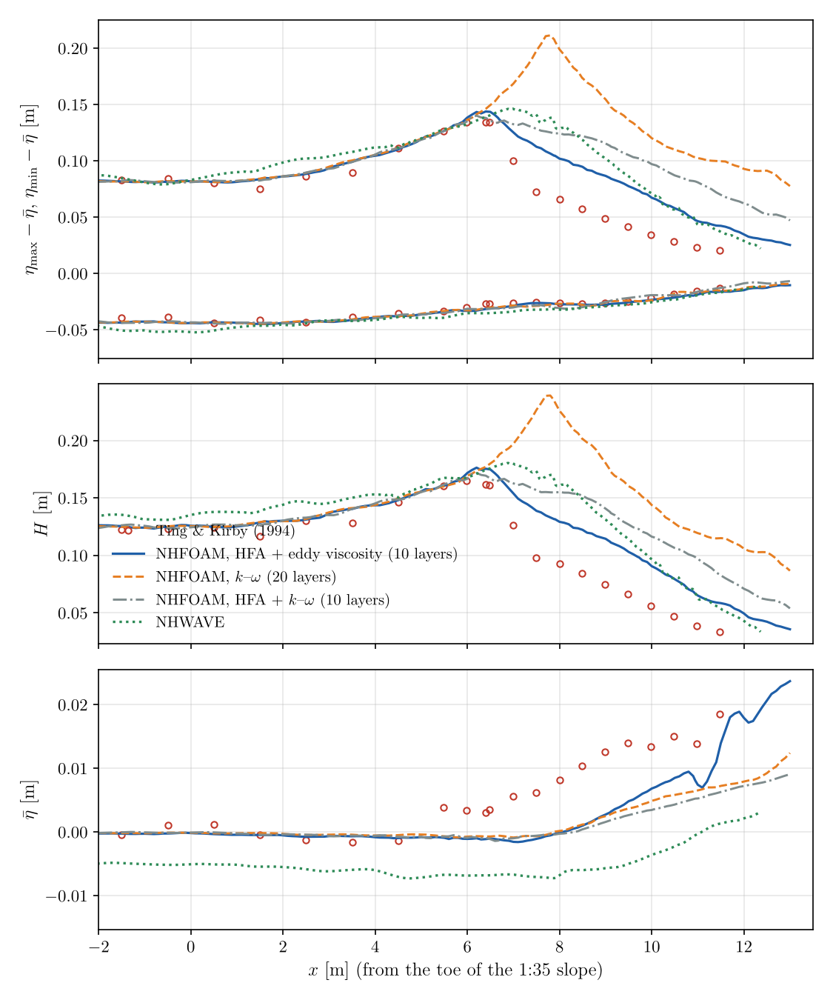

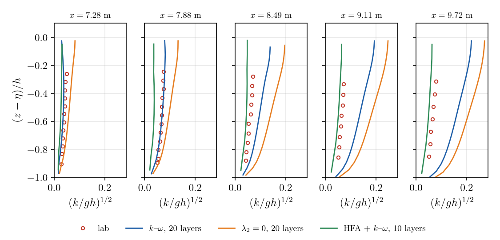

### 6.8 Longshore current on a plane beach (test 4.7)

Visser (1991), experiment 4, is the last test of Ma et al. (2012): regular
waves (H = 7.8 cm, T = 1.02 s, 15.4° from the shore normal at h = 0.35 m)
break on a smooth 1:20 beach and drive a longshore current. Measurements:
Visser's case 4 as tabulated by Kraus & Larson (1991, NMLONG, Table B3).
`validation/longshore.py` writes both models' cases, `plot_longshore.py`
makes the figures; the tutorial `longshoreCurrent` is the NHFOAM run.

Both models are periodic alongshore over one alongshore wavelength,
L_y = 2π/(k sin θ), with 5 uniform layers, log-law friction with k_s = 0.8 mm
(Ma et al.'s tuned value), the Smagorinsky model with Δ = (Δx Δy Δσ D)^(1/3)
and C_s = 0.168 (OpenFOAM's LES library; NHWAVE `IVTURB = 20`), a 5 mm film,
100 s, statistics over the last 5 periods. Ma et al. used 280 × 128 cells;
here both run on the same coarser grid, Δx = 4 cm with 40 (NHFOAM) or 32
(NHWAVE, a power of two for its periodic boundaries) cells alongshore,
about 70 min on one core each. NHFOAM makes stream-function waves in a 1.5 m
relaxation zone; NHWAVE uses its linear wavemaker at the boundary.

| | H at 2.41 m (cm) | H at 1.21 m (cm) | mean level at the shoreline (cm) | largest V (m/s), at (m) | rms error H (cm) | rms error V (m/s) |
|---|---|---|---|---|---|---|
| lab | 8.7 | 2.6 | 1.6 | 0.39, 1.21 | | |
| **NHFOAM, HFA + eddy viscosity** | 7.1 | 5.0 | 1.2 | 0.265, 1.08 | 1.3 | 0.074 |
| … with vertical mixing | 7.1 | 4.8 | 1.2 | 0.258, 1.48 | 1.2 | 0.071 |
| NHFOAM, HFA | 7.7 | 6.4 | 1.1 | 0.186, 0.68 | 1.9 | 0.123 |
| NHWAVE | 6.2 | 4.2 | 0.7 | 0.250, 1.26 | 1.3 | 0.082 |

NHFOAM's waves start breaking 2.85 m from the shoreline, 0.35 m seaward of
Visser's breaker line, at 7.9 cm instead of 8.7 cm, and stay too high inside
the surf zone (as in 6.7); NHWAVE's lose height before breaking on this
grid. Both models put the current at about the measured position but give
two thirds of its strength. With the HFA alone the current is weaker and its
peak sits near the shoreline, as Ma et al. found without turbulent diffusion;
the eddy viscosity mixes the current across the surf zone. The current is
uniform alongshore and still grows by about 2% per 10 s at 100 s. Ma et al.
report the current well predicted on their finer grid, so the resolution is
the likely main cause of the deficit both models share here.

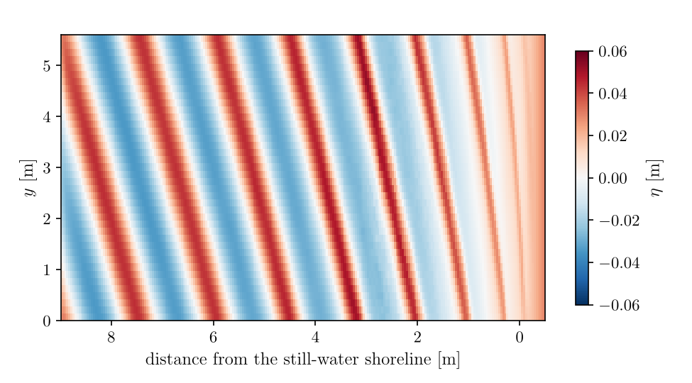

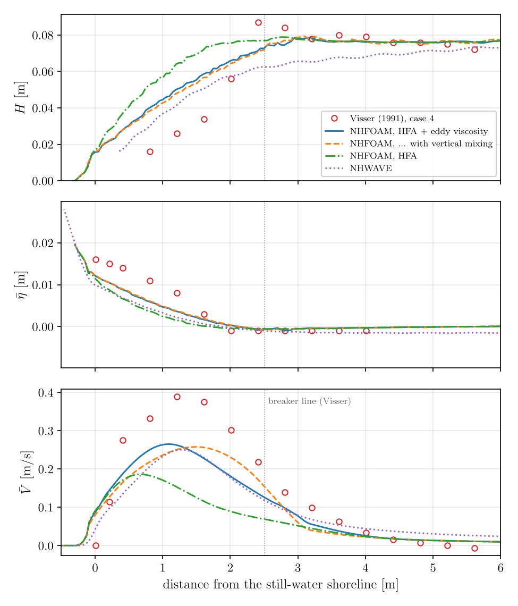

### 6.9 Solitary waves on a conical island (NTHMP benchmark 6)

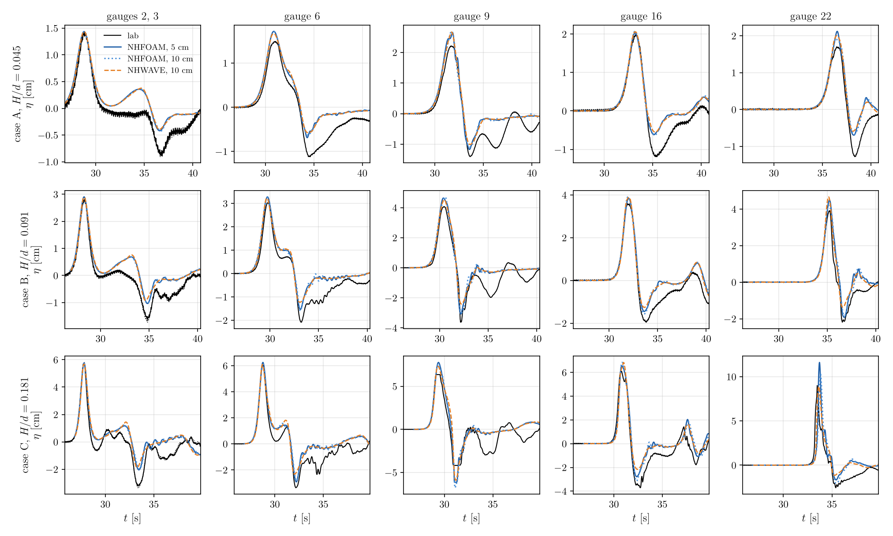

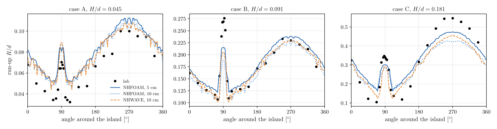

Briggs et al. (1995) sent solitary waves of H/d = 0.045, 0.091 and 0.181
(cases A, B, C; d = 0.32 m) against a conical island: toe radius 3.6 m, crest
radius 1.1 m, 1:4 faces. They recorded the water level in front of the island
(gauges 1–4), on its front face (6, 9), on its side (16) and behind it (22),
and the run-up all round. It is benchmark 6 of the NTHMP and one of NHWAVE's
examples (`inundation_benchmarks/Solitary_wave_on_a_conical_island`), and the
first test of wetting and drying in 3D here. `validation/conical_island.py`
writes both models' cases, `plot_conical_island.py` makes the figures.

Both models use the settings of NHWAVE's example: 3 layers, Cd = 0.01, a
5 mm film, NHWAVE with its k–ε model and NHFOAM with the hybrid breaking
model. To keep the cost down they cover half the basin, cut along the line
through the island's centre (a slip wall, so gauges 1 and 2 are the mirror
images of 4 and 3), and start from the exact solitary wave with
η = H/20 at the incident gauges instead of NHWAVE's boundary wavemaker; the
basin ends in a 2 m sponge. Each run is shifted in time so that its crest
meets the measured one at the incident gauges, and each lab record starts
from its mean before the wave. The run-up is the highest water level of the
cells on the edge of the flooded area, in 5° sectors (NHFOAM's new `etaMax`
field, NHWAVE's `hmax`), as NHWAVE's own script for this benchmark does.
NHWAVE's runs are on the 10 cm grid only: on its own 5 cm grid one case
would take about 5 h here, because its time step follows the vertical
Courant number of its thinnest layers and falls to about 0.01 s in the thin
water on the island.

Errors of the highest crest at the gauges, run-up R/d in front of (270°) and
behind (90°) the island, rms error of the run-up over the measured points,
and run time on 2 cores:

| case | run | gauge 6 | gauge 9 | gauge 16 | gauge 22 | R/d front | R/d back | rms R/d | time |
|---|---|---|---|---|---|---|---|---|---|
| A | lab | | | | | 0.100 | 0.070 | | |
| A | NHFOAM, 5 cm | +15% | +19% | +1% | +25% | 0.112 | 0.081 | 0.018 | 76 min |
| A | NHFOAM, 10 cm | +15% | +21% | +3% | +13% | 0.104 | 0.087 | 0.014 | 7 min |
| A | NHWAVE, 10 cm | +12% | +20% | +3% | +18% | 0.107 | 0.089 | 0.016 | 22 min |
| B | lab | | | | | 0.230 | 0.269 | | |
| B | NHFOAM, 5 cm | +8% | +14% | +7% | +15% | 0.238 | 0.215 | 0.024 | 58 min |
| B | NHFOAM, 10 cm | +8% | +16% | +9% | +7% | 0.220 | 0.188 | 0.039 | 5 min |
| B | NHWAVE, 10 cm | +6% | +11% | +8% | +19% | 0.229 | 0.205 | 0.032 | 21 min |
| C | lab | | | | | 0.547 | 0.341 | | |
| C | NHFOAM, 5 cm | +4% | +22% | +8% | +28% | 0.473 | 0.301 | 0.052 | 42 min |
| C | NHFOAM, 10 cm | +3% | +18% | +12% | +13% | 0.422 | 0.285 | 0.070 | 4 min |
| C | NHWAVE, 10 cm | +1% | +14% | +12% | −2% | 0.454 | 0.291 | 0.067 | 27 min |

- **NHFOAM and NHWAVE on the same grid** agree closely: the crests at the
  incident gauges and gauges 6, 9 and 16 within 4% of each other, the
  run-up within 0.01 d in case A and within 0.02 d on average in cases B and
  C. They differ most behind the island, where the two fronts that wrapped
  round it collide: at gauge 22 NHWAVE's crest is 5% and 11% higher than
  NHFOAM's in cases A and B, and 13% lower in case C, where the waves break
  and NHWAVE's crest is the closer to the measured one (NHFOAM's also comes
  0.3 s late); on the flanks of the run-up peak behind the island
  (75°–105°) the run-up differs by up to 0.08 d. Without its breaking model
  NHFOAM gives the same crest at gauge 22 (10.4 cm against 10.3 cm) and the
  same run-up: its breaking model hardly acts in the collision.
- **Against the measurements** both models overshoot on the island's face
  (gauge 9, 11–22%) and behind it in the smaller waves (gauge 22, 7–25% in
  cases A and B), as do the FUNWAVE results that come with NHWAVE's example
  (gauge 9: 17–25%, gauge 22: 47% in case A, 31% in B). The run-up has the
  measured shape: highest in front, lowest at the sides, a peak behind the
  island where the fronts meet. In cases A and C the measured minima at
  45°–135° are deeper than both models give; in case B the models follow
  them but stay below the measured peak behind the island (0.28 d against
  0.19–0.22 d). In case C both stay below the measured front run-up of
  0.55 d (0.42–0.45 d on the 10 cm grid, 0.47 d on 5 cm). After the crests
  the measured troughs are deeper than both models give (case A: −0.9 cm
  against −0.4 cm at the incident gauges, −1.1 cm against −0.6 to −0.7 cm
  at gauge 6). The measured records also sit about 1 mm below the
  still-water level after the incident crest, so part of this probably
  comes from the paddle's wave, which was not an exact solitary wave.
- **The 5 cm grid** brings NHFOAM's run-up closer to the measurements in
  cases B and C (rms 0.039 → 0.024 and 0.070 → 0.052) and changes the gauges
  by a few per cent, except gauge 22, whose crests rise further above the
  measured ones (case A: +13% → +25%, case C: +13% → +28%).
- **Cost:** on the same grid NHFOAM was 3–6 times faster than NHWAVE
  (4–7 min against 21–27 min).

### 6.10 Solitary waves on a composite beach with a vertical wall (NTHMP benchmark 5)

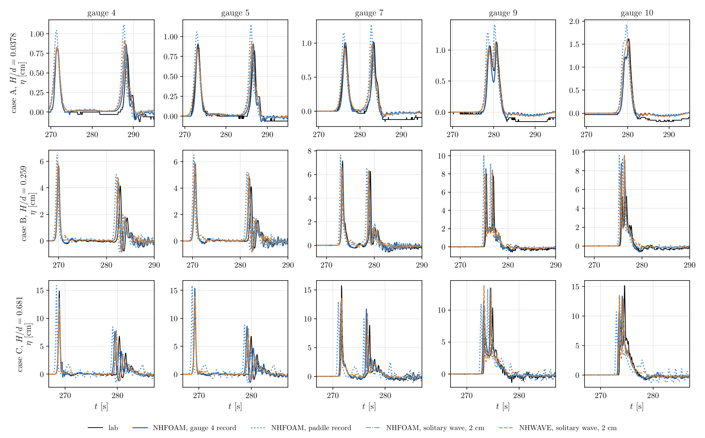

The Coastal and Hydraulics Laboratory of the US Army Corps of Engineers
built a model of Revere Beach in a flume: 0.218 m of water from the
wavemaker to 15.04 m, then slopes of 1:53, 1:150 and 1:13 up to a vertical
wall at 23.23 m that stands in 4.7 cm of water (benchmark problem 3 of the
1995 long-wave run-up workshop, Yeh et al. 1996; NTHMP benchmark 5; one of
the tests of NHWAVE's tsunami benchmark report, Tehranirad et al. 2012).
Solitary waves of target H/d = 0.05, 0.30 and 0.70 (cases A, B and C;
0.038, 0.26 and 0.68 at gauge 4) shoal over the slopes, reflect from the
wall (B and C break first) and run back; gauges 4–10 recorded them, and the
highest run-up on the wall was measured. The benchmark gives the paddle
trajectories and recommends driving the models with the record of the
incident gauge 4, which is what the time-series input is for.
`validation/composite_beach.py` writes the cases from the files of the
NTHMP benchmark collection (`rjleveque/nthmp-benchmark-problems`),
`plot_composite_beach.py` makes the figure.

Both models use 3 layers, log-law friction with ks = 0.1 mm (NHWAVE's Zob
in its examples of the inundation benchmarks) and a 5 mm film; NHFOAM runs
its hybrid breaking model. NHFOAM makes the wave in three ways on a 1 cm
grid (the grid of NHWAVE's report):

- **gauge 4 record**: the domain starts at gauge 4, where the direct pulse
  (to 275 s) drives `nhWaveVelocity` with the benchmark's velocity relation
  and the active absorption;
- **paddle record**: the whole flume from the middle of the paddle stroke,
  driven by the paddle trajectory, without absorption;
- **solitary wave**: the whole flume, starting from the exact solitary wave
  of the height measured at gauge 4, with its crest timed to the measured
  one there.

The last is also NHWAVE's input. On the 1 cm grid NHWAVE grows short-wave
noise in this flume (wiggles of ±1.5 mm on the 8 mm crest of case A, crests
3–8% high, with or without its k–ε model, in a flat tank as well), so the
two models are compared on a 2 cm grid, where NHWAVE carries the solitary
wave cleanly. NHWAVE's k–ε model, which is on in its inundation examples,
damps the steep waves of cases B and C already on the flat bed (in a flat
tank a wave of H/d = 0.26 keeps 0.87 H after 3.5 m with it and 1.02 H
without it), so NHWAVE runs without it and, for reference, with it. The lab
records start from their mean over the first 2 s, and no run is shifted in
time.

Crests against the measured ones (model/lab − 1): the incident crest at
gauges 4, 5, 7 and 8 (at gauge 4 of the record run, the boundary column
against the record), the highest crest at gauges 9 and 10, where incident
and reflected waves overlap, the reflected crest at gauge 5; the rms
difference over gauges 5–10 from the arrival of the wave; the highest water
level at the wall:

| case | run | g4 | g5 | g7 | g8 | g9 | g10 | g5 refl. | rms | wall R |
|---|---|---|---|---|---|---|---|---|---|---|
| A | lab | | | | | | | | | 2.74 cm |
| A | NHFOAM, gauge 4 record | 0% | −5% | −5% | +3% | −4% | −10% | +10% | 0.08 cm | 2.30 cm |
| A | NHFOAM, paddle record | +27% | +16% | +15% | +25% | +25% | +19% | +40% | 0.19 cm | 2.76 cm |
| A | NHFOAM, solitary wave, 2 cm | 0% | −9% | −9% | −2% | −1% | −2% | +8% | 0.11 cm | 2.13 cm |
| A | NHWAVE, solitary wave, 2 cm | +1% | −8% | −9% | −1% | +1% | −1% | +14% | 0.11 cm | 2.16 cm |
| A | NHWAVE with k–ε, 2 cm | +1% | −8% | −9% | −1% | +3% | −1% | +13% | 0.11 cm | 2.19 cm |
| B | lab | | | | | | (clipped) | | | 45.7 cm |
| B | NHFOAM, gauge 4 record | −1% | +10% | −7% | −1% | +7% | | +16% | 0.63 cm | 17.4 cm |
| B | NHFOAM, paddle record | +15% | +22% | +7% | +15% | +26% | | +27% | 1.12 cm | 18.6 cm |
| B | NHFOAM, solitary wave, 2 cm | −1% | +5% | −9% | −3% | +5% | | +19% | 0.75 cm | 18.8 cm |
| B | NHWAVE, solitary wave, 2 cm | +5% | +11% | −8% | −5% | +5% | | +25% | 0.90 cm | 19.6 cm |
| B | NHWAVE with k–ε, 2 cm | −21% | −15% | −26% | −23% | −2% | | −7% | 0.27 cm | 17.5 cm |
| C | lab | | | | | | | | | 27.4 cm |
| C | NHFOAM, gauge 4 record | −14% | +12% | −18% | +46% | +30% | −12% | +27% | 1.34 cm | 23.8 cm |
| C | NHFOAM, paddle record | +7% | +15% | −18% | +46% | +28% | −12% | +29% | 1.90 cm | 23.5 cm |
| C | NHFOAM, solitary wave, 2 cm | −7% | 0% | −17% | +39% | +29% | −16% | +20% | 1.08 cm | 23.6 cm |
| C | NHWAVE, solitary wave, 2 cm | −20% | +1% | −14% | +75% | +34% | −11% | +13% | 1.17 cm | 28.4 cm |
| C | NHWAVE with k–ε, 2 cm | −21% | −15% | −15% | +71% | +21% | −17% | −5% | 0.92 cm | 24.7 cm |

- **The record of gauge 4** carries the measured pulse, which is not a
  solitary wave: in case A it is 20% narrower at half height than the
  solitary wave of its height (1.25 s against 1.55 s). With it the
  incident crests at gauges 5–8 are within 5% of the measured ones in case
  A and within 10% in case B, they arrive within 0.13 s, and the rms
  difference is the smallest of NHFOAM's three inputs (0.08 and 0.63 cm).
  The
  benchmark's velocity and the celerity √(g(d + H)) give the same crests
  within 2% in these two cases.
- **Case C** (H/d = 0.68) is at the limit of the input: the boundary column
  falls 14% short of the recorded crest (22% with √(g(d + H))), as in the
  flat tank at H/h = 0.6 (5.7), and the absorption makes up the volume, so
  the crest at gauge 5 is 12% above the measured one. Further on the run is
  governed by breaking, in both models: the measured wave peaks at gauge 7
  (19.4 m) and plunges before gauge 8, while the models' waves are 14–18%
  lower at gauge 7 (NHFOAM breaks at 16.8–18.4 m) and 39–75% higher at
  gauge 8: the broken waves keep too much height, as on the spilling-breaker
  beaches (6.7).
- **The paddle record** makes waves 27%, 15% and 7% higher than measured at
  gauge 4 (cases A, B, C), which arrive 0.2–0.6 s early. In the flat tank
  the paddle input reproduces the wave of a piston that follows its record
  to 0.4% up to H/h = 0.3 (5.7), so the laboratory paddle displaced less
  water than its record implies (leakage
  past the paddle or the calibration of its feedback signal; the measured
  heights fell short of the target ones). This is why the benchmark
  recommends the record of gauge 4.
- **NHFOAM and NHWAVE** with the same input on the same grid: in case A the
  crests agree within 2% at every gauge, the reflected crest at gauge 5 is
  14% high in NHWAVE and 8% in NHFOAM, and the run-up on the wall differs
  by 0.03 cm. In case B NHWAVE's crests are within 6% of NHFOAM's. In case
  C the near-limit wave loses height on the flat bed before gauge 4 in both
  models, 20% in NHWAVE and 7% in NHFOAM (which does not break there);
  after that both follow the same pattern, and NHWAVE's run-up on the wall
  is the closer one (28.4 cm against 23.6 cm, lab 27.4 cm). With its k–ε
  model NHWAVE's incident crests are already 21% low at gauge 4 in cases B
  and C, and 15–26% low at gauges 5 and 7; its small rms in case B comes
  from its slower wave, which meets the measured arrival times, not from
  the crests.
- **The run-up on the wall** is 16% low in case A (2.30 against 2.74 cm)
  and 13% low in case C (23.8 against 27.4 cm). In case B the measured
  45.7 cm (2.1 d) is a jet thrown up the wall by the wave breaking against
  it, which a σ-mesh, with one free surface per column, cannot represent;
  both models give 17–20 cm.
- **Timing of the reflection.** Both models send the reflected crest back
  to gauges 4–7 early: by up to 0.5 s in case A, 0.2–0.5 s in B and
  0.4–0.8 s in C. As the two models agree, the difference probably lies in the lab
  (the position of the wall, or the time the water takes to climb it and
  fall back).
- **The measurements.** The crest changes by +11%, −6% and −7% from gauge 4
  to gauge 5 on the flat bed (cases A, B, C), which a wave of permanent
  form does not do: the gauges agree to about 10%, and their records come
  in steps of 0.3 mm (0.001 ft), 4% of the crest in case A. Gauge 10
  saturated at 5.3 cm in case B (its record is flat for 0.2 s on both
  crests), so its crest is left out.
- **The grids and the cost.** NHFOAM's solitary runs on 1 and 2 cm agree
  within 3% at every gauge. On one core NHFOAM took 2–3 min on the 2 cm
  grid and NHWAVE 7–21 min (each run sharing the machine with another), and
  NHFOAM 4 min (record runs) to 15 min (whole flume) on the 1 cm grid.

### 6.11 Tsunami run-up onto a complex 3D beach: the Monai valley (NTHMP benchmark 7)

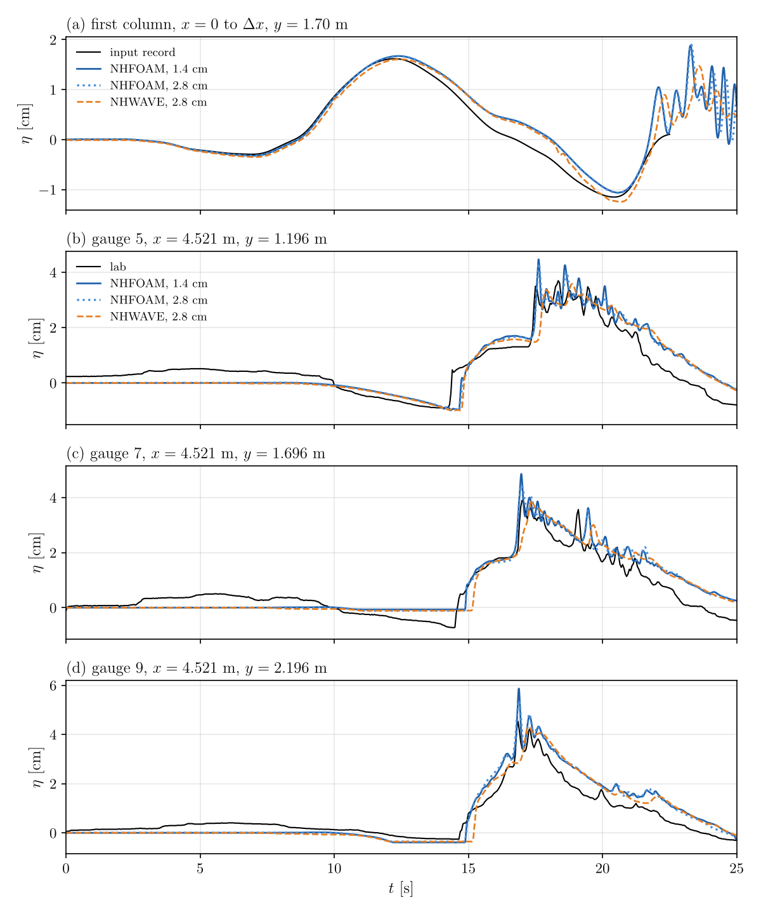

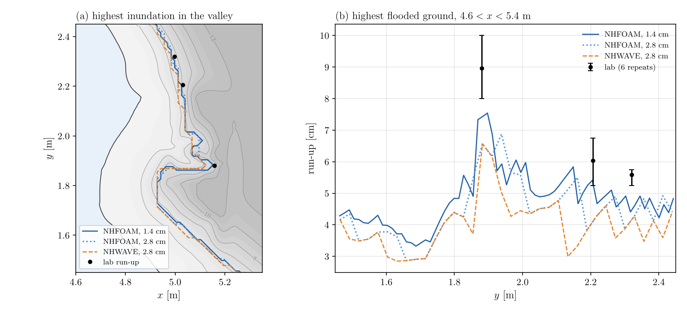

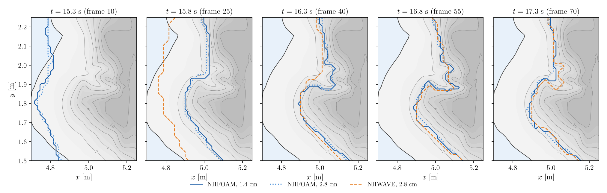

The 1993 Hokkaido Nansei-Oki tsunami ran up 31.7 m at the head of a narrow
valley near Monai, on Okushiri Island. The Central Research Institute for
Electric Power Industry (CRIEPI) rebuilt the coast at 1:400 in a 205 m long,
3.5 m wide tank (Matsuyama & Tanaka 2001). The experiment was benchmark 2 of
the 2004 workshop on long-wave run-up models (Liu et al. 2008); it is
benchmark 7 of the NTHMP and one of NHWAVE's examples
(`inundation_benchmarks/Runup_onto_a_complex_3-D_beach_Monai_Valley`). The
benchmark covers 5.488 × 3.402 m with the bed on a 1.4 cm grid: 13.5 cm of
water at x = 0, a small island in front of the valley, land up to 12.5 cm
above the still water, and walls on the other three sides. The incident
wave is given at x = 0 for 22.5 s, a depression of 2.9 mm followed by a
crest of 16.1 mm (H/d = 0.12). Gauges 5, 7 and 9 recorded the water level
at x = 4.521 m, where the bed file has only 1.2, 0.3 and 0.6 cm of water.
In six repeats the wave ran up 8.0–10.0 cm (mean 9.0 cm) at the head of the
valley, which narrows to 4–6 cm there, and 5.25–6.75 and 5.25–5.75 cm at two
points on its north side. `validation/monai_valley.py` writes both models'
cases from the NTHMP files, `plot_monai_valley.py` makes the figures.

**Set-up.** NHFOAM covers the benchmark domain and takes the incident wave
at x = 0 as a time series (`theory timeSeries`, 5.7) with the active
absorption, so the boundary lets the reflected waves out, also after
22.5 s, when the record (tapered to zero over its last 0.5 s) ends; the
velocity is depth-uniform, u = cη/(d + η) with c = √(g(d + η)). NHWAVE runs
its example: the domain extended 1.4 m offshore, its internal wavemaker
between x = −0.14 and 0 m driven by a Fourier fit of the record (399
components), a 1 m sponge behind it and its k–ε model. Both use 4 layers,
log-law friction with ks = 0.1 mm (NHWAVE's Zob) and NHWAVE's 2 mm film;
NHFOAM runs its hybrid breaking model. NHFOAM runs on the benchmark grid
(1.4 cm, 392 × 243 columns) and on the grid coarsened twice (2.8 × 2.79 cm,
196 × 122 columns). On the benchmark grid NHWAVE takes about 10 s per time
step on 2 cores, about 16 h for the 25 s, so it runs on the coarse grid,
with the bed interpolated from the benchmark nodes and the cell depths the
means of the four corners, as NHWAVE's own depth file has them on the fine
grid. On the coarse grid each model also runs without its breaking
treatment (NHFOAM without the breaking model, NHWAVE without k–ε). No run
is shifted in time, and the lab gauges are shown as given (they read +2 to
+5 mm before the wave arrives). The run-up is the highest ground that a
model floods (the highest bed of the columns ever wet), which is how it was
measured: the ground at the three lab points is 8.9, 6.2 and 5.5 cm high,
their mean run-ups. The shorelines at the times of the video frames of the
experiment come from NHFOAM's new `surfaceSnapshots` (the free surface of
every column at listed times, without writing the full fields) and
NHWAVE's surface output every 0.1 s; the photographs themselves were not
compared.

Gauges over 13–23 s: highest crest against the measured one, arrival of the
bore (η rising through 0.5 cm) against the measured arrival, and the rms
difference:

| run | crest g5 | crest g7 | crest g9 | bore g5 | bore g7 | bore g9 | rms g5 / g7 / g9 |
|---|---|---|---|---|---|---|---|
| lab | 3.70 cm | 3.92 cm | 4.54 cm | 14.59 s | 14.81 s | 14.95 s | |
| NHFOAM, 1.4 cm | +21% | +24% | +29% | +0.39 s | +0.11 s | +0.03 s | 0.58 / 0.52 / 0.58 cm |
| NHFOAM, 2.8 cm | +16% | +13% | +18% | +0.36 s | +0.12 s | +0.03 s | 0.57 / 0.53 / 0.59 cm |
| NHWAVE, 2.8 cm | −3% | −1% | −5% | +0.34 s | +0.40 s | +0.30 s | 0.62 / 0.53 / 0.58 cm |
| NHFOAM, 2.8 cm, no breaking model | +27% | +14% | +20% | +0.36 s | +0.11 s | +0.03 s | 0.58 / 0.53 / 0.60 cm |
| NHWAVE, 2.8 cm, no k–ε | −1% | +2% | −3% | +0.32 s | +0.38 s | +0.28 s | 0.62 / 0.52 / 0.60 cm |

Run-up (cm; lab: the six repeats), the highest flooded
ground in the valley (1.75 < y < 2.05 m), the flooded land and the run time
on 2 cores:

| run | head of the valley (5.158, 1.880) | (5.030, 2.206) | (4.998, 2.320) | highest in the valley | flooded land | time |
|---|---|---|---|---|---|---|
| lab, range | 8.0–10.0 | 5.25–6.75 | 5.25–5.75 | | | |
| lab, mean | 9.0 | 6.0 | 5.6 | | | |
| NHFOAM, 1.4 cm | 7.4 | 5.4 | 4.4 | 7.5 | 0.65 m² | 6.2 h |
| NHFOAM, 2.8 cm | 6.6 | 4.3 | 4.3 | 6.9 | 0.64 m² | 35 min |
| NHWAVE, 2.8 cm | 6.6 | 4.3 | 4.3 | 6.6 | 0.63 m² | 2.0 h |
| NHFOAM, 2.8 cm, no breaking model | 6.6 | 4.3 | 4.3 | 6.9 | 0.64 m² | 35 min |
| NHWAVE, 2.8 cm, no k–ε | 6.6 | 4.3 | 4.3 | 6.6 | 0.64 m² | 1.7 h |

- **The incident wave.** NHFOAM's first column follows the record to
  0.2 mm rms over the first 12 s, before the waves reflected from the island
  and the coast come back, on both grids. NHWAVE's wavemaker keeps time
  with the record too (lag 0.001 s), with a deeper depression (3.5 against
  2.9 mm) and a 2% lower crest (0.6 mm rms). After 12 s both boundaries let
  the same reflected waves out.
- **Gauges.** The depression dries all three gauge columns in both models
  (the flat parts at 12–15 s), while the lab gauges stay wet: gauge 7 reads
  0.6 cm below the still water at 14 s, where the bed file has the bed at
  −0.27 cm, so the gauges stood in deeper water than the file has at their
  positions. The bore then floods the dried bed. NHFOAM's arrives 0.03–0.39 s
  after the measured one on both grids, NHWAVE's 0.30–0.40 s, about the
  0.4 s by which NHWAVE's example shifts its results. Behind the bore both
  models follow the measured records, with rms differences of 0.5–0.6 cm.
  NHFOAM's short crests at 17–17.6 s are 13–18% higher than the measured
  ones on the coarse grid and 21–29% on the benchmark grid; NHWAVE's
  smoother crests are 1–5% lower.
- **Run-up.** On the coarse grid the two models flood almost the same
  columns (0.64 and 0.63 m² of land; NHFOAM floods every column that NHWAVE
  floods) and run up 6.6 cm at the head of the valley (27% below the
  measured mean) and 4.3 cm at the two points to the north (23–29% low):
  the head of the valley is only one or two coarse cells wide. On the
  benchmark grid NHFOAM runs up 7.4 cm at the head (17% low, below the
  lowest of the six repeats), 5.4 cm at the first point to the north
  (within the measured 5.25–6.75 cm) and 4.4 cm at the second (21% low).
  The shorelines of the two grids agree at the frame times; NHWAVE's lags
  behind NHFOAM's while the water climbs the valley (by 0.27 m at 15.3 s
  and 0.17 m at 15.8 s) and has caught up by 16.8 s.
- **The breaking closures.** Without its breaking model NHFOAM's crest at
  gauge 5 is 9% higher (4.70 against 4.31 cm), and the bore, the rms
  differences and the run-up do not change. Without k–ε NHWAVE's crests
  are 1–3% higher and its bore arrives 0.02 s earlier, with the same
  run-up. Neither closure explains the differences between the models:
  with or without them NHWAVE's bore reaches gauges 7 and 9 0.3 s after
  NHFOAM's, and NHFOAM's short crests stay 11–29% above NHWAVE's. The
  difference lies in how the bore runs over the dried bed: NHWAVE's
  shoreline also lags behind NHFOAM's while the water climbs the valley.
- **Cost.** On the coarse grid NHFOAM took 35 min and NHWAVE 2.0 h on 2
  cores (1.7 h without k–ε); NHFOAM took 6.2 h on the benchmark grid.

### 6.12 The Monai valley on a mesh refined around the valley

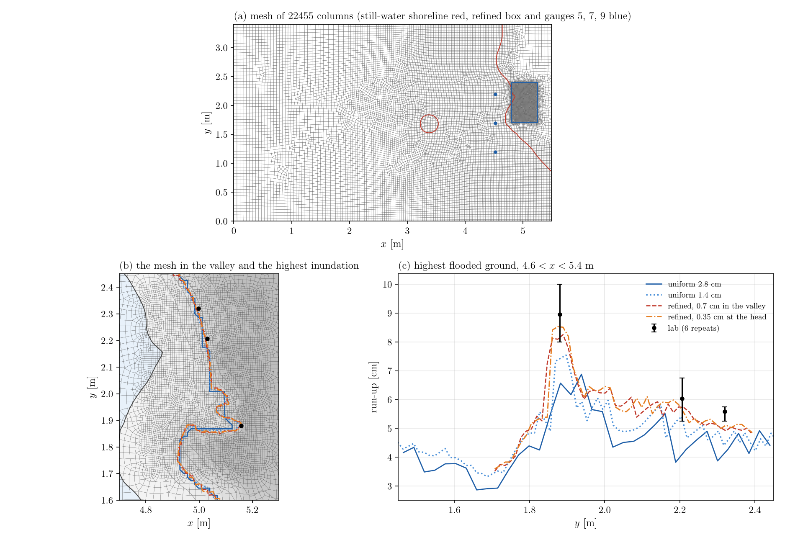

On the uniform grids of 6.11 the run-up at the head of the valley stays 17%
(1.4 cm) to 27% (2.8 cm) below the measured mean: the valley narrows to
4–6 cm there, and a uniform grid pays for the resolution of the valley over
the whole basin. NHWAVE has no other choice, NHFOAM takes any mesh that is
made of columns. `validation/monai_refined.py` meshes the basin with gmsh
quadrilaterals whose size follows the depth, lc = 5.6 cm √(h/d) down to
2.8 cm in the shallow water and on the land that the wave can reach, with
smaller cells in a box of 0.45 × 0.7 m around the valley and the three lab
points (and, as an option, on the shelf in front of it, 1.3 × 1.5 m, which
holds the gauges), and extrudes them into 4 layers.
`plot_monai_refined.py` makes the figure. Everything else is the set-up of
6.11. The time step follows the Courant number (`adjustTimeStep`,
maxCo = 1) below 8 ms, the step of the uniform 2.8 cm grid, so the small
cells cost time steps only while water moves through them (smallest step
2–4 ms, 3150–3530 steps in all). The bed is still the bilinear
interpolation of the 1.4 cm benchmark data: cells below 1.4 cm add numerical
resolution and no detail of the bed. Run-up as in 6.11 (the highest flooded
ground in a 1.4 cm wide strip through each lab point), in cm:

| mesh | columns | time steps | head of the valley | N1 (5.030, 2.206) | N2 (4.998, 2.320) | highest in the valley | time, 2 cores |
|---|---|---|---|---|---|---|---|
| lab, range | | | 8.0–10.0 | 5.25–6.75 | 5.25–5.75 | | |
| lab, mean | | | 9.0 | 6.0 | 5.6 | | |
| uniform 2.8 cm (6.11) | 23 912 | 3125 | 6.6 | 4.3 | 4.3 | 6.9 | 35 min |
| uniform 1.4 cm (6.11) | 95 256 | 6250 | 7.4 | 5.4 | 4.4 | 7.5 | 6.2 h |
| refined: valley 1.4 cm | 16 883 | 3150 | 7.0 | 4.7 | 4.3 | 7.4 | 16 min |
| refined: shelf and valley 1.4 cm | 22 962 | 3163 | 7.1 | 5.8 | 4.7 | 7.8 | 22 min |
| refined: valley 0.7 cm | 22 455 | 3264 | 8.1 | 5.7 | 4.9 | 8.3 | 22 min |
| refined: shelf 1.4 cm, valley 0.7 cm | 28 279 | 3282 | 8.1 | 5.6 | 5.1 | 8.2 | 28 min |
| refined: valley 0.7 cm, head 0.35 cm | 24 897 | 3528 | 8.5 | 5.8 | 5.1 | 8.5 | 27 min |
| refined: valley 0.7 cm, triangles | 52 929 | 3891 | 8.3 | 5.6 | 5.3 | 8.3 | 64 min |

- **Resolution of the valley decides the run-up.** With 0.7 cm cells in the
  valley the run-up at the head is 8.1 cm, inside the measured 8.0–10.0 cm,
  and 5.7 cm at N1 (measured 5.25–6.75 cm); N2 stays 12% below the measured
  mean (4.9 cm; lowest repeat 5.25 cm). That mesh has fewer columns than the
  uniform 2.8 cm grid and ran in 22 min, against 6.2 h for the uniform
  1.4 cm grid, which gives 7.4 cm: a quarter of the columns and, with the
  adaptive step that the uniform runs did not use, half the time steps.
- **Same resolution, same answer.** With 1.4 cm on the shelf and in the
  valley the refined mesh gives the run-up of the uniform 1.4 cm grid
  within 0.3 cm at the three points (7.1 / 5.8 / 4.7 against 7.4 / 5.4 /
  4.4 cm) and its crests at the gauges (+21 / +17 / +25% against +21 / +24 /
  +29%), with a quarter of the columns. Meshes of the same nominal
  resolution differ by 0.1–0.3 cm at a point: the run-up is read from the
  bed height of single columns.
- **The shelf matters for the gauges, not for the head of the valley.**
  With 0.7 cm in the valley, the shelf at 1.4 cm instead of 2.8 cm leaves
  the run-up at the head at 8.1 cm. The gauges follow the resolution of the
  shelf: on every refined mesh the bore arrives within 0.04 s of the uniform
  grid of the same shelf resolution, and the rms differences (0.50–0.60 cm)
  do not change.
- **Not yet converged at the head.** With 0.35 cm cells at the head of the
  valley (0.32 × 0.22 m) the run-up there rises again, to 8.5 cm (lab mean
  9.0 cm); from 2.8 to 0.35 cm it goes 6.6, 7.0–7.4, 8.1, 8.5 cm.
- **Triangles give the same run-up at three times the cost.** The 0.7 cm
  mesh in triangles (edges of the same length, so 2.4 times the columns)
  runs up 8.3 / 5.6 / 5.3 cm, within 0.4 cm of the quadrilaterals'
  8.1 / 5.7 / 4.9 cm, with the same gauges, in 64 min. The
  8% lower run-up of the triangulated strip of 5.8 does not show here.
- **The film is not the limit.** On the uniform 2.8 cm grid, films of 2, 1
  and 0.5 mm give the same run-up at all three points and crests within 5%
  of each other; with the thinner films the bore
  reaches gauge 5 0.15 s earlier (0.21 s after the measured one instead of
  0.36 s) and gauge 9 0.07–0.11 s later.

### 6.13 The cases of SWASH: its tutorials and its laboratory comparisons

SWASH (Zijlema et al. 2011) is the other open non-hydrostatic model with
the pressure on the layer interfaces. Its documentation has four tutorials
(irregular waves on a plane beach; no measurements), and its papers compare
it with laboratory experiments, most of which NHFOAM has already run with
the set-ups of NHWAVE. This section runs NHFOAM the way SWASH is run (one or
two layers, its friction and breaking settings) against the same
measurements. SWASH itself was not run: everything said about it comes from
its papers and manual.

| SWASH case | experiment | SWASH's set-up | NHFOAM |
|---|---|---|---|
| run-up on a conical island (Zijlema et al. 2011, 5.6) | Briggs et al. (1995) | 5 cm, depth-averaged, no friction | 6.9 (3 layers, C_d = 0.01); here case C with 1 layer, no friction |
| N-wave run-up on a complex beach (5.7) | Matsuyama & Tanaka (2001) | 1.25 cm, depth-averaged, Manning n = 0.012 | 6.11, 6.12 (4 layers, k_s = 0.1 mm); here 1 layer, n = 0.012 |
| regular breaking waves (Smit et al. 2013) | Ting & Kirby (1994) | 2.5 cm; 2–5 layers with the hydrostatic front approximation (α = 0.6, β = 0.3), 20 layers without | 6.6, 6.7 (10 layers); here 2, 3 and 5 layers |
| waves over a submerged bar (examples) | Beji & Battjes (1993), Luth et al. (1994) | | 6.3, 5.7 (3 and 10 layers); here 1 and 2 layers |
| Berkhoff shoal (examples) | Berkhoff et al. (1982) | | 6.4 (3 layers), no new run |
| parabolic basin (5.4) | Thacker (1981), exact | | 6.6, no new run |
| irregular waves on barred beaches (5.8, 5.9; Smit et al. 2013), a shallow foreshore (5.10), rip channels (5.11) | the flume tests of Battjes & Janssen, Boers and others named in those papers | | not run: the measurements were not at hand |
| tutorials 1–3: JONSWAP waves on a 1:83 beach | none | 1 m, 1 or 2 layers, Manning n = 0.02 | here, against linear shoaling |
| tutorial 4: oblique short-crested waves, longshore current | none | 1 × 4 m, 1 layer | not run |

`validation/swash_tutorials.py` writes the tutorial cases (and SWASH's input
files next to them), `plot_swash_tutorials.py` their figure; the other runs
use the scripts of the sections named in the table with fewer layers.

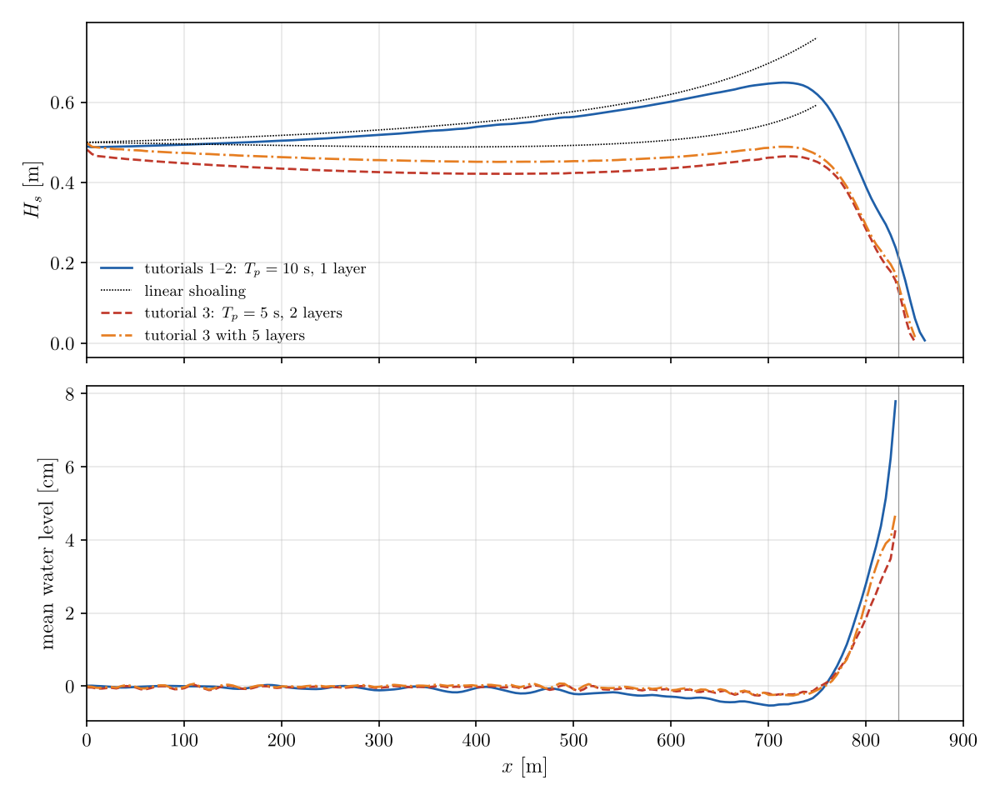

**Tutorials 1–3.** JONSWAP waves (H_s = 0.5 m) on a beach that rises from
10 m below to 2 m above the still water over 1 km, Δx = 1 m, Δt = 0.05 s,
Manning n = 0.02, the hydrostatic front approximation with SWASH's α and β,
a 1 cm film; the boundary wavemaker with active absorption makes the
spectrum from 300 components (linear: without the bound waves that SWASH
adds). The runs take 3–4 min on one core.

- **T_p = 10 s, one layer (tutorials 1–2, kd = 0.68 offshore).** H_s stays
  2.0–2.6% below linear shoaling from the wavemaker to 4 m depth (2.9% at
  2.8 m), rises to 0.65 m at 1.4 m depth and falls from there; the mean
  level drops by 0.5 cm before the surf zone and stands 10 cm above the
  still water at the still-water shoreline.
- **T_p = 5 s, two layers (tutorial 3, kd = 1.7).** H_s is 3.7% below
  linear shoaling at the wavemaker, 9.7% after 100 m and 13% after 300 m
  (eight peak wavelengths); after that it follows the shoaling curve,
  13–14% below it. The loss is the one of 5.7 (irregular waves, 3–5% of H_m0 over
  eight wavelengths in the flume), now with three things known about it.
  It is not the grid: with Δx and Δt halved H_s changes by about 1%
  between the wavemaker and 500 m. It is not the short components: the
  peak band (0.5–1.5 f_p) loses 9% in 300 m (0.455 to 0.416 m), and 8%
  with the spectrum cut at 1.5 f_p (0.489 to 0.451 m). It depends on
  the layers: with five layers the peak band loses 6% (0.465 to 0.439 m)
  and H_s ends 7–9% below linear shoaling. Linear shoaling itself takes 2%
  off in those 300 m. Regular waves of the peak period do not show it
  (5.7); the cause is still open.
- **Breaking.** The front criterion ∂η/∂t > 0.6 √(gD) is never met in
  these runs (Δx = 1 m for waves of 0.5 m): the waves lose their
  height in the last 120 m through the TVD convection scheme and the
  friction, not through the breaking model. Whether SWASH's criterion acts
  on this grid would take a SWASH run to tell.

**Ting & Kirby's spilling breakers with 2–5 layers** (the set-up of 6.6;
Smit et al. 2013 use Δx = 2.5 cm and 2–5 layers with the hydrostatic front
approximation, α = 0.6 and β = 0.3, and report the edge of the surf zone,
the largest wave height and the decay in the surf zone well reproduced):

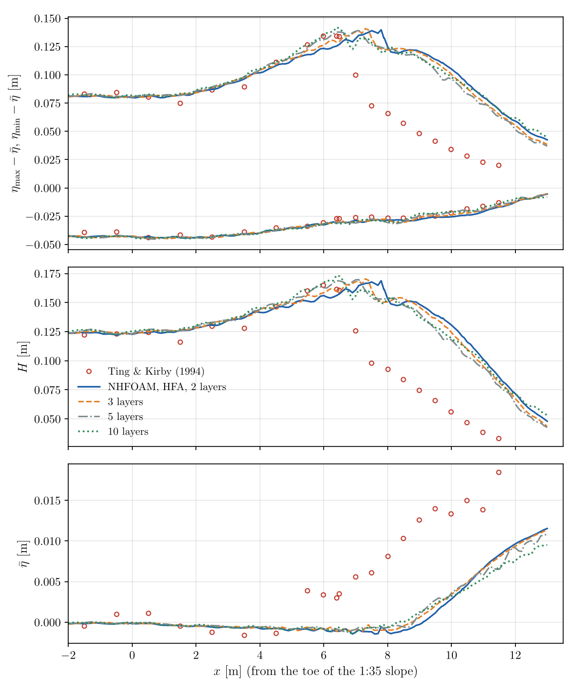

| layers | largest H at | H, rms error before x = 6 m | H, mean error after x = 7 m | mean level, rms error |
|---|---|---|---|---|
| lab | 16.5 cm at 5.99 m (breaking at 6.4 m) | | | |
| 2 | 16.9 cm at 7.80 m | 0.61 cm | +6.7 cm | 0.73 cm |
| 3 | 17.0 cm at 7.30 m | 0.55 cm | +6.3 cm | 0.70 cm |
| 5 | 17.0 cm at 7.10 m | 0.52 cm | +5.9 cm | 0.70 cm |
| 10 (6.7) | 17.3 cm at 6.40 m | 0.54 cm | +6.1 cm | 0.71 cm |

Up to breaking two layers are enough (0.6 cm rms). The breaking point moves
shoreward as the layers get fewer (1.4 m late with two), and in the surf
zone the waves are 6–7 cm too high with any number of layers: with the
front approximation alone NHFOAM does not reproduce what Smit et al. report
for SWASH at the same resolution. The difference is not in the criterion,
which is the same, so it lies in what the hydrostatic bore dissipates in
NHFOAM (the breaking eddy viscosity of 6.7 nearly halves the error). This
is the first limitation under Breaking in section 7, and SWASH's result
says that a hydrostatic front alone can do better.

**The submerged bar with one and two layers** (the set-ups of 6.3 and 5.7;
rms difference of the surface over the last periods and mean error of the
wave height at the ten gauges):

| layers | case A (T = 2.02 s): rms, height | case C (T = 1.01 s): rms, height |
|---|---|---|
| 1 | 0.80 cm, 17% | 2.0 cm, 12% |
| 2 | 0.38 cm, 5.0% | 1.3 cm, 8.2% |
| 3 | 0.31 cm, 4.9% | |
| 10 | 0.17 cm, 5.1% | 1.4 cm, 7.5% |

Two layers give the wave heights of ten (5% in case A, 8% in case C) and
twice the rms difference in case A, where the phases of the harmonics
behind the bar count; one layer loses the harmonics behind the bar (+77% at
37.3 m). SWASH's manual gives kd ≤ 2.9 for one layer (3% error) and
kd ≤ 7.7 for two (1%), and NHFOAM's own dispersion table (5.2) says the
same of it: +3.9% at kh = 3 with one layer, −0.2% with two. In case C the
rms difference is the phase drift of the long run in all three (5.7).

**The Monai valley, depth-averaged with Manning friction** (SWASH's set-up
of Zijlema et al. 2011, on the mesh of 6.12 with 1.4 cm on the shelf and
0.7 cm in the valley, 28 279 columns):

| run | run-up: head / N1 / N2 | crest g5 / g7 / g9 | bore, after the measured one | time, 2 cores |
|---|---|---|---|---|
| lab | 8.0–10.0 / 5.25–6.75 / 5.25–5.75 cm | | | |
| 4 layers, k_s = 0.1 mm (6.12) | 8.1 / 5.6 / 5.1 cm | +23 / +18 / +26% | 0.35 / 0.13 / 0.02 s | 28 min |
| 1 layer, Manning n = 0.012 | 7.9 / 5.1 / 4.9 cm | +18 / +8 / +16% | 0.34 / 0.15 / 0.03 s | 12 min |
| 1 layer, k_s = 0.1 mm | 8.1 / 5.6 / 5.3 cm | +22 / +21 / +17% | 0.34 / 0.12 / 0.00 s | 9 min |

One layer gives the run-up of four (8.1 cm at the head in both), the same
bore and the same rms differences at the gauges (0.52–0.60 cm), in a third
of the time: the flow in the valley is a long-wave flow, as SWASH's
depth-averaged run assumes. Manning's n = 0.012 instead of the log law
takes 0.2–0.5 cm off the run-up and lowers the crests at the gauges (from
+17–22% to +8–18%). Zijlema et al. report the first wave at the gauges in
very good agreement and give no run-up; their grid of 1.25 cm lies between
the 1.4 and 0.7 cm of the meshes here.

**The conical island, depth-averaged and without friction** (SWASH's
set-up; case C, H/d = 0.181, on the 5 cm grid of 6.9): one layer without
friction gives the crests at the gauges within 5% of the run of 6.9 with
three layers and C_d = 0.01 in front and at the sides of the island (−1%,
−1%, +21% and +8% against the lab at gauges 3, 6, 9 and 16; three layers
0%, +4%, +22%, +8%) and a higher crest behind it (+37% against +28% at
gauge 22). The run-up around the island differs from the measured one by
1.5 cm rms (three layers 1.7 cm), with the highest run-up at 15.7 cm
(15.1 cm; lab 17.5 cm), in half the time (22 against 42 min). Zijlema et
al. report the run-up reasonably well reproduced, with a small
underprediction at the front in this case. Cases A and B were not rerun.

## 7. Limitations (this version)

- **Wetting and drying** has been tested in 2DV, on triangulated strips,
  around a conical island (6.9) and in the Monai valley (6.11, 6.12).
  The film acts as a wet bed (in NHWAVE too), so thin swash flows run slower
  than over a truly dry bed, and puddles of a few millimetres above the film
  stay on the beach in the backwash; on triangles the run-up is 8% lower
  than on the structured mesh and the backwash slower (5.8). A narrow cell
  at the shoreline raises the errors, and so does a valley only a few cells
  wide: at the head of the Monai valley the run-up is 17% below the
  measured mean on the benchmark grid and 27% on a grid twice as coarse.
  It takes 0.7 cm cells in the valley, on a mesh refined there, to bring it
  into the measured range, and it still rises with 0.35 cm cells (6.12).
  The film thickness is not the limit there. It needs the interface
  pressure.
- **Breaking.** Tested on two spilling-breaker beaches and the longshore
  current (6.7, 6.8). With the eddy viscosity the decay inside the surf zone
  is close to the measured one, but just after the breaking point the waves
  lose too little height (3.5–4 cm too much at x = 8 m on Ting & Kirby's
  beach), and no parameter of the model removes this. With the hydrostatic
  front alone the surf-zone heights are 6–7 cm too high with 2 to 10
  layers, where SWASH is reported to reproduce them with 2 (6.13); fewer
  layers also break later (1.4 m with two). The kinematic onset
  with B_k ≈ 0.7–0.8 is promising but tested on the two 2DV beaches only;
  its crest-speed estimate does not look across processor boundaries.
- **Turbulence closure.** `kOmegaLF` gives the undertow its measured
  strength but does not replace the breaking eddy viscosity (6.7).
- **Longshore current** (test 4.7) has been run on a grid three to four
  times coarser alongshore than Ma et al.'s. There both NHFOAM and NHWAVE
  give two thirds of the measured current, at about the right place
  (`longshore.visser(..., dx=0.0343, ny=128, nproc=8)` writes the fine grid).
- **Wave generation** is linear (no second-order correction for the bound
  long waves of groups; SWASH adds them). Measured records enter with a depth-uniform
  long-wave velocity; under very steep pulses (H/h ≈ 0.6–0.7) the boundary
  column falls behind the crest (14% in case C of 6.10) and the absorption
  makes up the volume. The absorbing boundary is uniform over the depth
  and reflects 9–13% at kh ≈ 1.7. Directional spreading has not been tested
  in a basin. Irregular waves lose 3–5% of Hm0 over 12 m, in the peak band,
  for a reason not yet identified (5.7); at field scale (SWASH's tutorial
  3, kd = 1.7) the loss is 10% over eight peak wavelengths with two layers
  and 6% with five, whatever the grid (6.13).
- **Trailing waves of the landslide** are up to three times the measured
  ones (5.5, 6.5); the beach is not the cause.
- **Phase over the submerged bar.** With 3 layers, NHFOAM and NHWAVE both
  have the waves behind the bar up to 0.08 s early (6.3), and with 10 layers
  all three models are 0.1–0.18 s early in case C (5.7).
- **OpenFOAM version.** Compiled and run with v1912; the API calls were
  checked against the v2512 headers, but the code has not been built with a
  newer release.

## 8. Roadmap

Done since the first version: prescribed seabed motion (uplift, rigid
slides), the hydrostatic front approximation, central convection,
surface-refined layers, velocity-only sponges, the pressure on the layer
interfaces (NHWAVE's arrangement) with a column preconditioner, and, from
the tests of Ma et al. (2012), second-order time integration (extrapolated
convecting flux) and filtered central convection for non-breaking waves.

Then wetting and drying (thin-film mask after NHWAVE, conservative
positivity limiter, upwind/TVD face depths, supercritical upwind fluxes),
quadratic bottom friction and stream-function wave generation, with the
run-up of test 4.5 and the surf zone of Ting & Kirby (6.6). Then the
breaking age and breaking eddy viscosity (Kennedy et al. 2000) with the
kinematic onset option, periodic lateral boundaries, log-law friction and
time averaging, with Ting & Kirby's undertow (6.7) and the longshore current
of test 4.7 (6.8). Then breaking across processor boundaries, exact
restarts, the crest-speed estimate of the kinematic onset, fractional
vertical mixing, the stabilised k–ω closure and the sensitivity study
(6.7); the boundary wavemaker with active absorption, the return current
and irregular waves (5.7); triangulated meshes with breaking, wetting and
drying and diffraction (5.8); the landslide with its beach (6.5); and the
regression suite (5.9). Then the record of the highest water level
(`etaMax`) and the solitary waves on a conical island, the first 3D test of
wetting and drying (6.9). Then measured records as wave input
(`theory timeSeries`: gauge and paddle records, 5.7) with the composite
beach of NTHMP benchmark 5 (6.10). Then free-surface snapshots at listed
times (`surfaceSnapshots`) with the tsunami run-up in the Monai valley of
NTHMP benchmark 7 (6.11), and that valley on quadrilateral meshes refined
around it, with the adaptive time step (6.12). Then the tutorials of SWASH
and its laboratory cases with one and two layers (6.13).

Next:

1. Breaking: the dissipation of the hydrostatic bore (6.13) and the
   transition just after the breaking point; the kinematic
   onset (B_k ≈ 0.7–0.8) on more beaches and on the longshore current, also
   on Ma et al.'s grid.
2. Second-order wave generation; a directional-spreading test in a basin.
3. The trailing waves of the landslide (slide motion, dissipation).
4. A build and the regression suite with a current OpenFOAM release.
5. Depth-integrated granular slides on a finite-area mesh for landslide
   tsunamis (NTHMP benchmarks 4–5).
6. One-way, then two-way, coupling to interFoam/sedInterFoam relaxation
   zones.
7. Hybrid meshes: a fixed body-fitted region around structures, with σ-layers
   only near the surface; porous media (Darcy–Forchheimer fvModel).

## 9. References

- Ma, G., Shi, F., Kirby, J.T. (2012). Shock-capturing non-hydrostatic model
  for fully dispersive surface wave processes. *Ocean Modelling* 43–44, 22–35.
- Stelling, G., Zijlema, M. (2003). An accurate and efficient finite-difference
  algorithm for non-hydrostatic free-surface flow with application to wave
  propagation. *IJNMF* 43, 1–23.
- Zijlema, M., Stelling, G.S. (2005). Further experiences with computing
  non-hydrostatic free-surface flows involving water waves. *IJNMF* 48,
  169–197.
- Zijlema, M., Stelling, G., Smit, P. (2011). SWASH: an operational public
  domain code for simulating wave fields and rapidly varied flows in coastal
  waters. *Coastal Engineering* 58, 992–1012.
- Smit, P., Zijlema, M., Stelling, G. (2013). Depth-induced wave breaking in a
  non-hydrostatic, near-shore wave model. *Coastal Engineering* 76, 1–16.
- Babenko, K.I. (1987). Some remarks on the theory of surface waves of
  finite amplitude. *Soviet Math. Dokl.* 35, 599–603.
- Clamond, D., Dutykh, D. (2013). Fast accurate computation of the fully
  nonlinear solitary surface gravity waves. *Computers & Fluids* 84, 35–38.
- Berkhoff, J.C.W., Booy, N., Radder, A.C. (1982). Verification of numerical
  wave propagation models for simple harmonic linear water waves. *Coastal
  Engineering* 6, 255–279.
- Synolakis, C.E. (1987). The runup of solitary waves. *JFM* 185, 523–545.
- Synolakis, C.E., Bernard, E.N., Titov, V.V., Kânoğlu, U., González, F.I.
  (2008). Validation and verification of tsunami numerical models. *Pure and
  Applied Geophysics* 165, 2197–2228.
- Ting, F.C.K., Kirby, J.T. (1994). Observation of undertow and turbulence in
  a laboratory surf zone. *Coastal Engineering* 24, 51–80.
- Thacker, W.C. (1981). Some exact solutions to the nonlinear shallow-water
  wave equations. *JFM* 107, 499–508.
- Ritter, A. (1892). Die Fortpflanzung der Wasserwellen. *Zeitschrift des
  Vereines Deutscher Ingenieure* 36, 947–954.
- Stoker, J.J. (1957). *Water Waves.* Interscience, New York.
- Stelling, G.S., Duinmeijer, S.P.A. (2003). A staggered conservative scheme
  for every Froude number in rapidly varied shallow water flows. *IJNMF* 43,
  1329–1354.
- Fenton, J.D. (1988). The numerical solution of steady water wave problems.
  *Computers & Geosciences* 14, 357–368.
- Visser, P.J. (1991). Laboratory measurements of uniform longshore currents.
  *Coastal Engineering* 15, 563–593.
- Beji, S., Battjes, J.A. (1993). Experimental investigation of wave
  propagation over a bar. *Coastal Engineering* 19, 151–162.
- Luth, H.R., Klopman, G., Kitou, N. (1994). Kinematics of waves breaking
  partially on an offshore bar. Delft Hydraulics report H1573.
- Hammack, J.L. (1973). A note on tsunamis: their generation and propagation
  in an ocean of uniform depth. *JFM* 60, 769–799.
- Grilli, S.T., Watts, P. (2005). Tsunami generation by submarine mass failure.
  I: Modeling, experimental validation, and sensitivity analyses. *J. Waterway,
  Port, Coastal, Ocean Eng.* 131, 283–297.
- Enet, F., Grilli, S.T. (2007). Experimental study of tsunami generation by
  three-dimensional rigid underwater landslides. *J. Waterway, Port, Coastal,
  Ocean Eng.* 133, 442–454.
- Hansen, J.B., Svendsen, I.A. (1979). Regular waves in shoaling water:
  experimental data. Series Paper 21, ISVA, Technical University of
  Denmark.
- Jacobsen, N.G., Fuhrman, D.R., Fredsøe, J. (2012). A wave generation toolbox
  for the open-source CFD library: OpenFoam. *IJNMF* 70, 1073–1088.
- Larsen, B.E., Fuhrman, D.R. (2018). On the over-production of turbulence
  beneath surface waves in Reynolds-averaged Navier–Stokes models. *JFM* 853,
  419–460.
- Kennedy, A.B., Chen, Q., Kirby, J.T., Dalrymple, R.A. (2000). Boussinesq
  modeling of wave transformation, breaking, and runup. I: 1D. *J. Waterway,
  Port, Coastal, Ocean Eng.* 126, 39–47.
- Barthelemy, X., Banner, M.L., Peirson, W.L., Fedele, F., Allis, M., Dias,
  F. (2018). On a unified breaking onset threshold for gravity waves in deep
  and intermediate depth water. *JFM* 841, 463–488.
- Kraus, N.C., Larson, M. (1991). NMLONG: Numerical model for simulating the
  longshore current. Report 1: Model development and tests. Technical Report
  DRP-91-1, US Army Engineer Waterways Experiment Station.
- Chen, Q., Kirby, J.T., Dalrymple, R.A., Shi, F., Thornton, E.B. (2003).
  Boussinesq modeling of longshore currents. *JGR* 108(C11), 3362.
- Wilcox, D.C. (2006). *Turbulence Modeling for CFD*, 3rd ed. DCW
  Industries.
- Schäffer, H.A., Klopman, G. (2000). Review of multidirectional active wave
  absorption methods. *J. Waterway, Port, Coastal, Ocean Eng.* 126, 88–97.
- Higuera, P., Lara, J.L., Losada, I.J. (2013). Realistic wave generation
  and active wave absorption for Navier–Stokes models: application to
  OpenFOAM. *Coastal Engineering* 71, 102–118.
- Hasselmann, K. et al. (1973). Measurements of wind-wave growth and swell
  decay during the Joint North Sea Wave Project (JONSWAP). *Ergänzungsheft
  zur Deutschen Hydrographischen Zeitschrift*, Reihe A, 8(12).
- Zelt, J.A., Skjelbreia, J.E. (1992). Estimating incident and reflected wave
  fields using an arbitrary number of wave gauges. *Proc. 23rd ICCE*,
  777–789.
- MacCamy, R.C., Fuchs, R.A. (1954). Wave forces on piles: a diffraction
  theory. Technical Memorandum 69, Beach Erosion Board, US Army Corps of
  Engineers.
- Briggs, M.J., Synolakis, C.E., Harkins, G.S., Green, D.R. (1995). Laboratory
  experiments of tsunami runup on a circular island. *Pure and Applied
  Geophysics* 144, 569–593.
- Yeh, H., Liu, P.L.-F., Synolakis, C.E. (eds.) (1996). *Long-Wave Runup
  Models.* World Scientific, Singapore (benchmark problem 3: runup of
  solitary waves on a vertical wall, the Revere Beach model).
- Kânoğlu, U., Synolakis, C.E. (1998). Long wave runup on piecewise linear
  topographies. *JFM* 374, 1–28.
- Tehranirad, B., Kirby, J.T., Ma, G., Shi, F. (2012). Tsunami benchmark
  results for non-hydrostatic wave model NHWAVE (version 1.1). Research
  Report CACR-12-03, Center for Applied Coastal Research, University of
  Delaware.
- Matsuyama, M., Tanaka, H. (2001). An experimental study of the highest
  run-up height in the 1993 Hokkaido Nansei-Oki earthquake tsunami. *Proc.
  International Tsunami Symposium 2001*, Seattle, 879–889.
- Liu, P.L.-F., Yeh, H., Synolakis, C. (eds.) (2008). *Advanced Numerical
  Models for Simulating Tsunami Waves and Runup.* Advances in Coastal and
  Ocean Engineering 10, World Scientific, Singapore (benchmark problem 2:
  tsunami run-up onto a complex three-dimensional beach, Monai valley).

## License

GPL-3.0-or-later, as OpenFOAM.
