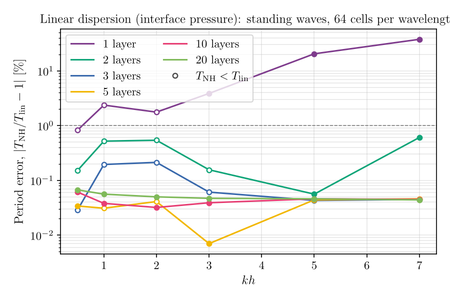
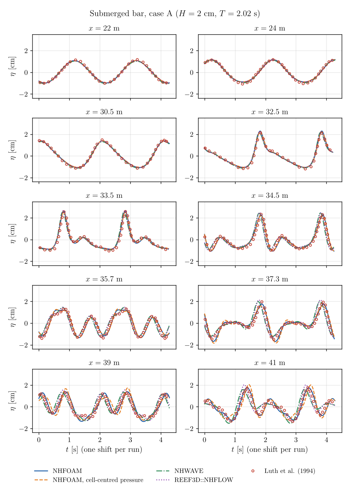
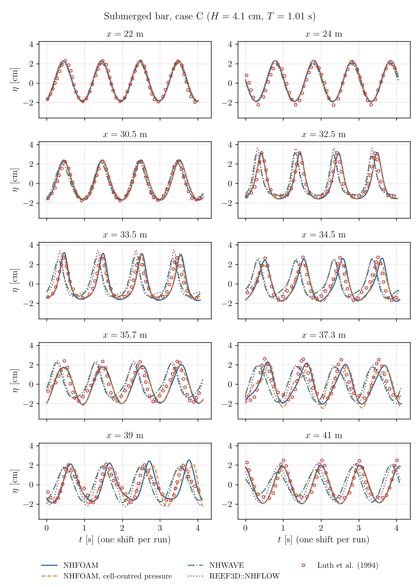
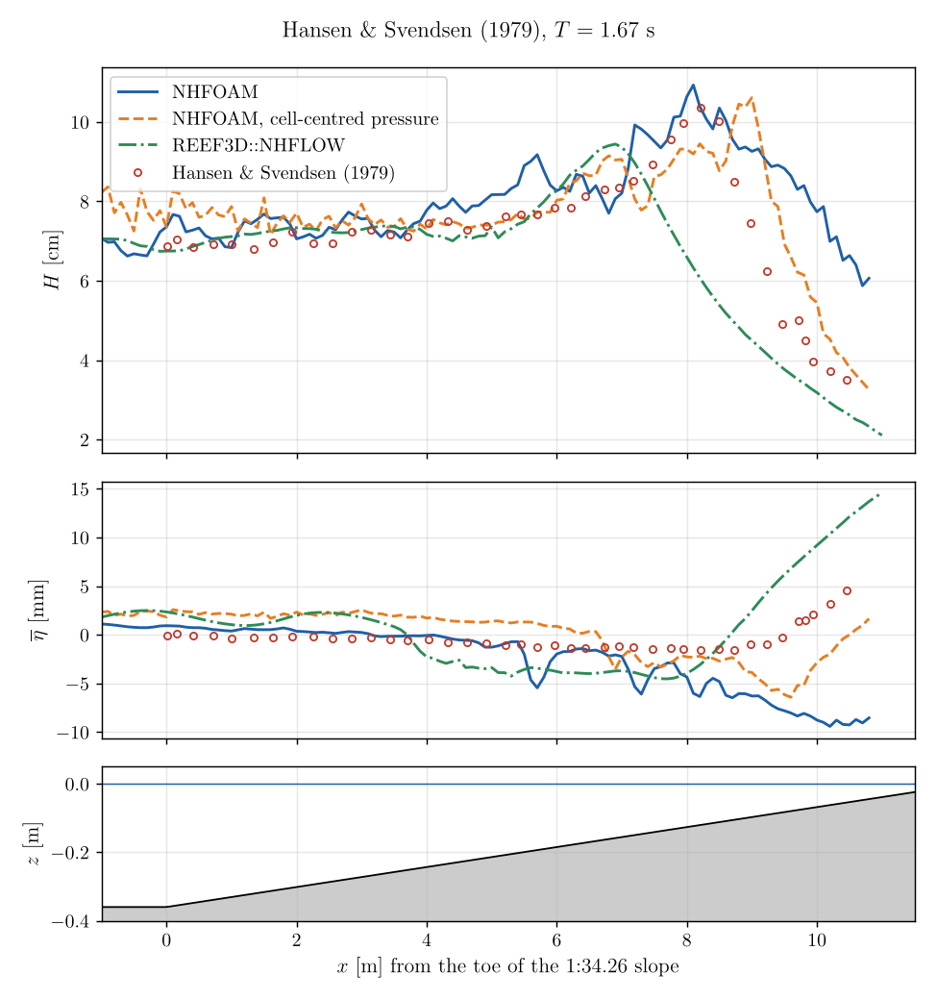
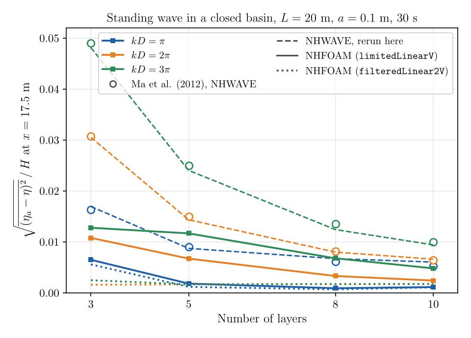

# NHFOAM

**A non-hydrostatic, free-surface wave model for OpenFOAM**, in the spirit of
NHWAVE and SWASH, on surface- and terrain-following (σ) meshes that can be
**unstructured in the horizontal**.

NHFOAM solves the incompressible Navier–Stokes equations for water only. The
free surface z = η(x, y, t) is the top boundary of a σ-mesh that moves with it.
Because it lives inside OpenFOAM, the horizontal mesh can be any 2D mesh
(quads, triangles, polygons) extruded into vertical columns. It also uses
OpenFOAM's parallelism, boundary conditions, turbulence models, fvOptions and
function objects.

> Status: research code. 2DV and 3D, pressure on the layer interfaces as in
> NHWAVE (2–3 layers resolve dispersion up to kh = 7), second order in time,
> prescribed seabed motion (tsunami generation, solid landslides) and
> depth-induced breaking with the hydrostatic front approximation. No wetting
> and drying yet. See *Limitations* and *Roadmap* below.


---

## 1. Method

**Pressure.** The kinematic pressure is written as

    p_rgh = p/ρ + g z = g η + q

where `g η` is the hydrostatic part and `q` is the non-hydrostatic part. The
momentum equation is

    ∂U/∂t + ∇·(φ_rel U) − ∇·(ν_eff ∇U) = −∇p_rgh  (+ relaxation-zone forcing)

Gravity never appears explicitly, so still water stays exactly at rest on any
mesh, however skewed the σ-cells are over steep bathymetry.

**Where the pressure lives (`pressureLocation`).** Two vertical arrangements
are available:

- `interface` (default), as in NHWAVE and SWASH: p_rgh is stored on the
  layer interfaces (σ-levels). There is one unknown on the bottom face of
  every cell (the bed and the internal interfaces) and one surface unknown
  per column, p_s = g η^{n+1}, so that q = 0 exactly at the free surface.
  Inside a cell the vertical gradient is compact, (p_top − p_bottom)/Δz.
  A cell's centre value is the mean of its two interfaces, and the
  horizontal gradient is the mean of the two interface gradients (NHWAVE's
  choice). In practice, the momentum equation takes the Gauss gradient with
  the interface values on the layer faces and the interpolated centre values
  on the side faces. Continuity is imposed on interface-centred control
  volumes, half a cell above and half a cell below each interface, as in
  NHWAVE's Poisson equation. Each side face gives half of its flux to the
  interface below and half to the one above, and the vertical fluxes at the
  cell centres connect neighbouring interfaces. After the solve, the side
  fluxes follow from the differences of the centre values. The layer fluxes
  are then integrated upward from the bed, so every cell conserves volume
  exactly, and η^{n+1} follows from the flux through the surface.
- `cell`: OpenFOAM's usual cell-centred pressure, with the free-surface
  condition applied as a Robin condition (below). For the same dispersion it
  needs more layers, up to ten times as many for short waves (section 5.2),
  and a step costs about two thirds of an interface step.

**Interface pressure matrix.** The unknowns are the interface values of all
cells plus one surface value per column. The flux through a side face depends
on the difference of the two centre values, so it couples the four
interfaces of its two cells (the bottom and top interfaces of the owner and
of the neighbour). Each cell couples its own two interfaces, and the
surface row holds the kinematic condition. The matrix is symmetric positive
definite, but it is not diagonally dominant where layers are thicker than
the horizontal spacing, and incomplete Cholesky (DIC) can then break down. NHFOAM solves it
with PCG and the `sigmaColumn` preconditioner. This preconditioner solves
the tridiagonal block of each column exactly (line relaxation in the
vertical), so it also handles thin layers and the strong vertical coupling
of breaking columns. On ordinary matrices it falls back to DIC, so a case can
name it in either layout. Three kinds of terms would need more couplings, so
they are lagged and updated in every non-orthogonal corrector:

- the non-orthogonal correction of the side faces;
- the part of the vertical flux through sloping σ-planes that comes from the
  gradient along the layer. The flux is split as in OpenFOAM's over-relaxed
  `corrected` Laplacian. If S_mid is the area vector of the cell's sloping
  mid-plane and A the column area (its vertical component), the implicit
  vertical coefficient carries |S_mid|² = A² + |S_mid,h|², not just A². The
  lagged part then holds no vertical pressure difference, and the iteration
  converges however steep the layers are. With A² alone, it diverged under
  the bore fronts of the breaking case (5.6);
- on processor boundaries, the couplings to the cell above the remote cell.
  The face is written in a compact form that bounds the exact one, and the
  difference is lagged, so the iteration converges.

**σ-mesh motion (ALE).** Each face of the `surface` patch defines one water
column. Points move only vertically:

    z = z_b + σ (η − z_b)

σ ∈ [0, 1] is taken from the initial mesh, so any vertical grading is kept.
η is stored per column and interpolated to the surface points with
horizontal inverse-distance weights, synchronised across processors. The
equations are solved in physical coordinates on the moving mesh. There are no
σ-transformation metric terms, and OpenFOAM's swept-volume mesh fluxes handle
space conservation.

**Semi-implicit free surface.** The kinematic condition

    (η^{n+1} − η̂)/a = φ_s/A_h

(where φ_s is the absolute flux through the surface face and A_h the
horizontal column area) is combined with the dynamic condition
p_rgh = g η^{n+1}. In the interface layout this is simply the equation of the
surface unknown of each column: with η^{n+1} = p_s/g and the relaxation
zones,

    A_h ((1 + a σ_z) p_s/g − η̂ − a σ_z η_t)/a = φ_s

In the cell layout the two conditions give a **Robin condition** for p_rgh
on the surface patch, implemented through OpenFOAM's `mixed` patch field:

    p_rgh_s  = f·refValue + (1 − f)·p_rgh_c
    refValue = g (η̂ + a σ_z η_t + a φHbyA_s/A_h)/(1 + a σ_z)
    f        = (1 + a σ_z)/(1 + a σ_z + β),   β = g a rAU_f |S_f| Δ_f / A_h

Either way, each pressure solve delivers q and η^{n+1} together. There is
no gravity-wave Courant limit, the matrix stays symmetric, and no pressure
reference is needed. Volume is conserved to round-off in closed basins.
Time integration follows `ddt(U)`: Euler, or backward (BDF2, with
variable-Δt coefficients) for both U and η. Here
η̂ = (c₀ ηⁿ − c₀₀ ηⁿ⁻¹)/c, a = Δt/c, and σ_z and η_t are the relaxation rate
and target of the forcing zones.

**Algorithm per time step** (PIMPLE):

1. Move the mesh to the extrapolated surface. Optionally, move it to the
   latest η in every outer corrector (`moveMeshOuterCorrectors`).
2. Rebuild the flux on the moved faces from the face velocity Uf, and make it
   relative to the mesh motion. In the first outer corrector, Uf is
   extrapolated from the last two time levels,
   (1 + r) Uf<sup>n</sup> − r Uf<sup>n−1</sup> with r = Δt/Δt₀
   (`fluxExtrapolation`, default with backward). Convecting with the flux of
   level n instead makes the scheme only first order in time for nonlinear
   waves: a solitary wave of H/h = 0.5 lost three times more height and fell
   0.8 m behind in 150 m (section 6.2).
3. Momentum predictor, with the pressure gradient of the last corrector.
4. Pressure correctors. Each one solves for the interface pressures and p_s
   (or, in the cell layout, sets the surface Robin coefficients from φHbyA
   and solves for p_rgh), then updates the flux, η^{n+1}, U and Uf.

**Wave generation and absorption.** Relaxation zones relax U and η towards a
target with rate σ(χ) = σ_max χⁿ, implicitly in both the momentum equation and
the surface condition. Type `wave` uses a linear (Airy) target and both
generates and absorbs waves. Type `sponge` uses still water and only absorbs.

**Moving bottom.** A prescribed displacement z_b = z_b0 + Δz(x, y, t) moves
the bottom points, and the σ-mesh follows. The new boundary condition
`nhMovingSlipVelocity` gives the fluid the bottom's normal velocity
(slip tangentially), so the flux through the bottom equals the swept volume.
The free-surface condition needs no change, because the surface flux already
contains the volume pushed up by the bottom. Two motions are built in:
- `uplift`: a box raised with an exponential (Hammack 1973), half-cosine or
  linear time history;
- `slide`: a rigid quasi-Gaussian slide moving down a plane slope with the
  law of motion s(t) = s₀ ln cosh(t/t₀) (Grilli & Watts 2005; Enet & Grilli
  2007).

**Breaking: hydrostatic front approximation (HFA).** This follows Smit,
Zijlema & Stelling (2013). A column starts breaking when
∂η/∂t > α√(gD) and keeps breaking, or spreads to a neighbouring column, while
∂η/∂t > β√(gD). Inside breaking columns the non-hydrostatic pressure is
switched off: the vertical coupling of the column in the pressure matrix is
multiplied by a large factor (`hydrostaticFactor`). In the interface layout
this is the coefficient between the two interfaces of each cell, up to the
surface unknown. In the cell layout it is an extra coupling across the layer
faces plus a large mobility of the surface face. p_rgh is then uniform in the
vertical (q = 0, since the surface value is g η), and the fluxes through the
layer faces follow from continuity. The factor acts on the vertical
difference of the pressure only. Scaling the face mobility itself would also
scale the non-orthogonal correction on the sloping layer faces, i.e. the
horizontal pressure gradient under a steep front, which drives spurious
vertical fluxes.

The wave front then travels as a bore. The conservative momentum equation
with a TVD convection scheme dissipates its energy.

**Convection.** For waves that do not break, use filtered central
differencing, `Gauss filteredLinear2V 0.2 0`: it damps as little as central
differencing, and its filter on grid-scale oscillations kept it stable in
40–65 s runs over the submerged bar and in 3D. The TVD scheme
`Gauss limitedLinearV 1` damps steep short waves even when they do not break
(8.5% of a standing wave at kD = 3π in 30 s, against 1.7%; section 6.1), but
bores need it, so breaking cases keep it. Plain central differencing
(`Gauss linear`) fails in long nonlinear runs and behind bores.

---

## 2. Building

You need the ESI OpenFOAM line (openfoam.com).

```sh
source /usr/lib/openfoam/openfoam2512/etc/bashrc   # or your own installation
./Allwmake
```

This builds:

| target | what |
|---|---|
| `libNHFOAM` | σ-column structure, mesh motion, the interface pressure matrix and the `sigmaColumn` preconditioner, linear wave theory, relaxation zones, seabed motion, the `nhMovingSlipVelocity` condition |
| `NHFOAM` | the solver |
| `nhSetWaves` | initial conditions: `standing`, `solitary`, `linear`, `circularMode` |

*Compatibility.* The code was compiled and run with OpenFOAM v1912. Every API
call was checked against the v2512 headers, and only calls present in both
versions are used. `./Allwclean` removes the build.

---

## 3. Setting up a case

**Mesh.** Use a vertical extrusion between a top patch (`surface`) and a
bottom patch (`bottom`). Mesh points must lie on vertical lines. Any of these
works:

- `blockMesh` with vertical block edges (sloping bottoms are fine);
- `extrudeMesh` from a 2D mesh;
- gmsh `Extrude {…} {Layers{n}; Recombine;}`, then `gmshToFoam`.

Build the bathymetry into the mesh, with the top of the mesh at the still
water level. The solver detects the columns at start-up and reports
`Sigma columns: N columns ..., layers per column n`.

**Layers.** With the interface pressure (the default), uniform layers are
best: 2 layers keep the period error of standing waves within 0.6% up to
kh = 7 and 3 layers within 0.21% (section 5.2). Refining the layers towards
the surface does not help in this layout. With `pressureLocation cell`, many
more layers are needed (about 20 at kh = 7), and a blockMesh `simpleGrading`
of 0.25–0.5 in z (top layer a quarter to half the bottom one) cuts the
period error at kh = 5 from 5.8% to 2.1% with 5 layers.

**Fields** (`0/`):

| field | `surface` | `bottom` / walls | notes |
|---|---|---|---|
| `U` | `zeroGradient` | `slip` or `noSlip` | |
| `p_rgh` | **`mixed`** | `fixedFluxPressure` | the mixed coefficients are overwritten by NHFOAM; in the interface layout, walls and bottom must be flux conditions (`fixedFluxPressure` or `zeroGradient`) |
| `eta` | `zeroGradient` | `zeroGradient` | free-surface elevation; one value per column (all cells of a column carry it) |

Outputs: `eta`, `q` (non-hydrostatic pressure), `p` (total p/ρ), `p_rgh`, `U`,
and in the interface layout `pI` (p_rgh on the bottom interface of each
cell).

**`constant/NHFOAMProperties`:**

```c++
surfacePatch    surface;     // top patch (default: surface)
bottomPatch     bottom;      // bottom patch (default: bottom)
minDepth        1e-4;        // smallest depth used to place mesh points
stillWaterLevel 0;           // reference for relaxation-zone targets
pressureLocation interface;  // pressure on the layer interfaces (default) or
                             // at the cell centres (cell)

gauges                       // free-surface time series of the nearest column
{                            // -> postProcessing/gauges/<t0>/eta.dat
    G1  (5.7 0 0);
}

forcingZones
{
    inlet                    // generation + absorption
    {
        type        wave;
        start       (8 0 0); // sigma = 0 here ...
        end         (0 0 0); // ... sigmaMax here
        sigmaMax    20;      // [1/s]
        exponent    2;
        waveHeight  0.02;  wavePeriod 2.02;  depth 0.4;
        direction   (1 0 0);
        rampTime    4.04;
    }
    outlet
    {
        type        sponge;
        start       (46 0 0);
        end         (54 0 0);
        sigmaMax    20;
        // relaxEta false;   // damp the velocity only and keep the water
                             // volume (e.g. ahead of a truncated beach, where
                             // the wave setup must not be drained)
    }
}
```

Optional entries in the same file:

```c++
breaking                     // hydrostatic front approximation
{
    model       HFA;
    alpha       0.6;         // onset:       d(eta)/dt > alpha sqrt(g D)
    beta        0.3;         // persistence: d(eta)/dt > beta  sqrt(g D)
    hydrostaticFactor 1000;  // extra vertical coupling in breaking columns
}

bottomMotion                 // prescribed seabed motion
{
    type        uplift;      // or slide (see src/NHFOAM/bottomMotion)
    min         (-0.305 -1 0);
    max         ( 0.305  1 0);
    amplitude   0.0005;      // [m], + up
    history     exponential; // exponential | halfCosine | linear
    riseTime    0.1;         // [s]
}

bottomMotion                 // rigid slide on a plane slope
{
    type        slide;
    centre      (0.551 0 0); // initial horizontal position of the centre
    direction   (1 0 0);     // down-slope direction
    slopeAngle  15;          // [deg]
    thickness   0.082;       // T, normal to the slope
    length      0.395;       // b, along the slope
    width       0.680;       // w, across (<= 0: 2D slide)
    epsilon     0.717;       // shape parameter of the sech^2 profile
    terminalVelocity     1.70;   // u_t: s(t) = (u_t^2/a_0) ln cosh(a_0 t/u_t)
    initialAcceleration  1.12;   // a_0
}
```

With a moving bottom, use `nhMovingSlipVelocity` for U on the bottom patch,
and add `libs ("libNHFOAM.so");` to `system/controlDict` so that utilities
such as `decomposePar` know that condition.

You also need `constant/g` (along −z), `transportProperties` and
`turbulenceProperties`, as in pimpleFoam.

**`system/fvSchemes`: full ddt flux correction and low-dissipation
convection.**

```c++
ddtSchemes { default backward 1; }        // "1" = ddtPhiCoeff
divSchemes
{
    div(phi,U)  Gauss filteredLinear2V 0.2 0;  // waves that do not break
//  div(phi,U)  Gauss limitedLinearV 1;        // TVD, where waves break
}
```

Without the ddt coefficient, OpenFOAM limits its Rhie–Chow ddt correction
and waves are visibly damped. In our standing-wave test, amplitude loss went
from 3.9% to 0.09% over 4.5 periods once the coefficient was set. NHFOAM
prints a warning if it is missing. Euler works, but it is far too
dissipative for wave propagation. Upwind-biased convection (`linearUpwind`,
`LUST`) damps progressive waves of moderate steepness, and the TVD
`limitedLinearV` damps steep short waves (section 6.1). Central
differencing (`Gauss linear`) damps least, but grid-scale noise grows in
long nonlinear runs and behind bores, and the runs fail; the filtered
version `filteredLinear2V 0.2 0` does not have this problem in the tests so
far, except with bores.

**Time step.** Resolve the shortest wave that matters, not only the peak
period. Behind the submerged bar, halving Δt to 5 ms (T/400 in case A,
T/200 in case C) cut the rms error by 40% and 60%, because the free higher
harmonics there have periods of T/2 and T/3 (see 5.4).

**`system/fvSolution`, PIMPLE:**

| entry | value |
|---|---|
| `nOuterCorrectors` | 1 (with flux extrapolation, a second one changes nothing in the tests) |
| `nCorrectors` | 2–3 |
| `nNonOrthogonalCorrectors` | 1 over sloping beds (it also updates the lagged terms of the interface matrix) |
| `fluxExtrapolation` | `true` (default with backward): second order in time with one outer corrector |
| `moveMeshOuterCorrectors` | `false` (default) |
| `ddtCorr` | `true` (default) |

**Pressure solver.** In the interface layout, use

```c++
p_rgh
{
    solver          PCG;
    preconditioner  sigmaColumn;   // falls back to DIC in the cell layout
    tolerance       1e-10;
    relTol          0.01;
}
```

The interface matrix is solved by NHFOAM's own lduMatrix with the controls
of `p_rgh`. Only PCG and PBiCGStab are used: other solvers (GAMG, smooth
solvers) are replaced by PCG, and any preconditioner except `diagonal` and
`none` by `sigmaColumn`. The unknowns are written as the field `pI` (the
pressure on the bottom interface of each cell); `p_rgh` holds the cell-centre
values, as in the cell layout.

**Initial conditions.** Set them with `nhSetWaves` (`system/nhSetWavesDict`).
NHFOAM moves the mesh onto the initial η at start-up.

**Parallel.** Whole columns must stay on one processor, so use the
`structured` decomposition method on the bottom patch:

```c++
method structured;
structuredCoeffs { method simple; patches (bottom); simpleCoeffs { n (2 1 1); } }
```

---

## 4. Tutorials

| case | what it shows |
|---|---|
| `standingWave` | 2DV closed basin, kh = 1, 10 layers: linear dispersion |
| `solitaryWave` | 2DV, H/h = 0.1, flat bottom: nonlinear propagation |
| `submergedBar` | Beji & Battjes (1993) / Luth et al. (1994) case A: shoaling, harmonic generation, wave-making and sponge zones; `Allrun-parallel` runs it on 2 processors |
| `circularBasin` | **3D unstructured** triangular-prism mesh (gmsh): first sloshing mode of a circular basin |
| `bottomUplift` | 2DV tsunami generation by a bottom uplift (Hammack 1973 type), `nhMovingSlipVelocity` bottom |
| `landslide3D` | 3D rigid slide of Enet & Grilli (2007), NTHMP landslide benchmark 2, on a coarse mesh (about 3.5 min on one core); `Allrun-parallel` for 2 processors |
| `breakingSlope` | Hansen & Svendsen (1979) spilling breakers on a 1:34 slope with the hydrostatic front approximation and a velocity-only sponge (about 8 min) |

Each case runs with `./Allrun` and cleans with `./Allclean`. `validation/`
holds the scripts used to generate cases and make the figures below
(`make_case.py` builds every validation case).

The figures are typeset with LaTeX (Computer Modern), and `doc/figures` has
both PNG and vector PDF versions. Regenerating them needs `latex`, `dvipng`
and the `cm-super` fonts; without them, the scripts fall back to
matplotlib's own Computer Modern.

---

## 5. Verification and comparison with NHWAVE and REEF3D::NHFLOW

*These runs predate the fixes of section 6: they use `limitedLinearV` and
one outer corrector without flux extrapolation.*

Where possible, the benchmarks below were also run with two established
non-hydrostatic σ-layer models, on the same set-up: the same domain, bottom,
gauges, horizontal spacing and number of layers. Each model keeps its own
numerics and its usual wave input.

| | NHFOAM | NHWAVE | REEF3D::NHFLOW |
|---|---|---|---|
| version | this repository | `JimKirby/NHWAVE` master (1483007), MPI + HYPRE 3.2 | 26.08 (conda-forge build) |
| vertical pressure | layer interfaces (default) or cell centres | layer interfaces (σ-levels) | as distributed |
| momentum advection, time | `limitedLinearV` (TVD), BDF2 | HLPA TVD, 2nd-order Runge–Kutta | WENO reconstruction, HLL fluxes (defaults) |
| time step (bar) | fixed, 5 ms | adaptive, CFL 0.5 (≈ 4.6 ms) | adaptive, CFL 1 (≈ 9.7 ms) |
| wave input (bar) | 8 m relaxation zone, linear | linear, at the left boundary | 8 m relaxation zone, linear |
| absorption (bar) | 8 m sponge | 8 m sponge | 8 m relaxation zone |

`validation/other_models.py` writes their input files and reads their gauge
output, and the plotting scripts accept `nhwave:<dir>` and `reef3d:<dir>`
next to NHFOAM cases. REEF3D::NHFLOW has no slide model, so the landslide
runs are NHFOAM and NHWAVE only. SWASH could not be included: its only
download site was not reachable from the build machine.

### 5.1 Basic checks

Interface pressure (the default) unless noted.

| test | result |
|---|---|
| Still water over the bar bathymetry (1:20 and 1:10 slopes), 10 s | η ≡ 0 (exact); max\|U\| below 10⁻¹² m/s (round-off) and exactly 0 at the end |
| Volume conservation, closed basins | round-off: 10⁻¹⁴ m³ or less (2DV and 3D) |
| Standing wave, kh = 1, 10 layers, T/Δt = 200 | period +0.04%, amplitude −0.04% over 4.5 T (cell layout: +0.13%, −0.03%) |
| Solitary wave, H/h = 0.1, 10 layers | speed 3.283 m/s between x = 10 and 30 m vs √(g(h+H)) = 3.285; height −0.2% from x = 10 to 40 m |
| Circular basin, 3D unstructured prisms, 8 layers | period +0.07% vs analytical Bessel mode (cell layout: +0.20%) |
| Serial vs 2-processor run (solitary wave crossing the processor boundary) | max \|Δη\| = 7·10⁻⁸ m (H = 0.1 m) |
| Bottom uplift, ζ₀/h = 0.01, 5 layers | peaks within 1.5% of linear potential theory up to x/b = 20; volume conserved to 10⁻¹⁶ m³ |


### 5.2 Dispersion and layer distribution



Standing waves in closed basins, 64 cells per wavelength, T/Δt = 200,
uniform layers, period from 4.5 periods. Period error:

| layers | interface layout (default), kh = 1 / 3 / 7 | cell layout, kh = 1 / 3 / 7 |
|---|---|---|
| 1 | −2.4 / +3.9 / +38% | +6.9 / +35 / +91% |
| 2 | −0.52 / −0.16 / +0.61% | +1.9 / +12 / +42% |
| 3 | −0.20 / −0.06 / +0.05% | +0.88 / +5.9 / +24% |
| 5 | −0.03 / +0.01 / +0.05% | +0.36 / +2.2 / +10.5% |
| 10 | +0.04 / +0.04 / +0.05% | +0.13 / +0.61 / +3.0% |
| 20 | +0.06 / +0.05 / +0.04% | +0.08 / +0.19 / +0.79% |

With 5 or more layers, what is left (−0.04 to +0.07%) comes from Δx and Δt.
In the cell layout, keeping the error below 1% takes about 3 layers for
kh ≤ 1, 5–6 for kh ≤ 2, 10 for kh ≤ 4 and 20 for kh ≤ 7. The interface layout
needs 2 for all of them. `validation/run_dispersion_study.sh` reproduces the
table (`PRESSURE=cell` for the cell layout).


Refining the layers towards the surface no longer helps. With 3 layers, a
top layer a quarter of the bottom one moves the error at kh = 1–2 from
−0.2% to −0.45%, and at kh = 5 it stays at +0.05%. (In the cell layout the
same grading cut the error at kh = 5 from 5.8% to 2.1% with 5 layers.)


**Against NHWAVE** (same basins and resolution, same analysis). NHWAVE keeps
the period error within 0.8% with 2 layers and 0.45% with 3; NHFOAM within
0.61% and 0.21%. With 10–20 layers both converge, NHWAVE to −0.17% and
NHFOAM to +0.05%. NHWAVE damps more. After 4.5 periods, NHWAVE has lost
0.6–12% of the amplitude with 3 layers and 0.6–3.5% with 10. NHFOAM has lost
0.04–1.3% and 0.04–0.7%. The cell-centred results are shown dotted. Before
the interface arrangement, they were NHFOAM's main disadvantage against
NHWAVE.

### 5.3 Convection and the decay of progressive waves


Waves of H = 4.1 cm and T = 1.01 s in 0.4 m of water (kh = 1.69, 10 layers,
Δx = 2 cm, interface pressure) lose 6.1% of their height over 12 m
(8 wavelengths) with `linearUpwind`, 4.7% with `LUST`, 4.4% with
`limitedLinearV` and 3.9% with central differencing. With the cell-centred
pressure the same runs lost 12%, 6.2%, 3.3% and 1.7%. The interface layout
thus narrows the spread between the schemes but adds some damping of steep
waves to the central and TVD schemes. Waves of H = 0.4 cm lose 0.7% over
10 m with `linearUpwind` (1.5% with the cell-centred pressure), so the
damping grows with steepness. Central differencing damps least, but over
longer runs it fails (5.4), so the default is `limitedLinearV`. The waves
leave the wave-making zone about 4% higher than the linear target, a
nonlinear effect of generating them with linear theory.

The phase speed of the small waves (H = 0.4 cm) is 0.24% below linear
theory (10 uniform layers, T/Δt = 100). With the cell-centred pressure it
was 0.60% below. About 0.13% of it is the BDF2 time step, and the layers
contribute less than 0.05% (5.2). The steep waves (H = 4.1 cm) travel 0.74%
below the linear speed (0.87% with the cell layout), where third-order
Stokes theory makes them 0.9% faster than linear waves. We have not
separated this deficit; the long waves and mean flows of the closed flume
(5.4) are a likely part of it.

### 5.4 Submerged bar (Luth et al. 1994)




All three models: Δx = 2 cm and 10 uniform layers. NHFOAM: interface
pressure, `limitedLinearV`, Δt = 5 ms; its cell-centred layout is shown for
reference. One time shift, fitted at x = 22 m, is applied to all gauges of
a run, and ΔH is the error of max − min over the lab record. All runs are
compared over the same window, the last 4 s before t = 50 s
(`validation/plot_bar.py --tend 50`). By then the wave train has reached the
last gauge (x = 41 m) about 10 periods earlier in case C. Why the window has
to be the same for all models is explained below.

| | NHFOAM | NHFOAM, cell layout | NHWAVE | REEF3D::NHFLOW |
|---|---|---|---|---|
| case A, rms over the 10 gauges | 0.17 cm | 0.21 cm | 0.29 cm | 0.25 cm |
| case A, mean \|ΔH\|/H | 5.1% | 6.6% | 4.7% | 6.3% |
| case C, rms over the 10 gauges | 0.65 cm | 0.59 cm | 1.02 cm | 0.92 cm |
| case C, mean \|ΔH\|/H | 4.9% | 4.7% | 6.1% | 5.1% |

In front of the bar (x ≤ 30.5 m) all models are within 0.06–0.42 cm rms of
the measurements. On and behind the bar, NHFOAM has the smallest errors at
every gauge in case C (0.46–0.90 cm, against 1.0–1.5 cm for the other two)
and at 6 of the 7 gauges in case A. In case C the difference is mostly
phase: NHWAVE and REEF3D::NHFLOW are 0.1–0.18 s early over the bar crest,
and NHFOAM is up to 0.1 s late. At x = 32.5–33.5 m in case C, where the lab
height drops from 4.5 to 4.2 cm (the lab waves seem to break slightly
there), NHFOAM's heights are 6–18% high and REEF3D::NHFLOW's 8–15%. NHWAVE
is within 3% there and 9–15% low just behind the bar.

**Long waves of the flume.** The phase over the bar changes with the time
at which it is measured, in all three models. Between t = 45 and 65 s, the
first harmonic at x = 35.7 m moves relative to x = 22 m. In NHFOAM it moves
0.21 s later, in NHWAVE 0.08 s later, and in REEF3D::NHFLOW 0.07 s earlier;
REEF3D's first-harmonic amplitude on the crest also drops by 20%. These
changes come with mean water levels that vary by a few millimetres along
the flume: ±2 mm in NHFOAM (+1.6 mm at 22 m and −1.8 mm behind the bar at
t = 65 s), ±1 mm in the other two. These are long waves of the closed flume,
released when the wave train starts and when it crosses the bar, which the
8 m zones absorb only partly. Over the 0.1 m deep crest, the current of such
a wave (a few cm/s) shifts the waves by tenths of a second. The rms error
over the 10 gauges therefore depends on the window, and so does the
ranking. Case C:

| window ending at | NHFOAM | NHFOAM, cell layout | NHWAVE | REEF3D::NHFLOW |
|---|---|---|---|---|
| 45 s | 0.49 cm | 0.47 cm | 1.08 cm (41 m not yet settled) | 0.93 cm |
| 50 s | 0.65 cm | 0.59 cm | 1.02 cm | 0.92 cm |
| 55 s | 0.94 cm | 0.77 cm | 0.97 cm | 0.92 cm |
| 60 s | 1.18 cm | 1.04 cm | 0.89 cm | 0.98 cm |
| 65 s | 1.39 cm | 1.19 cm | 0.77 cm | 1.10 cm |

NHFOAM's long waves are the largest of the three and shift its phase the
most. The lab flume had long waves of its own, which no model reproduces,
so the comparison above uses the earliest window in which all gauges are
settled. Volume-conserving wave-making zones and long-wave absorption
(roadmap) would make long runs comparable.

Behind the bar, the interface pressure also made NHFOAM's records nearly
periodic. Over the last 15 periods of case C, the heights at 37–41 m vary by
at most ±7% from wave to wave. With the cell-centred pressure they varied by
±25% (at 41 m between 3.5 and 5.7 cm, lab 3.9 cm), and the irregularity
reached the gauges in front of the bar after about 60 s.

Two numerical settings matter as much as the model (cell layout,
50 s windows):
- **Time step.** With Δt = 10 ms instead of 5 ms, NHFOAM's single-shift rms
  error was 65% higher in case A and 150% higher in case C. The free third
  harmonic behind the bar (T/3 = 0.34 s in case C) gets only 34 steps per
  period with Δt = 10 ms, and the phase error of BDF2 grows with the square
  of Δt/T.
- **Convection.** Central differencing failed after 62 s (case A) and 53 s
  (case C) with Δt = 5 ms; `limitedLinearV` runs to the end. `linearUpwind`
  loses 17% of the wave height before the bar in case C.

The bar measurements (digitised) are in the FUNWAVE-TVD benchmark
repository, `fengyanshi/BENCHMARK_FUNWAVE/car_luth_AC/lab_data`, and are not
redistributed here.

### 5.5 Seabed motion


**Bottom uplift** (Hammack 1973 type). A block of half-width b = 0.305 m
rises by ζ₀ = 0.5 mm in h = 5 cm of water with the exponential history
(t_c = 0.1 s). With 5 layers and Δx = 5 mm, the peaks at x/b = 0–20 are within
1.5% of linear potential theory, and the dispersive tail follows it. The two
pressure layouts differ by less than 2% of ζ₀ at any gauge.


**3D rigid landslide** (Enet & Grilli 2007, NTHMP benchmark 2, d = 61 mm).
Half tank, symmetry wall on the axis. NHFOAM: Δx = Δy = 2.5 cm, 5 uniform
layers (141 000 cells); the domain starts 0.2 m from the shoreline (no
wetting and drying). In deep water the layers are up to 12 times thicker
than Δx, so the interface matrix needs about 180 PCG iterations per solve.
The run takes 51 min on one core for 4 s, about 1.6 times the CPU time of
the cell layout. NHWAVE: its own benchmark set-up
(`examples/landslide_benchmarks/BM2_enet_grilli`: Δx = 2 cm, 3 layers, full
beach), with the gauges moved to the published positions. No time shift is
applied.

| gauge | first trough, lab / NHFOAM / NHFOAM cell layout / NHWAVE [mm] | first crest [mm] |
|---|---|---|
| g2 (1.469, 0.35) | −13.7 / −15.3 / −14.9 / −14.9 | 15.0 / 16.7 / 15.2 / 16.3 |
| g3 (1.929, 0) | −17.0 / −17.7 / −18.0 / −17.1 | 22.2 / 23.9 / 22.5 / 20.5 |
| g4 (1.919, 0.5) | −9.4 / −10.2 / −9.5 / −9.6 | 11.0 / 13.0 / 11.6 / 12.3 |

All runs get the leading trough within 12%. The leading crest is 8–18% high
with the interface pressure, 1–5% with the cell-centred pressure, and
between −7% and +12% for NHWAVE. NHFOAM has the leading waves on time,
NHWAVE about 0.05 t₀ early. The trailing waves (kh = 3–5) are where the
interface pressure matters. They now follow the measured phase, as NHWAVE's
do; with the cell-centred pressure they were too slow and fell further
behind with every wave. Their amplitude is still too large: the third and
fourth crests are up to 2–3 times the measured ones, while NHWAVE follows
the measured decay. The wall that replaces NHFOAM's beach also affects them
after t/t₀ ≈ 1.5. The lab records are in the same NHWAVE example folder.

### 5.6 Breaking



**Spilling breakers** (Hansen & Svendsen 1979, test 061071): T = 1.67 s,
H = 6.9 cm at the toe of a 1:34.26 slope from h = 0.36 m. 10 layers,
Δx = 2 cm, Δt = 10 ms, HFA with α = 0.6 and β = 0.3, `limitedLinearV`. The
slope is cut at x = 11 m (h = 3.9 cm) and continues as a 3 m shelf with a
velocity-only sponge (`relaxEta false`). The run covers 40 periods (8 min on
one core with the interface pressure, 5 min with the cell layout), and the
statistics use the last 10.

| H (mean of max − min per period) | lab | NHFOAM (interface) | NHFOAM (cell) |
|---|---|---|---|
| near the toe, x < 1 m | 6.9–7.0 cm | −1% to +9% | +8% to +17% |
| shoaling, x = 2–7 m | 7.0–8.4 cm | −4% to +20% | −2% to +9% |
| largest | 10.4 cm at x = 8.2 m | 10.9 cm at x = 8.1 m | 10.6 cm at x = 9.0 m |
| surf zone, x = 8.3–11 m | 10.0 → 3.5 cm | +3% to +99% | −12% to +47% |
| rms before / after x = 8.3 m | | 0.55 / 2.98 cm | 0.56 / 1.79 cm |
| rms over all lab points | | 1.55 cm | 1.01 cm |

With the interface pressure, the incident waves are within a few percent of
the lab at the toe, and the waves break where they did in the flume: the
largest height is 5% high and 0.1 m from the measured position (the cell
layout broke 0.8 m too far inshore). Inside the surf zone, however, the
bores lose too little energy. They keep a sawtooth shape of 7–8 cm down to
x = 10 m, where the lab heights have halved. Through the surf zone, the
breaking switch flags about 7 columns at a time in both layouts. So the
onset is right, and the dissipation of the hydrostatic bores is what falls
short. The strong bores also reach the shallow end of the flume
(h < 6 cm). There, between t = 28 and 43 s, their troughs fell below the bed
for a few periods. The mesh survives this through `minDepth`, but those
values are not physical; the statistics window (the last 10 periods) is
clear of it. Without a beach, the mean water level
is off in both layouts: the interface run has a set-down of up to 9 mm in
the surf zone, against a measured setup of 4.5 mm.

The bore fronts are where the lagged terms of the interface matrix matter
most. With only the horizontal projection of the sloping mid-plane in the
implicit vertical coefficient, the pressure correctors diverged under the
first steep bores. This happened after 22 s, with a fixed or an adaptive
time step alike. The over-relaxed split described in section 1 fixed it.

**REEF3D::NHFLOW** on the same case, with the full beach (it has wetting and
drying), 10 layers, Δx = 2.5 cm, an 8 m linear wave zone and its breaking
algorithm (`A 550 1`, onset parameter 0.6), breaks too early instead:
largest H 9.4 cm at x = 6.9 m, rms 1.5 cm. Its incident waves are within 4%
of the lab at the toe, and inshore of x = 8.3 m its heights are 18–46% low. It overpredicts the setup at the shoreline
(14 mm at x = 11 m against 4.5 mm measured at 10.5 m). Neither model gets
this case right with default breaking parameters: the onset is the hard
part. NHWAVE is not included yet: our run of this case (10 layers, k–ε,
full beach) stopped after 4 s of simulated time without an error message.

NHFOAM does not reproduce the mean water level. There is no beach to hold
the setup, and the wave-making zone fixes the mean level offshore. With a
full sponge (η relaxed to zero) on the shelf, water drains out through the
sponge until the shelf dries and the run fails after 37 periods; the
velocity-only sponge keeps the volume.

The plunging case of the same experiments (T = 3.33 s, Ursell number 33)
needs nonlinear wave generation. With a linear target, the incident waves
are about 15% too low and change shape from gauge to gauge.

Making the HFA work in the cell layout needed two fixes to the first
implementation:
- Scaling the face mobility of the layer faces also scaled the explicit
  non-orthogonal correction, i.e. the horizontal pressure gradient on the
  sloping layer faces under the front. The large coupling is now applied to
  the difference of the cell values only.
- Overwriting the cell-centred w with values reconstructed from the face
  fluxes is ill-conditioned on the nearly vertical faces of a bore front and
  made the runs fail. The vertical momentum is now left alone, and the
  layer-face fluxes alone carry continuity.

Bores also need a TVD convection scheme everywhere. With central
differencing away from the breaking columns, grid-scale oscillations grow
behind the bores and the run fails within a wave period of the first
breaking. In the cell layout, the switch is also sensitive to the time
step: with Δt = 5 ms instead of 10 ms, the same case fails after 11
periods.

---

## 6. Validation against NHWAVE: the tests of Ma et al. (2012)

Ma, Shi & Kirby (2012) introduced NHWAVE with seven tests. They were run here
with NHWAVE and NHFOAM on the same set-ups, from the simplest upwards, and
each was used to look for weaknesses of NHFOAM before moving on.
`validation/ma2012.py` writes the cases for both models.

| test (Ma et al. 2012) | reference | status |
|---|---|---|
| 4.1 standing wave in a closed basin, kD = π, 2π, 3π | linear theory | 6.1 |
| 4.2 solitary wave, H/h = 0.5 | exact solution | 6.2 |
| 4.3 periodic waves over a submerged bar | Luth et al. (1994) | 6.3 |
| 4.4 elliptic shoal on a 1:50 slope | Berkhoff et al. (1982) | runs in progress |
| 4.5 breaking solitary wave run-up | Synolakis (1987) | needs wetting and drying |
| 4.6 3D rigid landslide, d = 61 mm | Enet & Grilli (2007) | 5.5 (rerun with the fixes in progress) |
| 4.7 longshore current on a plane beach | Visser (1991) | needs wetting and drying |

Two of the tests changed the code and its defaults: the standing waves
showed that the TVD scheme damps steep short waves, and the solitary wave
that the time integration was only first order for nonlinear waves.

### 6.1 Standing wave in a closed basin



L = 20 m (one wavelength), a = 0.1 m, D = 10, 20, 30 m, Δx = 0.2 m, 30 s;
normalised rms error at x = 17.5 m against linear theory, as in the paper.
Our NHWAVE runs reproduce the published errors to within 0.1 percentage
points. NHFOAM's error is 2.5–4 times smaller with `limitedLinearV` and
3–20 times smaller with `filteredLinear2V 0.2 0`:

| kD | layers | Ma et al. | NHWAVE | NHFOAM, limitedLinearV | NHFOAM, filteredLinear2V |
|---|---|---|---|---|---|
| π | 3 / 5 / 10 | 1.63 / 0.90 / 0.53% | 1.69 / 0.87 / 0.60% | 0.65 / 0.18 / 0.11% | 0.56 / 0.12 / 0.11% |
| 2π | 3 / 5 / 10 | 3.07 / 1.50 / 0.64% | 3.05 / 1.43 / 0.66% | 1.08 / 0.67 / 0.24% | 0.16 / 0.16 / 0.17% |
| 3π | 3 / 5 / 10 | 4.90 / 2.50 / 1.00% | 4.81 / 2.40 / 0.94% | 1.28 / 1.17 / 0.48% | 0.25 / 0.17 / 0.17% |

The difference between the two schemes is damping: at kD = 3π with 3
layers, `limitedLinearV` loses 8.5% of the amplitude in 30 s,
`filteredLinear2V` 1.7%. The damping is nonlinear (a wave ten times smaller
loses 0.09%) and does not depend on Δt.

### 6.2 Solitary wave


H/h = 0.5, h = 1 m, Δx = 0.1 m, 3 layers, 40 s (150 m). Both models start
from the exact solution of Babenko's equation (`validation/solitary_exact.py`,
Petviashvili iteration to a residual of 1e-13). Peaks of η, and of u and w at
mid-depth, after 40 s:

| run | η | u | w | crest | CPU |
|---|---|---|---|---|---|
| NHWAVE (CFL 0.5) | −2.3% | −0.7% | +0.4% | −0.08 m | 570 s |
| NHFOAM before the fix (Δt = 5 ms) | −6.4% | −4.3% | −4.6% | −0.77 m | 240 s |
| … with Δt = 10 ms / 2.5 ms | −10.3% / −4.4% | −7.6% / −2.6% | −9.4% / −2.2% | −1.37 / −0.47 m | |
| … with 2 (or 3) outer correctors | −2.3% | −0.9% | +0.2% | −0.17 m | 390 s |
| NHFOAM, flux extrapolation | −2.3% | −0.9% | +0.3% | −0.17 m | 210 s |
| NHFOAM, flux extrapolation, `filteredLinear2V` | **−1.0%** | **−0.2%** | **+1.6%** | **−0.07 m** | 210 s |

Before the fix the error grew linearly with Δt: the convection term was
linearised with the flux of the previous time level, a first-order error.
Neither the convection scheme, 5 layers nor a non-orthogonal corrector
changed it, and a second outer corrector gave the same result whether the
mesh was moved again or not. Extrapolating the convecting flux removes the
error at no cost. With `filteredLinear2V` the wave then keeps its height
after an initial adjustment of about 1%.

### 6.3 Submerged bar with 3 layers


NHWAVE's own example (`examples/submerged_bar`: boundary wavemaker, 10 m
sponge, Δx = 2 cm, 3 layers, CFL 0.5, bottom friction Cd = 0.006 as
distributed) with all ten gauges, against NHFOAM on the same domain with an
8 m wave zone upstream of NHWAVE's wavemaker, Δt = 5 ms. 40 s runs, compared
with Luth et al. case A over the last 4 s, one time shift per run:

| | NHFOAM | NHWAVE | NHFOAM before the fix |
|---|---|---|---|
| rms error over the 10 gauges | 0.31 cm | 0.24 cm | 0.16 cm |
| mean \|ΔH\|/H | 4.9% | 3.8% | 4.6% |
| phase at x = 35.7–41 m relative to x = 22 m | 0.05–0.08 s early | 0.03–0.08 s early | 0.01–0.035 s early |

After the fix NHFOAM's waves over and behind the bar are as early as
NHWAVE's, by up to 0.08 s. Before it they were closer to the measured phase,
because the first-order lag slowed them by about 0.5%, the same lag that
delayed the solitary wave; with the fix, halving Δt moves the phase by less
than 0.005 s. Most of the rms error is this phase error, which both models
share. A second outer corrector, filtered convection or the TVD
scheme change the rms error by less than 0.02 cm.

## 7. Limitations (this version)

- **No wetting and drying.** The depth is only limited by `minDepth`. Runup,
  inundation and the wave setup at the shoreline are not possible yet;
  beaches have to end in a wall or a shelf with a sponge.
- **Breaking (HFA) is a first version.** It has been tested on one case
  only (spilling breakers, 5.6). With the interface pressure, the breaking
  point is within 0.1 m of the measured one, but the bores lose too little
  energy in the surf zone, and the wave heights there are up to twice the
  measured ones. Breaking columns spread only to neighbours on the same
  processor.
- **Wave generation** is by relaxation zones with linear (Airy) targets only.
  Steep or long waves (high Ursell number) carry spurious free harmonics.
  There is no boundary wavemaker and no irregular, cnoidal or stream-function
  input.
- **Restarts** do not save the BDF2 history of η or Uf. The first step after
  a restart is Euler without flux extrapolation, and the flux is rebuilt
  from U.
- **Long waves in closed flumes.** The relaxation zones absorb long waves
  only partly, and the wave-making zone does not conserve volume (no return
  current for the Stokes drift). Long waves of a few millimetres therefore
  build up in closed flumes. Over the submerged bar they shift the phase of
  the waves by about 0.2 s within 20 s of simulated time, more than in
  NHWAVE and REEF3D::NHFLOW (5.4). Compare long runs at the same times.
- **Phase over the submerged bar.** With 3 layers, NHFOAM and NHWAVE both
  have the waves behind the bar up to 0.08 s early (6.3). The cause (linear
  wave generation, long waves of the flume) is not yet identified.

## 8. Roadmap

Done since the first version: prescribed seabed motion (uplift, rigid
slides), the hydrostatic front approximation, central convection,
surface-refined layers, velocity-only sponges, the pressure on the layer
interfaces (NHWAVE's arrangement) with a column preconditioner, and, from
the tests of Ma et al. (2012), second-order time integration (extrapolated
convecting flux) and filtered central convection for non-breaking waves.

The comparisons with NHWAVE and REEF3D::NHFLOW (sections 5 and 6) set the
order. Wetting and drying comes first now: it is what the remaining tests of
Ma et al. (4.5 and 4.7) need.

1. Wetting/drying with thin-film columns and q switched off in very shallow
   water, so that beaches, runup and setup can be modelled.
2. Breaking: the dissipation of the hydrostatic bores in the surf zone
   (momentum-conserving face depths at the fronts, or a small eddy
   viscosity there), a kinematic B = u/c onset trigger, and stabilised k–ω
   (Larsen & Fuhrman 2018) for many-layer runs.
3. Steady long runs: volume-conserving wave-making zones (with a return
   current for the Stokes drift, as in a closed flume) and absorbing zones
   that also take out the long waves of the flume (see 5.4).
4. Nonlinear wave generation (stream function, cnoidal) and irregular
   spectra in the relaxation zones; a boundary wavemaker.
5. Depth-integrated granular slides on a finite-area mesh for landslide
   tsunamis (NTHMP benchmarks 4–5).
6. One-way, then two-way, coupling to interFoam/sedInterFoam relaxation
   zones.
7. Hybrid meshes: a fixed body-fitted region around structures, with σ-layers
   only near the surface; porous media (Darcy–Forchheimer fvModel).

## 9. References

- Ma, G., Shi, F., Kirby, J.T. (2012). Shock-capturing non-hydrostatic model
  for fully dispersive surface wave processes. *Ocean Modelling* 43–44, 22–35.
- Stelling, G., Zijlema, M. (2003). An accurate and efficient finite-difference
  algorithm for non-hydrostatic free-surface flow with application to wave
  propagation. *IJNMF* 43, 1–23.
- Zijlema, M., Stelling, G.S. (2005). Further experiences with computing
  non-hydrostatic free-surface flows involving water waves. *IJNMF* 48,
  169–197.
- Zijlema, M., Stelling, G., Smit, P. (2011). SWASH: an operational public
  domain code for simulating wave fields and rapidly varied flows in coastal
  waters. *Coastal Engineering* 58, 992–1012.
- Smit, P., Zijlema, M., Stelling, G. (2013). Depth-induced wave breaking in a
  non-hydrostatic, near-shore wave model. *Coastal Engineering* 76, 1–16.
- Babenko, K.I. (1987). Some remarks on the theory of surface waves of
  finite amplitude. *Soviet Math. Dokl.* 35, 599–603.
- Clamond, D., Dutykh, D. (2013). Fast accurate computation of the fully
  nonlinear solitary surface gravity waves. *Computers & Fluids* 84, 35–38.
- Berkhoff, J.C.W., Booy, N., Radder, A.C. (1982). Verification of numerical
  wave propagation models for simple harmonic linear water waves. *Coastal
  Engineering* 6, 255–279.
- Synolakis, C.E. (1987). The runup of solitary waves. *JFM* 185, 523–545.
- Visser, P.J. (1991). Laboratory measurements of uniform longshore currents.
  *Coastal Engineering* 15, 563–593.
- Beji, S., Battjes, J.A. (1993). Experimental investigation of wave
  propagation over a bar. *Coastal Engineering* 19, 151–162.
- Luth, H.R., Klopman, G., Kitou, N. (1994). Kinematics of waves breaking
  partially on an offshore bar. Delft Hydraulics report H1573.
- Hammack, J.L. (1973). A note on tsunamis: their generation and propagation
  in an ocean of uniform depth. *JFM* 60, 769–799.
- Grilli, S.T., Watts, P. (2005). Tsunami generation by submarine mass failure.
  I: Modeling, experimental validation, and sensitivity analyses. *J. Waterway,
  Port, Coastal, Ocean Eng.* 131, 283–297.
- Enet, F., Grilli, S.T. (2007). Experimental study of tsunami generation by
  three-dimensional rigid underwater landslides. *J. Waterway, Port, Coastal,
  Ocean Eng.* 133, 442–454.
- Hansen, J.B., Svendsen, I.A. (1979). Regular waves in shoaling water:
  experimental data. Series Paper 21, ISVA, Technical University of
  Denmark.
- Jacobsen, N.G., Fuhrman, D.R., Fredsøe, J. (2012). A wave generation toolbox
  for the open-source CFD library: OpenFoam. *IJNMF* 70, 1073–1088.
- Larsen, B.E., Fuhrman, D.R. (2018). On the over-production of turbulence
  beneath surface waves in Reynolds-averaged Navier–Stokes models. *JFM* 853,
  419–460.

## License

GPL-3.0-or-later, as OpenFOAM.
