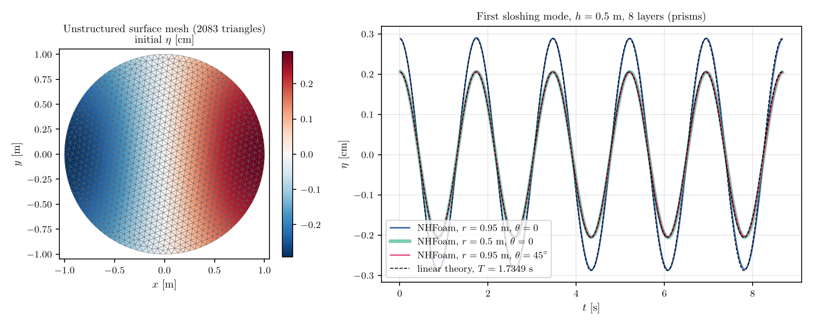

# NHFoam

**A non-hydrostatic, free-surface wave model for OpenFOAM**, in the spirit of
NHWAVE and SWASH, on surface- and terrain-following (σ) meshes that can be
**unstructured in the horizontal**.

NHFoam solves the incompressible Navier–Stokes equations for water only. The
free surface z = η(x, y, t) is the top boundary of a σ-mesh that moves with it.
Because it lives inside OpenFOAM, the horizontal mesh can be any 2D mesh
(quads, triangles, polygons) extruded into vertical columns. It also uses
OpenFOAM's parallelism, boundary conditions, turbulence models, fvOptions and
function objects.

> Status: first working version (2DV and 3D, non-breaking waves, fixed
> bathymetry). See *Limitations* and *Roadmap* below.

---

## 1. Method

**Pressure.** The kinematic pressure is written as

    p_rgh = p/ρ + g z = g η + q

where `g η` is the hydrostatic part and `q` is the non-hydrostatic part. The
momentum equation is

    ∂U/∂t + ∇·(φ_rel U) − ∇·(ν_eff ∇U) = −∇p_rgh  (+ relaxation-zone forcing)

Gravity never appears explicitly, so still water stays exactly at rest on any
mesh, however skewed the σ-cells are over steep bathymetry.

**σ-mesh motion (ALE).** Each face of the `surface` patch defines one water
column. Points move only vertically:

    z = z_b + σ (η − z_b)

σ ∈ [0, 1] is taken from the initial mesh, so any vertical grading is kept.
η is stored per column and interpolated to the surface points with
horizontal inverse-distance weights, synchronised across processors. The
equations are solved in physical coordinates on the moving mesh. There are no
σ-transformation metric terms, and OpenFOAM's swept-volume mesh fluxes handle
space conservation.

**Semi-implicit free surface.** The kinematic condition

    (η^{n+1} − η̂)/a = φ_s/A_h

(where φ_s is the absolute flux through the surface face and A_h the
horizontal column area) is inserted into the dynamic condition
p_rgh = g η^{n+1}. Together they give a **Robin condition** for p_rgh on the
surface patch, implemented through OpenFOAM's `mixed` patch field:

    p_rgh_s  = f·refValue + (1 − f)·p_rgh_c
    refValue = g (η̂ + a σ_z η_t + a φHbyA_s/A_h)/(1 + a σ_z)
    f        = (1 + a σ_z)/(1 + a σ_z + β),   β = g a rAU_f |S_f| Δ_f / A_h

Each pressure solve therefore delivers q and η^{n+1} together. There is no
gravity-wave Courant limit, the matrix stays symmetric, and no pressure
reference is needed. Volume is conserved to round-off in closed basins.
Time integration follows `ddt(U)`: Euler, or backward (BDF2, with
variable-Δt coefficients) for both U and η. Here
η̂ = (c₀ ηⁿ − c₀₀ ηⁿ⁻¹)/c, a = Δt/c, and σ_z and η_t are the relaxation rate
and target of the forcing zones.

**Algorithm per time step** (PIMPLE):

1. Move the mesh to the extrapolated surface. Optionally, move it to the
   latest η in every outer corrector (`moveMeshOuterCorrectors`).
2. Rebuild the flux on the moved faces from the face velocity Uf, and make it
   relative to the mesh motion.
3. Momentum predictor.
4. Pressure correctors. Each one sets the surface Robin coefficients from
   φHbyA, solves for p_rgh, then updates the flux, η^{n+1}, U and Uf.

**Wave generation and absorption.** Relaxation zones relax U and η towards a
target with rate σ(χ) = σ_max χⁿ, implicitly in both the momentum equation and
the surface condition. Type `wave` uses a linear (Airy) target and both
generates and absorbs waves. Type `sponge` uses still water and only absorbs.

---

## 2. Building

You need the ESI OpenFOAM line (openfoam.com).

```sh
source /usr/lib/openfoam/openfoam2512/etc/bashrc   # or your own installation
./Allwmake
```

This builds:

| target | what |
|---|---|
| `libNHFoam` | σ-column structure, mesh motion, linear wave theory, relaxation zones |
| `NHFoam` | the solver |
| `nhSetWaves` | initial conditions: `standing`, `solitary`, `linear`, `circularMode` |

*Compatibility.* The code was compiled and run with OpenFOAM v1912. Every API
call was checked against the v2512 headers, and only calls present in both
versions are used. `./Allwclean` removes the build.

---

## 3. Setting up a case

**Mesh.** Use a vertical extrusion between a top patch (`surface`) and a
bottom patch (`bottom`). Mesh points must lie on vertical lines. Any of these
works:

- `blockMesh` with vertical block edges (sloping bottoms are fine);
- `extrudeMesh` from a 2D mesh;
- gmsh `Extrude {…} {Layers{n}; Recombine;}`, then `gmshToFoam`.

Build the bathymetry into the mesh, with the top of the mesh at the still
water level. The solver detects the columns at start-up and reports
`Sigma columns: N columns ..., layers per column n`.

**Fields** (`0/`):

| field | `surface` | `bottom` / walls | notes |
|---|---|---|---|
| `U` | `zeroGradient` | `slip` or `noSlip` | |
| `p_rgh` | **`mixed`** | `fixedFluxPressure` | the mixed coefficients are overwritten by NHFoam |
| `eta` | `zeroGradient` | `zeroGradient` | free-surface elevation; one value per column (all cells of a column carry it) |

Outputs: `eta`, `q` (non-hydrostatic pressure), `p` (total p/ρ), `p_rgh`, `U`.

**`constant/NHFoamProperties`:**

```c++
surfacePatch    surface;     // top patch (default: surface)
bottomPatch     bottom;      // bottom patch (default: bottom)
minDepth        1e-4;        // smallest depth used to place mesh points
stillWaterLevel 0;           // reference for relaxation-zone targets

gauges                       // free-surface time series of the nearest column
{                            // -> postProcessing/gauges/<t0>/eta.dat
    G1  (5.7 0 0);
}

forcingZones
{
    inlet                    // generation + absorption
    {
        type        wave;
        start       (8 0 0); // sigma = 0 here ...
        end         (0 0 0); // ... sigmaMax here
        sigmaMax    20;      // [1/s]
        exponent    2;
        waveHeight  0.02;  wavePeriod 2.02;  depth 0.4;
        direction   (1 0 0);
        rampTime    4.04;
    }
    outlet
    {
        type        sponge;
        start       (46 0 0);
        end         (54 0 0);
        sigmaMax    20;
    }
}
```

You also need `constant/g` (along −z), `transportProperties` and
`turbulenceProperties`, as in pimpleFoam.

**`system/fvSchemes`: use full ddt flux correction.**

```c++
ddtSchemes { default backward 1; }   // "1" = ddtPhiCoeff
```

Without the coefficient, OpenFOAM limits its Rhie–Chow ddt correction and
waves are visibly damped. In our standing-wave test, amplitude loss went from
3.9% to 0.09% over 4.5 periods once the coefficient was set. NHFoam prints a
warning if it is missing. Euler works, but it is far too dissipative for
wave propagation.

**`system/fvSolution`, PIMPLE:**

| entry | value |
|---|---|
| `nCorrectors` | 2–3 |
| `nNonOrthogonalCorrectors` | 1 over sloping beds |
| `moveMeshOuterCorrectors` | `false` (default) |
| `ddtCorr` | `true` (default) |

**Initial conditions.** Set them with `nhSetWaves` (`system/nhSetWavesDict`).
NHFoam moves the mesh onto the initial η at start-up.

**Parallel.** Whole columns must stay on one processor, so use the
`structured` decomposition method on the bottom patch:

```c++
method structured;
structuredCoeffs { method simple; patches (bottom); simpleCoeffs { n (2 1 1); } }
```

---

## 4. Tutorials

| case | what it shows |
|---|---|
| `standingWave` | 2DV closed basin, kh = 1, 10 layers: linear dispersion |
| `solitaryWave` | 2DV, H/h = 0.1, flat bottom: nonlinear propagation |
| `submergedBar` | Beji & Battjes (1993) / Luth et al. (1994) case A: shoaling, harmonic generation, wave-making and sponge zones; `Allrun-parallel` runs it on 2 processors |
| `circularBasin` | **3D unstructured** triangular-prism mesh (gmsh): first sloshing mode of a circular basin |

Each case runs with `./Allrun` and cleans with `./Allclean`. `validation/`
holds the scripts used to generate cases and make the figures below.

The figures are typeset with LaTeX (Computer Modern), and `doc/figures` has
both PNG and vector PDF versions. Regenerating them needs `latex`, `dvipng`
and the `cm-super` fonts; without them, the scripts fall back to
matplotlib's own Computer Modern.

---

## 5. Verification

| test | result |
|---|---|
| Still water over the bar bathymetry (1:20 and 1:10 slopes), 10 s | max\|U\| = 0, η ≡ 0 (exact) |
| Volume conservation, closed basins | 10⁻¹⁸ (2DV) to 10⁻¹² (3D) m³ |
| Standing wave, kh = 1, 10 layers, T/Δt = 200 | period +0.13%, amplitude −0.07% over 4.5 T |
| Solitary wave, H/h = 0.1, 10 layers | speed 3.281 m/s vs √(g(h+H)) = 3.285; height −0.5% after 30 m |
| Circular basin, 3D unstructured prisms, 8 layers | period +0.21% vs analytical Bessel mode; mode shape (cos 45°) 0.710 vs 0.707 |
| Serial vs 2-processor run (solitary wave) | max \|Δη\| = 1.7·10⁻⁸ m |
| Submerged bar, case A | see figure and note below |


**Dispersion with layers.** The pressure is cell-centred, as everywhere in
OpenFOAM, so more layers are needed than with the Keller-box arrangement of
SWASH/Basilisk for the same accuracy. To keep the period error below 1%:

| kh | layers needed |
|---|---|
| ≤ 1 | about 3 |
| ≤ 2 | 5–6 |
| ≤ 4 | about 10 |
| ≤ 7 | about 20 |




**Submerged bar, case A.** One time shift, fitted at x = 22 m, is applied
to all gauges.

| gauges | rms error, 10 layers, Δx = 0.02 m |
|---|---|
| upslope and bar crest (22–33.5 m) | 0.06–0.2 cm |
| behind the bar (34.5–41 m) | 0.36–0.57 cm |

Behind the bar, the free higher harmonics drift in phase and the crest at
37.3 m is about 22% low. This is not a resolution effect:

| run | rms at 41 m |
|---|---|
| 10 layers, Δx = 0.02 m | 0.57 cm |
| 20 layers, Δx = 0.02 m (2 processors) | 0.50 cm |
| 10 layers, Δx = 0.01 m | 0.54 cm |
| 10 layers, Δx = 0.02 m, central convection | 0.62 cm |

Fitting the time shift separately at each gauge lowers the behind-bar errors
to 0.2–0.3 cm. The best-fit shift grows steadily with distance, by 0.1 s from
22 m to 41 m. Possible causes still to check:
- the time referencing of the digitised data;
- spurious free harmonics from the linear wave-making zone;
- a direct comparison with NHWAVE/FUNWAVE on the same gauges.

The bar measurements (digitised) are in the FUNWAVE-TVD benchmark
repository, `fengyanshi/BENCHMARK_FUNWAVE/car_luth_AC/lab_data`, and are not
redistributed here.

---

## 6. Limitations (this version)

- **No wetting and drying.** The depth is only limited by `minDepth`. Runup
  and inundation are not possible yet.
- **No wave-breaking model.** Breaking would need a hydrostatic-front
  approximation, a breaking-onset criterion and/or a stabilised turbulence
  closure. The single-valued surface also excludes overturning by design.
- **Fixed bottom.** There is no moving seabed or landslide layer yet.
- **Wave generation** is by relaxation zones only. There is no boundary
  wavemaker and no irregular or spectral input.
- **Restarts** do not save the BDF2 history of η or Uf. The first step after
  a restart is Euler, and the flux is rebuilt from U.
- **Dispersion per layer** is lower than with a Keller-box layout (see above).

## 7. Roadmap

1. Interface (Keller-box) vertical pressure arrangement, or optimised layer
   distributions, for fewer layers.
2. Wetting/drying with thin-film columns and q switched off in very shallow
   water.
3. Breaking: hydrostatic front approximation (Smit et al. 2013), a kinematic
   B = u/c onset trigger, and stabilised k–ω (Larsen & Fuhrman 2018) for
   many-layer runs.
4. Moving bottom: prescribed motion, then a depth-integrated granular slide on
   a finite-area mesh for landslide tsunamis (NTHMP benchmarks).
5. One-way, then two-way, coupling to interFoam/sedInterFoam relaxation
   zones.
6. Hybrid meshes: a fixed body-fitted region around structures, with σ-layers
   only near the surface.
7. Boundary wavemakers, irregular waves, porous media (Darcy–Forchheimer
   fvModel).

## 8. References

- Ma, G., Shi, F., Kirby, J.T. (2012). Shock-capturing non-hydrostatic model
  for fully dispersive surface wave processes. *Ocean Modelling* 43–44, 22–35.
- Stelling, G., Zijlema, M. (2003). An accurate and efficient finite-difference
  algorithm for non-hydrostatic free-surface flow with application to wave
  propagation. *IJNMF* 43, 1–23.
- Zijlema, M., Stelling, G.S. (2005). Further experiences with computing
  non-hydrostatic free-surface flows involving water waves. *IJNMF* 48,
  169–197.
- Zijlema, M., Stelling, G., Smit, P. (2011). SWASH: an operational public
  domain code for simulating wave fields and rapidly varied flows in coastal
  waters. *Coastal Engineering* 58, 992–1012.
- Smit, P., Zijlema, M., Stelling, G. (2013). Depth-induced wave breaking in a
  non-hydrostatic, near-shore wave model. *Coastal Engineering* 76, 1–16.
- Beji, S., Battjes, J.A. (1993). Experimental investigation of wave
  propagation over a bar. *Coastal Engineering* 19, 151–162.
- Luth, H.R., Klopman, G., Kitou, N. (1994). Kinematics of waves breaking
  partially on an offshore bar. Delft Hydraulics report H1573.
- Jacobsen, N.G., Fuhrman, D.R., Fredsøe, J. (2012). A wave generation toolbox
  for the open-source CFD library: OpenFoam. *IJNMF* 70, 1073–1088.
- Larsen, B.E., Fuhrman, D.R. (2018). On the over-production of turbulence
  beneath surface waves in Reynolds-averaged Navier–Stokes models. *JFM* 853,
  419–460.

## License

GPL-3.0-or-later, as OpenFOAM.
