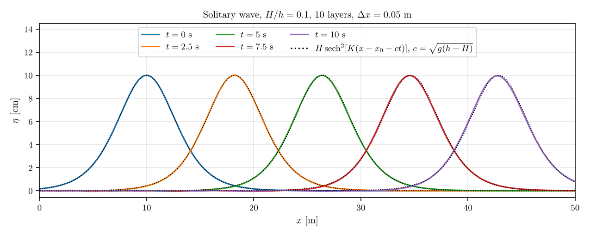
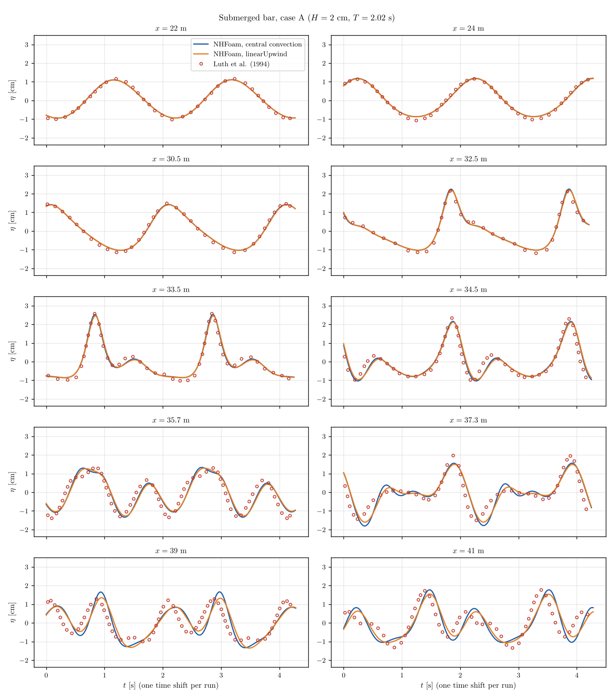
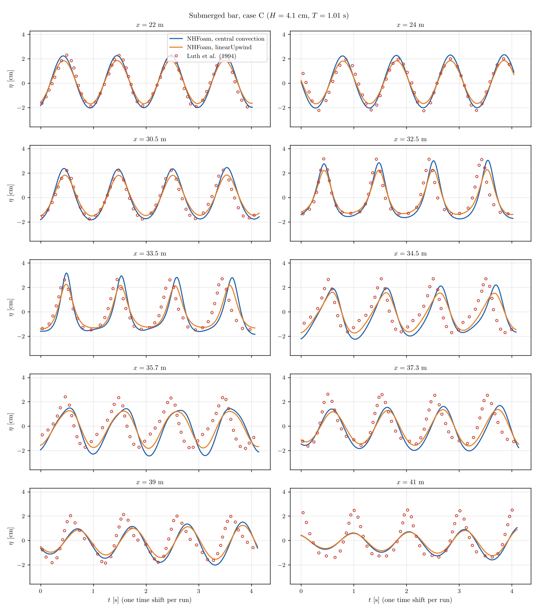
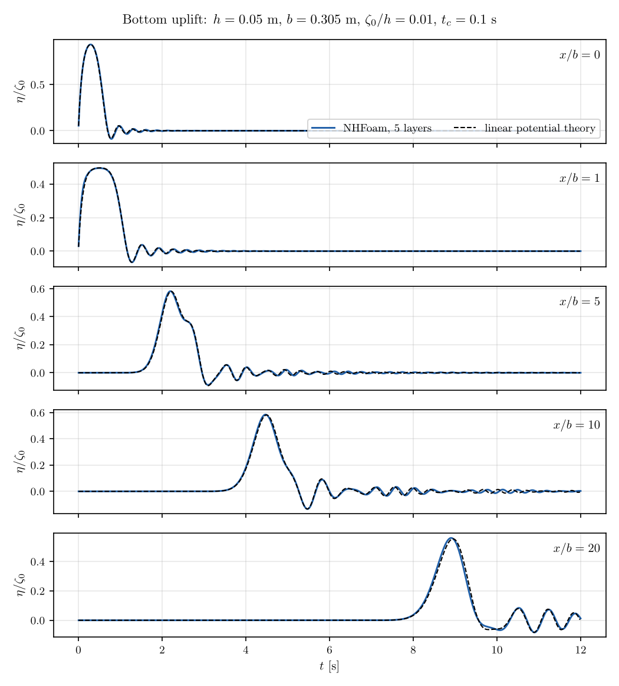
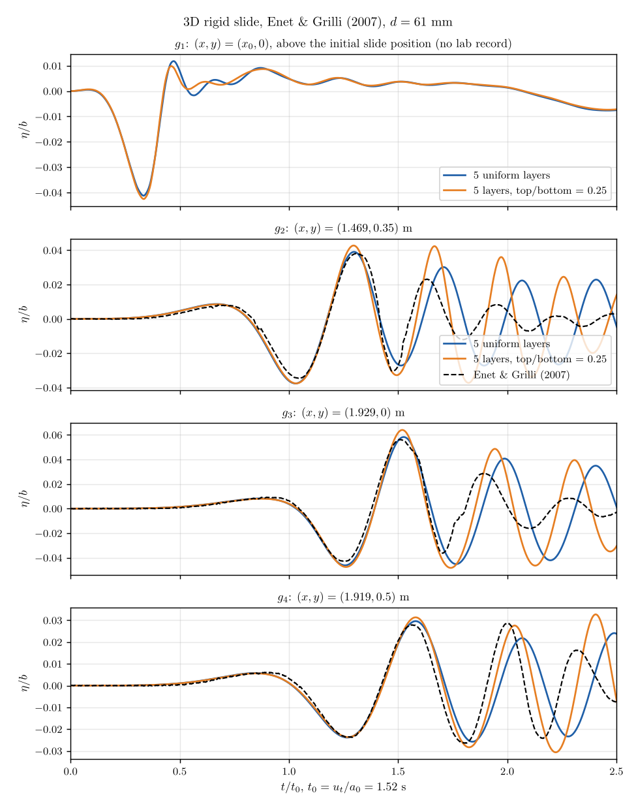
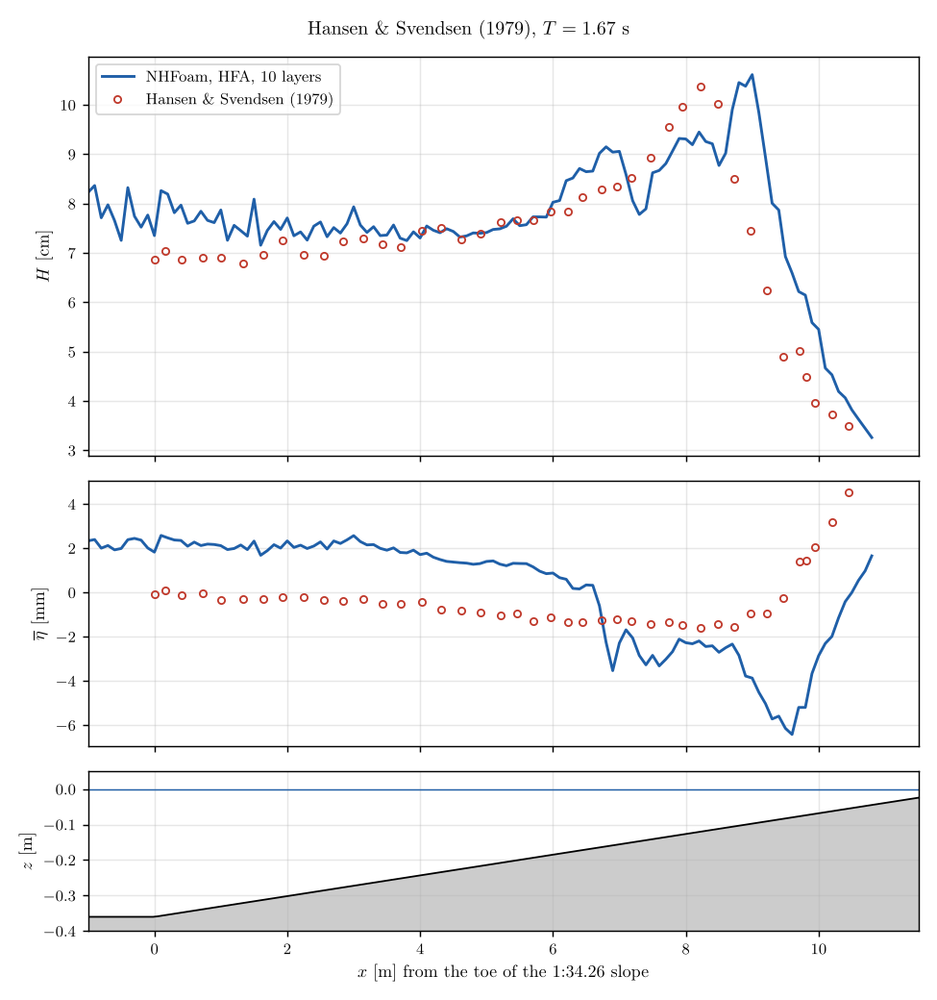

# NHFoam

**A non-hydrostatic, free-surface wave model for OpenFOAM**, in the spirit of
NHWAVE and SWASH, on surface- and terrain-following (σ) meshes that can be
**unstructured in the horizontal**.

NHFoam solves the incompressible Navier–Stokes equations for water only. The
free surface z = η(x, y, t) is the top boundary of a σ-mesh that moves with it.
Because it lives inside OpenFOAM, the horizontal mesh can be any 2D mesh
(quads, triangles, polygons) extruded into vertical columns. It also uses
OpenFOAM's parallelism, boundary conditions, turbulence models, fvOptions and
function objects.

> Status: research code. 2DV and 3D, prescribed seabed motion (tsunami
> generation, solid landslides) and depth-induced breaking with the
> hydrostatic front approximation. No wetting and drying yet. See
> *Limitations* and *Roadmap* below.

---

## 1. Method

**Pressure.** The kinematic pressure is written as

    p_rgh = p/ρ + g z = g η + q

where `g η` is the hydrostatic part and `q` is the non-hydrostatic part. The
momentum equation is

    ∂U/∂t + ∇·(φ_rel U) − ∇·(ν_eff ∇U) = −∇p_rgh  (+ relaxation-zone forcing)

Gravity never appears explicitly, so still water stays exactly at rest on any
mesh, however skewed the σ-cells are over steep bathymetry.

**σ-mesh motion (ALE).** Each face of the `surface` patch defines one water
column. Points move only vertically:

    z = z_b + σ (η − z_b)

σ ∈ [0, 1] is taken from the initial mesh, so any vertical grading is kept.
η is stored per column and interpolated to the surface points with
horizontal inverse-distance weights, synchronised across processors. The
equations are solved in physical coordinates on the moving mesh. There are no
σ-transformation metric terms, and OpenFOAM's swept-volume mesh fluxes handle
space conservation.

**Semi-implicit free surface.** The kinematic condition

    (η^{n+1} − η̂)/a = φ_s/A_h

(where φ_s is the absolute flux through the surface face and A_h the
horizontal column area) is inserted into the dynamic condition
p_rgh = g η^{n+1}. Together they give a **Robin condition** for p_rgh on the
surface patch, implemented through OpenFOAM's `mixed` patch field:

    p_rgh_s  = f·refValue + (1 − f)·p_rgh_c
    refValue = g (η̂ + a σ_z η_t + a φHbyA_s/A_h)/(1 + a σ_z)
    f        = (1 + a σ_z)/(1 + a σ_z + β),   β = g a rAU_f |S_f| Δ_f / A_h

Each pressure solve therefore delivers q and η^{n+1} together. There is no
gravity-wave Courant limit, the matrix stays symmetric, and no pressure
reference is needed. Volume is conserved to round-off in closed basins.
Time integration follows `ddt(U)`: Euler, or backward (BDF2, with
variable-Δt coefficients) for both U and η. Here
η̂ = (c₀ ηⁿ − c₀₀ ηⁿ⁻¹)/c, a = Δt/c, and σ_z and η_t are the relaxation rate
and target of the forcing zones.

**Algorithm per time step** (PIMPLE):

1. Move the mesh to the extrapolated surface. Optionally, move it to the
   latest η in every outer corrector (`moveMeshOuterCorrectors`).
2. Rebuild the flux on the moved faces from the face velocity Uf, and make it
   relative to the mesh motion.
3. Momentum predictor.
4. Pressure correctors. Each one sets the surface Robin coefficients from
   φHbyA, solves for p_rgh, then updates the flux, η^{n+1}, U and Uf.

**Wave generation and absorption.** Relaxation zones relax U and η towards a
target with rate σ(χ) = σ_max χⁿ, implicitly in both the momentum equation and
the surface condition. Type `wave` uses a linear (Airy) target and both
generates and absorbs waves. Type `sponge` uses still water and only absorbs.

**Moving bottom.** A prescribed displacement z_b = z_b0 + Δz(x, y, t) moves
the bottom points, and the σ-mesh follows. The new boundary condition
`nhMovingSlipVelocity` gives the fluid the bottom's normal velocity
(slip tangentially), so the flux through the bottom equals the swept volume.
The free-surface condition needs no change, because the surface flux already
contains the volume pushed up by the bottom. Two motions are built in:
- `uplift`: a box raised with an exponential (Hammack 1973), half-cosine or
  linear time history;
- `slide`: a rigid quasi-Gaussian slide moving down a plane slope with the
  law of motion s(t) = s₀ ln cosh(t/t₀) (Grilli & Watts 2005; Enet & Grilli
  2007).

**Breaking: hydrostatic front approximation (HFA).** This follows Smit,
Zijlema & Stelling (2013). A column starts breaking when
∂η/∂t > α√(gD) and keeps breaking, or spreads to a neighbouring column, while
∂η/∂t > β√(gD). Inside breaking columns the non-hydrostatic pressure is
switched off. The cells of the column are tied together in the pressure
matrix by a large extra coupling across the layer faces, and the surface
face gets a large mobility (`hydrostaticFactor`). p_rgh is then uniform in
the vertical, and the fluxes through the layer faces follow from continuity.
The extra coupling acts on the difference of the two cell values only.
Scaling the face mobility itself would also scale the non-orthogonal
correction on the sloping layer faces, i.e. the horizontal pressure gradient
under a steep front, which drives spurious vertical fluxes.

The wave front then travels as a bore. The conservative momentum equation
with a TVD convection scheme dissipates its energy.

**Convection.** The tutorials and validation cases convect momentum with
central differencing (`Gauss linear`). Upwind-biased schemes damp
progressive waves:
over 8 wavelengths, H = 4.1 cm drops by 12% with `linearUpwind` and by 1.6%
with `Gauss linear` (see *Verification*). Bores need a TVD scheme, so cases
with breaking use `Gauss limitedLinearV 1` (3% over the same distance).

---

## 2. Building

You need the ESI OpenFOAM line (openfoam.com).

```sh
source /usr/lib/openfoam/openfoam2512/etc/bashrc   # or your own installation
./Allwmake
```

This builds:

| target | what |
|---|---|
| `libNHFoam` | σ-column structure, mesh motion, linear wave theory, relaxation zones, seabed motion, the `nhMovingSlipVelocity` condition |
| `NHFoam` | the solver |
| `nhSetWaves` | initial conditions: `standing`, `solitary`, `linear`, `circularMode` |

*Compatibility.* The code was compiled and run with OpenFOAM v1912. Every API
call was checked against the v2512 headers, and only calls present in both
versions are used. `./Allwclean` removes the build.

---

## 3. Setting up a case

**Mesh.** Use a vertical extrusion between a top patch (`surface`) and a
bottom patch (`bottom`). Mesh points must lie on vertical lines. Any of these
works:

- `blockMesh` with vertical block edges (sloping bottoms are fine);
- `extrudeMesh` from a 2D mesh;
- gmsh `Extrude {…} {Layers{n}; Recombine;}`, then `gmshToFoam`.

Build the bathymetry into the mesh, with the top of the mesh at the still
water level. The solver detects the columns at start-up and reports
`Sigma columns: N columns ..., layers per column n`.

**Layers.** For waves up to kh ≈ 1, uniform layers are best. For shorter
waves (kh = 2–5, e.g. the dispersive tail of a landslide tsunami), refine the
layers towards the surface: a blockMesh `simpleGrading` of 0.25–0.5 in z (top
layer a quarter to half the bottom one) cuts the period error at kh = 5 from
5.8% to 2.1% with 5 layers (see *Verification*).

**Fields** (`0/`):

| field | `surface` | `bottom` / walls | notes |
|---|---|---|---|
| `U` | `zeroGradient` | `slip` or `noSlip` | |
| `p_rgh` | **`mixed`** | `fixedFluxPressure` | the mixed coefficients are overwritten by NHFoam |
| `eta` | `zeroGradient` | `zeroGradient` | free-surface elevation; one value per column (all cells of a column carry it) |

Outputs: `eta`, `q` (non-hydrostatic pressure), `p` (total p/ρ), `p_rgh`, `U`.

**`constant/NHFoamProperties`:**

```c++
surfacePatch    surface;     // top patch (default: surface)
bottomPatch     bottom;      // bottom patch (default: bottom)
minDepth        1e-4;        // smallest depth used to place mesh points
stillWaterLevel 0;           // reference for relaxation-zone targets

gauges                       // free-surface time series of the nearest column
{                            // -> postProcessing/gauges/<t0>/eta.dat
    G1  (5.7 0 0);
}

forcingZones
{
    inlet                    // generation + absorption
    {
        type        wave;
        start       (8 0 0); // sigma = 0 here ...
        end         (0 0 0); // ... sigmaMax here
        sigmaMax    20;      // [1/s]
        exponent    2;
        waveHeight  0.02;  wavePeriod 2.02;  depth 0.4;
        direction   (1 0 0);
        rampTime    4.04;
    }
    outlet
    {
        type        sponge;
        start       (46 0 0);
        end         (54 0 0);
        sigmaMax    20;
        // relaxEta false;   // damp the velocity only and keep the water
                             // volume (e.g. ahead of a truncated beach, where
                             // the wave setup must not be drained)
    }
}
```

Optional entries in the same file:

```c++
breaking                     // hydrostatic front approximation
{
    model       HFA;
    alpha       0.6;         // onset:       d(eta)/dt > alpha sqrt(g D)
    beta        0.3;         // persistence: d(eta)/dt > beta  sqrt(g D)
    hydrostaticFactor 1000;  // extra vertical coupling in breaking columns
}

bottomMotion                 // prescribed seabed motion
{
    type        uplift;      // or slide (see src/NHFoam/bottomMotion)
    min         (-0.305 -1 0);
    max         ( 0.305  1 0);
    amplitude   0.0005;      // [m], + up
    history     exponential; // exponential | halfCosine | linear
    riseTime    0.1;         // [s]
}

bottomMotion                 // rigid slide on a plane slope
{
    type        slide;
    centre      (0.551 0 0); // initial horizontal position of the centre
    direction   (1 0 0);     // down-slope direction
    slopeAngle  15;          // [deg]
    thickness   0.082;       // T, normal to the slope
    length      0.395;       // b, along the slope
    width       0.680;       // w, across (<= 0: 2D slide)
    epsilon     0.717;       // shape parameter of the sech^2 profile
    terminalVelocity     1.70;   // u_t: s(t) = (u_t^2/a_0) ln cosh(a_0 t/u_t)
    initialAcceleration  1.12;   // a_0
}
```

With a moving bottom, use `nhMovingSlipVelocity` for U on the bottom patch,
and add `libs ("libNHFoam.so");` to `system/controlDict` so that utilities
such as `decomposePar` know that condition.

You also need `constant/g` (along −z), `transportProperties` and
`turbulenceProperties`, as in pimpleFoam.

**`system/fvSchemes`: full ddt flux correction and central convection.**

```c++
ddtSchemes { default backward 1; }        // "1" = ddtPhiCoeff
divSchemes
{
    div(phi,U)  Gauss linear;             // non-breaking waves
 // div(phi,U)  Gauss limitedLinearV 1;   // with breaking (bores)
}
```

Without the ddt coefficient, OpenFOAM limits its Rhie–Chow ddt correction
and waves are visibly damped. In our standing-wave test, amplitude loss went
from 3.9% to 0.09% over 4.5 periods once the coefficient was set. NHFoam
prints a warning if it is missing. Euler works, but it is far too
dissipative for wave propagation. Upwind-biased convection (`linearUpwind`,
`LUST`) damps progressive waves of moderate steepness; with breaking,
central differencing produces grid-scale oscillations behind the bores and
the run fails, so use a TVD scheme there.

**`system/fvSolution`, PIMPLE:**

| entry | value |
|---|---|
| `nCorrectors` | 2–3 |
| `nNonOrthogonalCorrectors` | 1 over sloping beds |
| `moveMeshOuterCorrectors` | `false` (default) |
| `ddtCorr` | `true` (default) |

**Initial conditions.** Set them with `nhSetWaves` (`system/nhSetWavesDict`).
NHFoam moves the mesh onto the initial η at start-up.

**Parallel.** Whole columns must stay on one processor, so use the
`structured` decomposition method on the bottom patch:

```c++
method structured;
structuredCoeffs { method simple; patches (bottom); simpleCoeffs { n (2 1 1); } }
```

---

## 4. Tutorials

| case | what it shows |
|---|---|
| `standingWave` | 2DV closed basin, kh = 1, 10 layers: linear dispersion |
| `solitaryWave` | 2DV, H/h = 0.1, flat bottom: nonlinear propagation |
| `submergedBar` | Beji & Battjes (1993) / Luth et al. (1994) case A: shoaling, harmonic generation, wave-making and sponge zones; `Allrun-parallel` runs it on 2 processors |
| `circularBasin` | **3D unstructured** triangular-prism mesh (gmsh): first sloshing mode of a circular basin |
| `bottomUplift` | 2DV tsunami generation by a bottom uplift (Hammack 1973 type), `nhMovingSlipVelocity` bottom |
| `landslide3D` | 3D rigid slide of Enet & Grilli (2007), NTHMP landslide benchmark 2, on a coarse mesh (about 1.5 min on one core); `Allrun-parallel` for 2 processors |
| `breakingSlope` | Hansen & Svendsen (1979) spilling breakers on a 1:34 slope with the hydrostatic front approximation and a velocity-only sponge (about 5 min) |

Each case runs with `./Allrun` and cleans with `./Allclean`. `validation/`
holds the scripts used to generate cases and make the figures below
(`make_case.py` builds every validation case).

The figures are typeset with LaTeX (Computer Modern), and `doc/figures` has
both PNG and vector PDF versions. Regenerating them needs `latex`, `dvipng`
and the `cm-super` fonts; without them, the scripts fall back to
matplotlib's own Computer Modern.

---

## 5. Verification

### 5.1 Basic checks

| test | result |
|---|---|
| Still water over the bar bathymetry (1:20 and 1:10 slopes), 10 s | max\|U\| = 0, η ≡ 0 (exact) |
| Volume conservation, closed basins | 10⁻¹⁸ (2DV) to 10⁻¹² (3D) m³ |
| Standing wave, kh = 1, 10 layers, T/Δt = 200 | period +0.13%, amplitude −0.07% over 4.5 T |
| Solitary wave, H/h = 0.1, 10 layers | speed 3.282 m/s vs √(g(h+H)) = 3.285; height −0.4% from x = 10 to 30 m |
| Circular basin, 3D unstructured prisms, 8 layers | period +0.21% vs analytical Bessel mode; mode shape (cos 45°) 0.710 vs 0.707 |
| Serial vs 2-processor run (solitary wave) | max \|Δη\| = 1.7·10⁻⁸ m |
| Bottom uplift, ζ₀/h = 0.01, 5 layers | peaks within 1% of linear potential theory up to x/b = 20; volume conserved to 10⁻¹⁶ m³ |




### 5.2 Dispersion and layer distribution


The pressure is cell-centred, as everywhere in OpenFOAM, so more layers are
needed than with the Keller-box arrangement of SWASH for the same accuracy.
To keep the period error below 1% with uniform layers:

| kh | layers needed |
|---|---|
| ≤ 1 | about 3 |
| ≤ 2 | 5–6 |
| ≤ 4 | about 10 |
| ≤ 7 | about 20 |


Refining the layers towards the surface helps for short waves and costs a
little for long ones. Period error, standing waves:

| kh | 5 uniform layers | 5 layers, top/bottom = 0.5 | 5 layers, top/bottom = 0.25 |
|---|---|---|---|
| 1 | 0.36% | 0.36% | 0.46% |
| 2 | 1.08% | 0.85% | 0.90% |
| 3 | 2.24% | 1.46% | 1.24% |
| 5 | 5.79% | 3.25% | 2.10% |

Part of the error at kh = 1 (about 0.07%) comes from Δx and Δt, not from the
layers. `validation/run_grading_study.sh` reproduces the table.

### 5.3 Convection and the decay of progressive waves


Waves of H = 4.1 cm and T = 1.01 s in 0.4 m of water (kh = 1.69, 10 layers,
Δx = 2 cm) lose 12% of their height over 12 m (8 wavelengths) with
`linearUpwind`, 6% with `LUST`, 3% with `limitedLinearV` and 1.6% with
central differencing. Waves of H = 0.4 cm lose 2.5% even with
`linearUpwind`, so the damping grows with steepness. The default is now
central differencing. The waves leave the wave-making zone about 3% higher
than the linear target, a nonlinear effect of generating them with linear
theory.

The phase speed is 0.6% below linear theory at kh = 1.69 with 10 uniform
layers and T/Δt = 100. Of this, about 0.4% comes from the layers and 0.2%
from the BDF2 time step.

### 5.4 Submerged bar (Luth et al. 1994)




10 layers, Δx = 2 cm. One time shift, fitted at x = 22 m, is applied to all
gauges. Wave heights (max − min over the record, the four lab periods):

| | case A (H = 2 cm, T = 2.02 s) | case C (H = 4.1 cm, T = 1.01 s) |
|---|---|---|
| mean \|ΔH\|/H, `linearUpwind` | 8.8% | 22.8% |
| mean \|ΔH\|/H, central | 8.9% | 7.5% |

In case C, `linearUpwind` loses 17% of the wave height before the bar and up
to 32% behind it. Central differencing keeps the heights, although the bar
crest at 33.5 m is 24% too high: the lab waves break slightly there, while
the HFA onset criterion is not reached in the model.

The phases drift: the best-fit time shift grows to 0.15 s at 35.7 m and
falls back to 0.05 s at 41 m (case C). Behind the bar in case A, the free
higher harmonics drift in phase, and the single-shift rms error grows from
0.06–0.2 cm on the bar to 0.3–0.6 cm. This is not a horizontal or vertical
resolution effect (20 layers or Δx = 1 cm change it by less than 0.07 cm).
Possible causes still to check: the time referencing of the digitised data,
spurious free harmonics from the linear wave-making zone, and a direct
comparison with NHWAVE/FUNWAVE on the same gauges.

The bar measurements (digitised) are in the FUNWAVE-TVD benchmark
repository, `fengyanshi/BENCHMARK_FUNWAVE/car_luth_AC/lab_data`, and are not
redistributed here.

### 5.5 Seabed motion



**Bottom uplift** (Hammack 1973 type). A block of half-width b = 0.305 m
rises by ζ₀ = 0.5 mm in h = 5 cm of water with the exponential history
(t_c = 0.1 s). With 5 layers and Δx = 5 mm, the peaks at x/b = 0–20 are within
1% of linear potential theory, and the dispersive tail follows it.



**3D rigid landslide** (Enet & Grilli 2007, NTHMP benchmark 2, d = 61 mm).
Half tank, symmetry wall on the axis, Δx = Δy = 2.5 cm (141 000 cells),
2 processors, about 10 min for 4 s. The domain starts 0.2 m from the
shoreline (no wetting and drying). No time shift is applied.

| gauge | first trough, lab / 5 uniform / 5 graded (0.25) layers | first crest |
|---|---|---|
| g2 (1.469, 0.35) | −13.7 / −14.8 / −14.8 mm | 15.0 / 15.4 / 16.9 mm |
| g3 (1.929, 0) | −17.0 / −18.3 / −18.8 mm | 22.2 / 23.0 / 25.3 mm |
| g4 (1.919, 0.5) | −9.4 / −9.4 / −9.4 mm | 11.0 / 11.7 / 12.4 mm |

The leading trough and crest arrive on time and are within 0–14% of the
measurements. The trailing waves are too large, and with uniform layers
too slow. Surface-refined layers correct their phase but not their size,
which is also affected by the wall that replaces the beach. The lab records
are in `JimKirby/NHWAVE`, `examples/landslide_benchmarks/BM2_enet_grilli`.

### 5.6 Breaking



**Spilling breakers** (Hansen & Svendsen 1979, test 061071): T = 1.67 s,
H = 6.9 cm at the toe of a 1:34.26 slope from h = 0.36 m. 10 layers,
Δx = 2 cm, HFA with α = 0.6 and β = 0.3, `limitedLinearV`. The slope is cut
at x = 11 m (h = 3.9 cm) and continues as a 3 m shelf with a velocity-only
sponge (`relaxEta false`). The run covers 40 periods (5 min on one core),
and the statistics use the last 10.

| H (mean of max − min per period) | lab | NHFoam |
|---|---|---|
| near the toe, x < 1 m | 6.9–7.0 cm | 9–17% high |
| shoaling, x = 2–7 m | 7.0–8.4 cm | −2% to +9% |
| largest | 10.4 cm at x = 8.2 m | 10.6 cm at x = 9.0 m |
| surf zone, x = 8.3–11 m | 10.0 → 3.5 cm | 12–47% high (breaking shifted inshore) |
| rms over all lab points | | 1.0 cm |

Breaking starts on average 0.8 m too far inshore, and the breaking point
moves from wave to wave (the onset lies between x = 8.0 and 9.8 m in 90% of
the steps). Inside the surf zone, H decays at about the measured rate, but
shifted inshore. The incident waves are not perfectly periodic, and they
are up to 17% too high near the toe, partly because linear generation of
these waves (Ursell number 12) leaves spurious free harmonics. A later
onset (α = 0.8) makes the comparison worse (rms 1.3 cm).

The mean water level is not reproduced. There is no beach to hold the setup,
the wave-making zone fixes the mean level offshore, and the shoaling zone
shows a 2 mm offset. With a full sponge (η relaxed to zero) on the shelf,
water drains out through the sponge until the shelf dries and the run
fails after 37 periods; the velocity-only sponge keeps the volume.

The plunging case of the same experiments (T = 3.33 s, Ursell number 33)
needs nonlinear wave generation. With a linear target, the incident waves
are about 15% too low and change shape from gauge to gauge.

Making the HFA work needed two fixes to the first implementation:
- Scaling the face mobility of the layer faces also scaled the explicit
  non-orthogonal correction, i.e. the horizontal pressure gradient on the
  sloping layer faces under the front. The large coupling is now applied to
  the difference of the cell values only.
- Overwriting the cell-centred w with values reconstructed from the face
  fluxes is ill-conditioned on the nearly vertical faces of a bore front and
  made the runs fail. The vertical momentum is now left alone, and the
  layer-face fluxes alone carry continuity.

Bores also need a TVD convection scheme everywhere. With central
differencing away from the breaking columns, grid-scale oscillations grow
behind the bores and the run fails within a wave period of the first
breaking.

---

## 6. Limitations (this version)

- **No wetting and drying.** The depth is only limited by `minDepth`. Runup,
  inundation and the wave setup at the shoreline are not possible yet;
  beaches have to end in a wall or a shelf with a sponge.
- **Breaking (HFA) is a first version.** It ran 40 periods of spilling
  breakers with a TVD convection scheme, but it has been tested on one case
  only, the bore fronts are spiky, and the breaking point moves from wave to
  wave (see 5.6). Breaking columns spread only to neighbours on the same
  processor.
- **Wave generation** is by relaxation zones with linear (Airy) targets only.
  Steep or long waves (high Ursell number) carry spurious free harmonics.
  There is no boundary wavemaker and no irregular, cnoidal or stream-function
  input.
- **Restarts** do not save the BDF2 history of η or Uf. The first step after
  a restart is Euler, and the flux is rebuilt from U.
- **Dispersion per layer** is lower than with a Keller-box layout (see 5.2).

## 7. Roadmap

Done since the first version: prescribed seabed motion (uplift, rigid
slides), the hydrostatic front approximation, central convection,
surface-refined layers, velocity-only sponges.

1. Wetting/drying with thin-film columns and q switched off in very shallow
   water, so that beaches, runup and setup can be modelled.
2. Breaking: upwinded face depths (or a small eddy viscosity) at the bore
   fronts, a kinematic B = u/c onset trigger, and stabilised k–ω
   (Larsen & Fuhrman 2018) for many-layer runs.
3. Nonlinear wave generation (stream function, cnoidal) and irregular
   spectra in the relaxation zones; a boundary wavemaker.
4. Interface (Keller-box) vertical pressure arrangement, for fewer layers.
5. Depth-integrated granular slides on a finite-area mesh for landslide
   tsunamis (NTHMP benchmarks 4–5).
6. One-way, then two-way, coupling to interFoam/sedInterFoam relaxation
   zones.
7. Hybrid meshes: a fixed body-fitted region around structures, with σ-layers
   only near the surface.
8. Porous media (Darcy–Forchheimer fvModel).

## 8. References

- Ma, G., Shi, F., Kirby, J.T. (2012). Shock-capturing non-hydrostatic model
  for fully dispersive surface wave processes. *Ocean Modelling* 43–44, 22–35.
- Stelling, G., Zijlema, M. (2003). An accurate and efficient finite-difference
  algorithm for non-hydrostatic free-surface flow with application to wave
  propagation. *IJNMF* 43, 1–23.
- Zijlema, M., Stelling, G.S. (2005). Further experiences with computing
  non-hydrostatic free-surface flows involving water waves. *IJNMF* 48,
  169–197.
- Zijlema, M., Stelling, G., Smit, P. (2011). SWASH: an operational public
  domain code for simulating wave fields and rapidly varied flows in coastal
  waters. *Coastal Engineering* 58, 992–1012.
- Smit, P., Zijlema, M., Stelling, G. (2013). Depth-induced wave breaking in a
  non-hydrostatic, near-shore wave model. *Coastal Engineering* 76, 1–16.
- Beji, S., Battjes, J.A. (1993). Experimental investigation of wave
  propagation over a bar. *Coastal Engineering* 19, 151–162.
- Luth, H.R., Klopman, G., Kitou, N. (1994). Kinematics of waves breaking
  partially on an offshore bar. Delft Hydraulics report H1573.
- Hammack, J.L. (1973). A note on tsunamis: their generation and propagation
  in an ocean of uniform depth. *JFM* 60, 769–799.
- Grilli, S.T., Watts, P. (2005). Tsunami generation by submarine mass failure.
  I: Modeling, experimental validation, and sensitivity analyses. *J. Waterway,
  Port, Coastal, Ocean Eng.* 131, 283–297.
- Enet, F., Grilli, S.T. (2007). Experimental study of tsunami generation by
  three-dimensional rigid underwater landslides. *J. Waterway, Port, Coastal,
  Ocean Eng.* 133, 442–454.
- Hansen, J.B., Svendsen, I.A. (1979). Regular waves in shoaling water:
  experimental data. Series Paper 21, ISVA, Technical University of
  Denmark.
- Jacobsen, N.G., Fuhrman, D.R., Fredsøe, J. (2012). A wave generation toolbox
  for the open-source CFD library: OpenFoam. *IJNMF* 70, 1073–1088.
- Larsen, B.E., Fuhrman, D.R. (2018). On the over-production of turbulence
  beneath surface waves in Reynolds-averaged Navier–Stokes models. *JFM* 853,
  419–460.

## License

GPL-3.0-or-later, as OpenFOAM.
